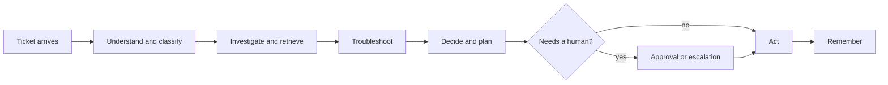

# CloudDesk AI

_Last updated: 2026-11-03 09:19 +0530_

> **Intelligent Resolution. Human-Controlled Decisions.**
>
> CloudDesk AI is an AI-Powered Customer Support & Ticket Investigation Platform. A ticket arrives,
> a team of AI agents investigates it and proposes a resolution, and a human approves anything that
> costs money or touches an account.

**Status**: In development. Phase 1 of 14 is complete (runtime skeleton, validated locally). **Version**: 0.1.0

**Name note**: the product is called CloudDesk AI. The repository, the Python package and the code are still
named `clouddesk`.

## Table of contents

1. [About CloudDesk AI](#1-about-clouddesk-ai)
   - [1.1 What it does](#11-what-it-does)
   - [1.2 How a ticket is handled](#12-how-a-ticket-is-handled)
   - [1.3 The one design rule](#13-the-one-design-rule)
2. [Project status](#2-project-status)
3. [Planned architecture](#3-planned-architecture)
4. [Roadmap](#4-roadmap)
5. [Getting started](#5-getting-started)
   - [5.1 What you need](#51-what-you-need)
   - [5.2 Install and run](#52-install-and-run)
   - [5.3 Without make](#53-without-make)
   - [5.4 Activate the environment](#54-activate-the-environment)
6. [Development](#6-development)
   - [6.1 Everyday commands](#61-everyday-commands)
   - [6.2 Working with Claude Code](#62-working-with-claude-code)
7. [Where to find things](#7-where-to-find-things)
8. [Author](#8-author)

## 1. About CloudDesk AI

CloudDesk AI is built for support agents, not for customers. It is shown here working for a fictional
software company, also called CloudDesk, which sells team collaboration, cloud file storage, billing,
workspaces and API access.

### 1.1 What it does

- Reads a new support ticket and works out what it is about and how urgent it is.
- Looks up the customer, their plan and their earlier tickets.
- Searches the knowledge base and shows the articles it used, so every claim can be checked.
- Suggests likely causes, step-by-step checks and a draft reply.
- Stops and asks a person before any refund or account change.
- Escalates risky cases, such as security incidents, data loss and payment disputes, to the right team.
- Remembers what it learned for the customer's next ticket.

### 1.2 How a ticket is handled



### 1.3 The one design rule

**Rules decide policy. The model adds judgement.**

Cases such as payment disputes, account deletion, security incidents and data loss are escalated by
fixed, tested rules. They are never left to the model's odds. Anything that involves a refund or an
account change waits for a recorded human approval.

[↑ Back to top](#clouddesk-ai)

## 2. Project status

Phase 1, the runtime skeleton, is complete and validated locally. The service starts offline and answers
health checks. What exists today:

- Three health routes: `GET /health`, `GET /health/live` (no outside calls) and `GET /health/ready`
  (checks configuration, returns `503` when something is wrong).
- An `X-Request-ID` on every response, errors included, repeated on every log line of that request.
- Settings for every variable in `.env.example`, with secrets and URL passwords hidden when printed.
- JSON logging that carries `request_id` and `workflow_id`.
- An offline test suite (no network, no API key), a linter (Ruff) and a `Makefile`.
- A Claude Code setup in `.claude/` (see [6.2](#62-working-with-claude-code)). It has not yet been used in a
  live session.
- The written specification and plan (see [7](#7-where-to-find-things)).
- Architecture decision records in `docs/adr/`: seven decisions taken, and five open questions recorded as proposed.

Not built yet: the database and demo data, sign-in, the support API, the knowledge pipeline, tools,
agents, the workflow, approvals, memory and the web console.

No cloud resources have been created and nothing is deployed. Tests have not been run on GitHub Actions.

[↑ Back to top](#clouddesk-ai)

## 3. Planned architecture

| Layer | Choice |
|---|---|
| Frontend | Next.js 15 (App Router), TypeScript, Tailwind |
| Backend | FastAPI, Pydantic v2, async SQLAlchemy 2 |
| Orchestration | LangGraph workflow coordinating six specialist agents |
| Retrieval | Hybrid semantic and keyword search with reranking and cited evidence |
| Data | PostgreSQL (SQLite for the demo), Redis (fakeredis offline), Qdrant (in memory offline) |
| Safety | Prompt-injection defence, output checks, role-based access, audit log |
| Delivery | Docker, Terraform for AWS, Azure and GCP, GitHub Actions |

The six agents are the Support Supervisor, Customer, Knowledge, Troubleshooting, Resolution and Escalation
agents.

The whole stack is designed to run offline with a fake language model, so the tests and the demo need no
API key.

[↑ Back to top](#clouddesk-ai)

## 4. Roadmap

| Phase | Name | Status |
|---|---|---|
| 1 | Runtime skeleton | validated locally |
| 2 | Persistence and demo data | not started |
| 3 | Identity and request guards | not started |
| 4 | Support API | not started |
| 5 | Knowledge pipeline | not started |
| 6 | Tools and mocks | not started |
| 7 | Rules and guardrails | not started |
| 8 | Memory | not started |
| 9 | Specialist agents | not started |
| 10 | Workflow graph and trace | not started |
| 11 | Approval and escalation | not started |
| 12 | Console shell | not started |
| 13 | Ticket workflow screen | not started |
| 14 | Evaluation and delivery | not started |

The next task is `P2-1` in `TASKS.md`.

[↑ Back to top](#clouddesk-ai)

## 5. Getting started

### 5.1 What you need

[uv](https://docs.astral.sh/uv/). It installs Python 3.12 if you do not have it.

### 5.2 Install and run

```bash
make setup              # install packages, and copy .env.example to .env if there is none
make backend            # start the API on http://localhost:8000 (reloads when you edit)
curl http://localhost:8000/health/ready
```

On Windows, `make` is not included. Install it with `winget install ezwinports.make`.

### 5.3 Without make

```bash
uv sync
uv run uvicorn app.main:app --app-dir backend --reload --port 8000
```

### 5.4 Activate the environment

You can activate the virtual environment instead of typing `uv run` before each command:

```bash
# Windows PowerShell
.\.venv\Scripts\Activate.ps1

# macOS / Linux
source .venv/bin/activate
```

Keep secrets in a local `.env` file. It is ignored by git. Never commit real keys.

[↑ Back to top](#clouddesk-ai)

## 6. Development

### 6.1 Everyday commands

```bash
make test               # run the tests, fully offline (or: uv run pytest)
make lint               # check the code with ruff (or: uv run ruff check .)
make format             # format the code with ruff
```

### 6.2 Working with Claude Code

The `.claude/` folder is committed, so a clone gets the same setup. Sonnet is the default model. Opus is
used only for planning and for single design questions, and Haiku for searching and reading long logs. This
keeps routine work cheap.

| Command | What it does |
|---|---|
| `/plan P2-1` | Writes a plan for a task from `TASKS.md` to `docs/plans/` (not committed) |
| `/implement <plan file>` | Carries out an approved plan, tests first |
| `/test`, `/review` | Runs targeted tests and gives a short digest; reviews the current changes |
| `/phase-docs 1` | Writes a finished phase's four documents |
| `/pr-review 10`, `/consult-opus`, `/cost-report` | Reviews a pull request; asks one design question; shows cost and cache health |

A hook runs `ruff` and `pytest` before Claude runs `git commit`, and blocks the commit if either fails. It
does not run when you commit by hand. Setup notes and open checks are in
[`docs/08_CLAUDE_SETUP.md`](docs/08_CLAUDE_SETUP.md).

[↑ Back to top](#clouddesk-ai)

## 7. Where to find things

| You want | Open |
|---|---|
| The full specification and coding rules | `CLAUDE.md` |
| Requirements and what each phase must achieve | `PLAN.md` |
| Every task, its branch and its status | `TASKS.md` |
| Honest status, decisions and open questions | `MEMORY.md` |
| The business case, product, high-level and low-level design | `docs/01` to `docs/04` |
| Git and GitHub flow | `docs/07_GIT_WORKFLOW.md` |
| The system diagrams and the API contract | `docs/design/` |
| Why an architecture choice was made | `docs/adr/` |
| Documents written for each finished phase | `internal/` |

The design documents in `docs/` describe the full multi-tenant product. This repository builds a
single-tenant first version of the same architecture. `CLAUDE.md` section 1.1 lists the differences.

[↑ Back to top](#clouddesk-ai)

## 8. Author

Built by **Mahesh Kumar**, Founder & CEO of **SaffronyxAI.in**.

[↑ Back to top](#clouddesk-ai)
