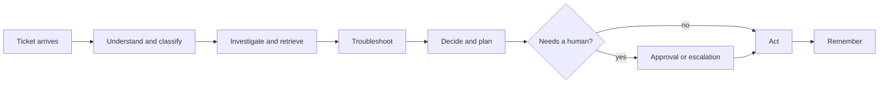

# CloudDesk AI

_Last updated: 2026-11-27 21:28 +0530_

> **Intelligent Resolution. Human-Controlled Decisions.**
>
> CloudDesk AI is an AI-Powered Customer Support & Ticket Investigation Platform. A ticket arrives,
> a team of AI agents investigates it and proposes a resolution, and a human approves anything that
> costs money or touches an account.

**Status**: All 14 phases and all 84 tasks are done and validated locally: the backend, the six-agent LangGraph workflow with human approval, the console and landing page, the evaluation thresholds, Docker and Compose, and validated (never applied) Terraform for AWS, Azure and GCP. Not done: any real cloud deployment, any GitHub Actions run, Postgres and RLS against a live database, the approval timeout and the PRD items listed in `CLAUDE.md` section 20. **Version**: 0.1.0

**Name note**: the product is called CloudDesk AI. The repository, the Python package and the code are still
named `clouddesk`.

## Table of contents

1. [About CloudDesk AI](#1-about-clouddesk-ai)
   - [1.1 What it does](#11-what-it-does)
   - [1.2 How a ticket is handled](#12-how-a-ticket-is-handled)
   - [1.3 The one design rule](#13-the-one-design-rule)
2. [Project status](#2-project-status)
3. [Planned architecture](#3-planned-architecture)
4. [Roadmap](#4-roadmap)
5. [Getting started](#5-getting-started)
   - [5.1 What you need](#51-what-you-need)
   - [5.2 Install and run](#52-install-and-run)
   - [5.3 Without make](#53-without-make)
   - [5.4 Activate the environment](#54-activate-the-environment)
   - [5.5 Run with containers](#55-run-with-containers)
6. [Development](#6-development)
   - [6.1 Everyday commands](#61-everyday-commands)
   - [6.2 Working with Claude Code](#62-working-with-claude-code)
   - [6.3 Branches and pull requests](#63-branches-and-pull-requests)
7. [Where to find things](#7-where-to-find-things)
8. [Author](#8-author)

## 1. About CloudDesk AI

CloudDesk AI is built for support agents, not for customers. It is shown here working for a fictional
software company, also called CloudDesk, which sells team collaboration, cloud file storage, billing,
workspaces and API access.

### 1.1 What it does

- Reads a new support ticket and works out what it is about and how urgent it is.
- Looks up the customer, their plan and their earlier tickets.
- Searches the knowledge base and shows the articles it used, so every claim can be checked.
- Suggests likely causes, step-by-step checks and a draft reply.
- Stops and asks a person before any refund or account change.
- Escalates risky cases, such as security incidents, data loss and payment disputes, to the right team.
- Remembers what it learned for the customer's next ticket.

### 1.2 How a ticket is handled



### 1.3 The one design rule

**Rules decide policy. The model adds judgement.**

Cases such as payment disputes, account deletion, security incidents and data loss are escalated by
fixed, tested rules. They are never left to the model's odds. Anything that involves a refund or an
account change waits for a recorded human approval.

[↑ Back to top](#clouddesk-ai)

## 2. Project status

Phases 1 to 8 are complete and validated locally, and Phase 9 is built and awaiting its documents. The service starts offline, seeds a demo database and
answers requests. What exists today:

- **Service basics:** health routes (`/health`, `/health/live`, `/health/ready`), an `X-Request-ID` on every
  response and log line, redacted settings and JSON logging.
- **Data:** SQLAlchemy models for 17 tables, tenant-scoped repositories, the Postgres schema, row-level
  security policies and a first migration (the SQL is text-checked only, never run against Postgres), and demo
  data: 13 tickets and 8 customers.
- **Identity and guards:** JWT sign-in for three demo users (viewer, agent, admin), role checks, a Redis rate
  limit and an audit log of every non-GET request.
- **Support API:** create, list and read tickets and customers, reply, request information, escalate and update
  a ticket, plus the dashboard summary, audit and settings views.
- **Knowledge:** 15 fictional articles, a chunker, a vector store (in memory, with a Qdrant option), hybrid
  retrieval (semantic plus BM25) and search and reindex routes.
- **Tools:** a tool registry with approval, timeout, idempotency and provenance checks, mock integrations
  (nothing real is sent or refunded), read and write tools, and a read-only MCP server.
- **Guardrails:** policy rules for escalation and severity, prompt-injection defence, customer-output
  validation and a secret scrubber.
- **Memory:** short-term memory in Redis and long-term customer memory in the database, with duplicate
  skipping, a confidence floor and erasure.
- **Console shell:** a Next.js app with navigation, a small UI kit and placeholder pages. It has no real screens
  yet and has not been opened in a browser.
- **Containers:** Dockerfiles for the backend and frontend and a Compose stack. On 2026-11-27 the stack was built
  and brought up once (see `MEMORY.md`).
- An offline test suite (no network, no API key), a linter (Ruff) and a `Makefile`.
- Tests that keep the documents honest: the task tracker's counters and dependencies, every link, the roadmap in this
  file, and the decision records are all checked, so a document that drifts fails the build.
- A Claude Code setup in `.claude/` (see [6.2](#62-working-with-claude-code)).
- The written specification and plan (see [7](#7-where-to-find-things)).
- Architecture decision records in `docs/adr/`: seven decisions taken, and five open questions recorded as proposed.
- The system diagrams and the API contract in `docs/design/`. The routes in the contract are built.

- **Language-model layer and agents (Phase 9):** a `get_llm()` factory with a deterministic fake provider and an
  OpenAI-compatible provider (`openai`, or `euron`, Euron's euri API), `call_structured`, the six specialist agents and a
  16-case evaluation dataset. The LangGraph workflow (Phase 10), approvals and escalations (Phase 11), the console and ticket screen (Phases 12 and 13) and the evaluation and delivery files (Phase 14) are built on top.

Nothing is deployed. Not built or not run: a real cloud deployment (the Terraform is validated, never applied), any GitHub Actions run, Postgres and the row-level-security policies against a live database, the approval timeout and the PRD extras in `CLAUDE.md` section 20. The real Euron model was exercised by hand through Docker; the test suite stays on the fake provider.

[↑ Back to top](#clouddesk-ai)

## 3. Planned architecture

| Layer | Choice |
|---|---|
| Frontend | Next.js 15 (App Router), TypeScript, Tailwind |
| Backend | FastAPI, Pydantic v2, async SQLAlchemy 2 |
| Orchestration | LangGraph workflow coordinating six specialist agents |
| Retrieval | Hybrid semantic and keyword search with reranking and cited evidence |
| Data | PostgreSQL, Redis and Qdrant, all running in Docker (SQLite, fakeredis and an in-memory store are for the offline tests only) |
| Safety | Prompt-injection defence, output checks, role-based access, audit log |
| Delivery | Docker, Terraform for AWS, Azure and GCP, GitHub Actions |

The six agents are the Support Supervisor, Customer, Knowledge, Troubleshooting, Resolution and Escalation
agents.

The whole stack is designed to run offline with a fake language model, so the tests and the demo need no
API key. The real model is Euron's OpenAI-compatible euri API, reached through a small router
inside the backend rather than a separate gateway service.

[↑ Back to top](#clouddesk-ai)

## 4. Roadmap

| Phase | Name | Status |
|---|---|---|
| 1 | Runtime skeleton | validated locally |
| 2 | Persistence and demo data | validated locally |
| 3 | Identity and request guards | validated locally |
| 4 | Support API | validated locally |
| 5 | Knowledge pipeline | validated locally |
| 6 | Tools and mocks | validated locally |
| 7 | Rules and guardrails | validated locally |
| 8 | Memory | validated locally |
| 9 | Specialist agents | validated locally |
| 10 | Workflow graph and trace | validated locally |
| 11 | Approval and escalation | validated locally |
| 12 | Console shell | validated locally |
| 13 | Ticket workflow screen | validated locally |
| 14 | Evaluation and delivery | validated locally |

All 14 phases are built and checked locally (84 of 84 tasks). The task list is in `TASKS.md`.

[↑ Back to top](#clouddesk-ai)

## 5. Getting started

### 5.1 What you need

[uv](https://docs.astral.sh/uv/). It installs Python 3.12 if you do not have it.

### 5.2 Install and run

```bash
make setup              # install packages and set the git hooks path (copy .env.example to .env, see below)
make backend            # start the API on http://localhost:8000 (reloads when you edit)
curl http://localhost:8000/health/ready
```

On Windows, `make` is not included. Install it with `winget install ezwinports.make`.

### 5.3 Without make

```bash
uv sync
uv run uvicorn app.main:app --app-dir backend --reload --port 8000
```

### 5.4 Activate the environment

You can activate the virtual environment instead of typing `uv run` before each command:

```bash
# Windows PowerShell
.\.venv\Scripts\Activate.ps1

# macOS / Linux
source .venv/bin/activate
```

Copy the placeholders-only template and add your own key: `cp .env.example .env` (PowerShell: `Copy-Item .env.example .env`). `.env` is ignored by git; `.env.example` is committed and holds no secret. The variables are listed in section 10.1 of `CLAUDE.md`, and a test keeps the template, that list and `Settings` in step. The only value you must supply is `LLM_API_KEY` (Euron); also set a long random `JWT_SECRET`. The offline test suite needs no `.env` at all. Never commit real keys.

### 5.5 Run with containers

With Docker running, from the repository root:

```bash
docker compose up --build
```

The stack is `frontend` (:3000) to `backend` (:8000) to `postgres`, `redis` and `qdrant`, with named volumes, and every service is real: the backend uses PostgreSQL through `asyncpg`, real Redis and a local Qdrant container (no key needed). The chat model and the embeddings are Euron, chosen in `.env` (`LLM_PROVIDER=euron`, `EMBEDDING_PROVIDER=euron`). On start the backend creates its tables, seeds the demo data and fills Qdrant when it is empty. Row-level security is written and was tested against Postgres, but it is not enforced at runtime yet (the repository filter is the boundary). The compose file is checked statically; the stack was brought up and tested end to end on 2026-11-27 (see `MEMORY.md`). Compose values win over `.env` for the keys it sets.

Check a running stack with `BASE_URL=http://localhost:8000 make smoke`, and drive it in a visible browser with `cd frontend && npm run e2e` (Playwright). `make terraform-validate` checks the AWS, Azure and GCP Terraform offline; nothing is applied.

If a host port is busy, move it. `BACKEND_PORT` (default 8000) and `FRONTEND_PORT` (default 3000) set the host side of each mapping, the browser-facing API URL and the allowed CORS origin:

```bash
BACKEND_PORT=18000 FRONTEND_PORT=13000 docker compose up --build
```

These two are compose-only variables, so they are not in the `CLAUDE.md` variable list and `Settings` does not read them. The frontend image inlines the API port at build time, so rebuild it after changing `BACKEND_PORT`.

[↑ Back to top](#clouddesk-ai)

## 6. Development

### 6.1 Everyday commands

```bash
make test               # run the tests, fully offline (or: uv run python -m pytest)
make lint               # check the code with ruff (or: uv run python -m ruff check .)
make format             # format the code with ruff
make seed               # load the demo data into the database
make ingest             # chunk and index the knowledge base
make mcp                # start the read-only MCP server
cd frontend && npm run dev | npm run lint | npm run test -- --run | npm run build
```

The demo, smoke-test and Terraform-validate make targets do not exist yet; later tasks add them (`TASKS.md`).

On some Windows machines `uv run pytest` fails with a "trampoline" path error. `uv run python -m pytest` works.

### 6.2 Working with Claude Code

The `.claude/` folder is committed, so a clone gets the same setup. Sonnet is the default model. Opus is
used only for planning and for single design questions, and Haiku for searching and reading long logs. This
keeps routine work cheap.

| Command | What it does |
|---|---|
| `/plan P2-1` | Writes a plan for a task from `TASKS.md` to `docs/plans/` (not committed) |
| `/implement <plan file>` | Carries out an approved plan, tests first |
| `/test`, `/review` | Runs targeted tests and gives a short digest; reviews the current changes |
| `/phase-docs 1` | Writes a finished phase's four documents |
| `/pr-review 10`, `/consult-opus`, `/cost-report` | Reviews a pull request; asks one design question; shows cost and cache health |

A hook runs `ruff`, `pytest` and, when `frontend/node_modules` exists, the frontend lint and tests before Claude makes a commit, and blocks it if any fails. It
does not run when you commit by hand. Setup notes and open checks are in
[`docs/08_CLAUDE_SETUP.md`](docs/08_CLAUDE_SETUP.md).

Personal settings stay out of the repository: put overrides for `CLAUDE.md` in `CLAUDE.local.md` and per-machine
settings in `.claude/settings.local.json`. Git ignores both.

### 6.3 Branches and pull requests

One task is one branch and one pull request. Name the branch as in `TASKS.md`: `feature/<name>` for product work,
`docs/<name>` for documents and `chore/<name>` for tooling. Branch from `development` and open the pull request
against `development`. `testing` and `main` are promotion branches, and nothing has been promoted yet. Each pull
request also updates `TASKS.md`. The full flow is in [`docs/07_GIT_WORKFLOW.md`](docs/07_GIT_WORKFLOW.md).

[↑ Back to top](#clouddesk-ai)

## 7. Where to find things

| You want | Open |
|---|---|
| The full specification and coding rules | `CLAUDE.md` |
| Requirements and what each phase must achieve | `PLAN.md` |
| Every task, its branch and its status | `TASKS.md` |
| Honest status, decisions and open questions | `MEMORY.md` |
| The business case, product, high-level and low-level design | `docs/01` to `docs/04` |
| How to use the console, from sign-in to resolution | [`docs/11_USER_GUIDE.md`](docs/11_USER_GUIDE.md) |
| Git and GitHub flow | `docs/07_GIT_WORKFLOW.md` |
| The system diagrams and the API contract | `docs/design/` |
| Why an architecture choice was made | `docs/adr/` |
| Documents written for each finished phase | `internal/` |

The upstream design documents, `docs/01` to `docs/04`, describe the full multi-tenant product. This repository
builds a single-tenant first version of the same architecture, and `docs/design/` shows that version.
`CLAUDE.md` section 1.1 lists the differences.

[↑ Back to top](#clouddesk-ai)

## 8. Author

Built by **Mahesh Kumar**, Founder & CEO of **SaffronyxAI.in**.

[↑ Back to top](#clouddesk-ai)
