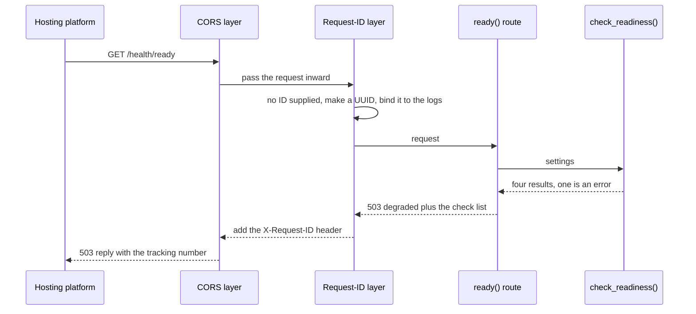

# Phase 1 explained: the runtime skeleton

> **What this document is.** A plain-language explanation of the code written in Phase 1 of CloudDesk, meant to be spoken aloud to recruiters, hiring managers and interview boards. It describes only what exists in the repository today. Where something is planned for a later phase, it says so.
>
> **Status of this phase:** implemented and checked locally (97 tests pass, lint is clean). Nothing is deployed. Phase 1 has **no database, no AI model, no login and no web screens**. Those arrive in later phases.
>
> **Related documents:** [system design evolution](./02_DESIGN_EVOLUTION.md) and [infrastructure evolution](./03_INFRA_EVOLUTION.md).

---

## A. Executive summary

**The 30-second version, ready to say out loud:**

"CloudDesk is a support platform where AI agents investigate customer tickets and a human approves anything risky. Phase 1 built the foundation everything else stands on: a small web service that starts up offline, reports whether it is healthy, labels every request with a tracking number, writes its logs in a tidy machine-readable format, and keeps its secrets out of those logs. It also built a safety net of ninety-seven automated checks that run without internet or any paid key. There is no AI in Phase 1 yet. The point was to get the boring, reliable parts right first."

**What the phase accomplished.** A web service that:

- starts on a developer's machine with no internet and no API key,
- answers three "are you healthy?" questions (`/health`, `/health/live`, `/health/ready`),
- stamps every reply with a request ID so a problem can be traced,
- writes each log line as one structured JSON record that carries that ID,
- reads all its settings from one place and hides secrets when settings are shown.

**What problem it solves.** A project like this fails in predictable, expensive ways: nobody can tell whether the service is alive, a bug cannot be traced through the logs, a password appears in a log file, or a test quietly calls a paid service. Phase 1 closes each of those before any real feature exists.

**Why it was necessary.** Every later phase assumes these foundations. The database layer needs the settings. The workflow needs request and workflow IDs in the logs. Every test relies on the offline harness.

**Before and after.**

| | Before Phase 1 | After Phase 1 |
|---|---|---|
| Can the project run? | No. It held planning documents and a dependency file only. | Yes. `make backend` starts a service on port 8000. |
| Can you tell if it is healthy? | No | Yes, three endpoints, one of which checks configuration |
| Can a request be traced in the logs? | No | Yes, by request ID |
| Are tests safe to run anywhere? | There were no tests | 97 tests that cannot reach the internet |

---

## B. Business problem and solution

**The real-world problem.** CloudDesk is for a fictional software company's support team. Agents spend their day on tickets: a customer cannot log in, a bill looks wrong, a file has vanished. The long-term goal is for AI agents to do the investigation while a human approves anything that costs money or touches an account.

That goal is only safe if the system underneath is trustworthy. Imagine a hospital that buys an advanced scanner but has no reliable power supply. Phase 1 is the power supply.

**Limits of a naive first version.** A quick prototype usually has settings scattered through the code, `print` statements for logging, no health check, and tests that hit real services. Each one causes pain later:

- *Scattered settings* mean a missing value surfaces as a confusing crash in the middle of a customer's ticket.
- *Plain-text logs* cannot be searched or filtered by a tool, and cannot be tied to one request.
- *No health check* means a platform that hosts the service cannot tell a healthy copy from a broken one.
- *Tests that call real services* cost money, fail when the internet does, and can leak real keys.

**The solution in this phase.** One settings object, structured logs, request IDs, three health endpoints, and an offline test harness, all small and each tested.

**Business benefit.** Faster diagnosis when something goes wrong, no secrets in logs, tests that anyone can run for free, and a service that a hosting platform can monitor automatically.

**Why this approach.** It follows a common production habit: make the service observable and testable *before* adding behaviour, because retrofitting that later means touching every file.

---

## C. Application architecture in simple language

Phase 1 contains eight parts. Think of the service as a small office with a front desk.

| Part | Plain-language role | If it were removed |
|---|---|---|
| **App factory** | The office manager who opens the building, hires the staff and sets the house rules | Nothing would start |
| **Settings** | The binder of house rules every employee reads from | Each part would invent its own rules, and they would disagree |
| **Logging** | The office diary, written in a fixed format so it can be searched | Problems could not be investigated |
| **Request-ID middleware** | The receptionist who writes a tracking number on every visitor's badge | Requests could not be followed through the diary |
| **Health routes** | A status board outside the door: "open", "alive", "ready" | A hosting platform could not tell whether to send visitors |
| **Readiness checks** | The checklist behind the "ready" light: is the filing cabinet there, is the phone line configured | "Ready" would be a guess |
| **Offline test harness** | A rehearsal room with no outside phone line, so nobody can accidentally call a real customer | Tests could spend money or leak keys |
| **Makefile and `.env.example`** | The new-starter handbook: how to start the office and which rules you must set | Every developer would have to work it out alone |

### The application factory

- **Purpose.** Build the whole service in one function, so a test can build a fresh copy.
- **Receives.** Settings.
- **Does.** Switches on logging, registers the health routes, and fits two layers around them: the request-ID layer and the CORS layer.
- **Produces.** A ready-to-run FastAPI application.
- **Talks to.** Settings, logging, the health routes, both middleware layers.

*CORS* ("cross-origin resource sharing") is a browser safety rule. A web page may only call a service if the service says that page's address is allowed. Here, only the planned console at `http://localhost:3000` is allowed by default.

### Settings

- **Purpose.** Hold every configurable value in one typed object.
- **Receives.** Environment variables and an optional local `.env` file.
- **Does.** Reads and checks values, hides secrets when the settings are printed, and is created once and reused.
- **Produces.** A `Settings` object with 27 fields.
- **Talks to.** Everything that needs configuration.

### Logging

- **Purpose.** Make every log line machine-readable and traceable.
- **Does.** Writes one JSON object per line with a time, level, source, message, `request_id` and `workflow_id`. Even uvicorn's own access lines go through it.
- **Why a "context".** The IDs are stored in a context variable, so any code running while a request is handled picks them up automatically without being passed around.

### Request-ID middleware

- **Purpose.** Give every reply an `X-Request-ID` header.
- **Does.** If the caller supplied a safe ID (1 to 128 characters from letters, digits and `. _ : -`), it reuses it. Otherwise it makes a new random one. It then binds the ID to the logs for that request.
- **Also.** If the service crashes mid-request, it still sends a clean error reply that carries the ID.

### Health routes and readiness checks

- **`/health`** returns the service name, version and environment.
- **`/health/live`** returns `{"status":"alive"}` and does *no* other work, on purpose. A "liveness" probe must be cheap, or a slow dependency could make a platform restart a perfectly healthy service.
- **`/health/ready`** runs four configuration checks (database, redis, vector store, language model) and answers 200 "ready" or 503 "degraded". It checks that the *settings are sensible*. It does **not** open any connection, because no database or model client exists yet.

### The offline test harness

- **Does.** Fixes the environment to an offline profile *before* the application loads, blanks every credential, and blocks any network request to a non-local address.
- **Result.** A test that tries to reach the internet fails immediately with a clear message.

---

## D. Codebase structure and file-by-file explanation

The Phase 1 application code is 379 lines across seven files, plus a 105-line test harness. Paths are relative to the project root.

### `backend/app/main.py` (33 lines)

| Item | Explanation |
|---|---|
| Responsibility | Builds the FastAPI application and exposes it as `app` |
| Reason for existence | One place that assembles the service, so tests and the server build it the same way |
| Main components | `create_app()`, the module-level `app` |
| Inputs | Settings from `get_settings()` |
| Processing | Starts logging, adds the health router, adds `RequestIdMiddleware`, then `CORSMiddleware` |
| Outputs | A configured `FastAPI` instance titled "CloudDesk API" |
| Dependencies | `backend/app/core/config.py`, `backend/app/core/logging.py`, `backend/app/api/health.py`, `backend/app/middleware/request_id.py` |
| Execution point | Loaded by uvicorn (`app.main:app`) and by the test client |
| Interview explanation | "It is the front door: it wires the parts together in the right order." |

The order matters. Each `add_middleware` call wraps the previous layers, so the *last* one added is the *outermost*. CORS is added last, so it sees the request first and the response last.

### `backend/app/core/config.py` (93 lines)

| Item | Explanation |
|---|---|
| Responsibility | Defines and validates all configuration |
| Reason for existence | A single source of truth, so a bad value fails early and loudly |
| Main components | `Settings`, `redact_url()`, `get_settings()`, a CORS list splitter |
| Inputs | Environment variables, an optional `.env` file |
| Processing | Reads values, converts types, accepts `a,b` or a JSON list for CORS origins, rejects an unknown vector-store name |
| Outputs | A `Settings` object. `model_dump()` returns a redacted copy. |
| Dependencies | `pydantic` and `pydantic-settings` |
| Execution point | The first call to `get_settings()`, then cached |
| Interview explanation | "One typed object for every setting. Secrets are hidden whenever it is printed." |

Secrets are stored as `SecretStr`. When settings are shown, secrets become `***` (or empty if unset), and a password inside a connection URL is masked while the user and host remain. Code that genuinely needs a secret reads the attribute directly.

### `backend/app/core/logging.py` (67 lines)

| Item | Explanation |
|---|---|
| Responsibility | Structured JSON logging with request and workflow IDs |
| Main components | `log_context()`, `JsonFormatter`, `setup_logging()` |
| Inputs | Log records from anywhere in the process |
| Processing | Formats each record as one JSON line. Reads the IDs from context variables. Re-routes uvicorn's loggers to the same handler. |
| Outputs | JSON lines on standard output |
| Dependencies | Python's standard library only |
| Execution point | `setup_logging()` runs when the app is created |
| Interview explanation | "Every log line is a searchable record that knows which request it belongs to." |

`setup_logging()` is safe to call repeatedly: it removes only the handler it installed earlier, so two calls leave exactly one JSON handler and any handler it did not install stays untouched.

### `backend/app/middleware/request_id.py` (66 lines)

| Item | Explanation |
|---|---|
| Responsibility | Attach an `X-Request-ID` to every HTTP response and to the logs |
| Main components | `RequestIdMiddleware`, `_resolve_request_id()`, the `_SAFE_ID` pattern |
| Inputs | The incoming request's headers |
| Processing | Validates a supplied ID with a full-match pattern, otherwise creates a UUID. Wraps the response so the header is added. Catches unhandled errors. |
| Outputs | The same response with the header added, or a clean 500 reply |
| Dependencies | `backend/app/core/logging.py` |
| Execution point | On every HTTP request |
| Interview explanation | "A tracking number on every reply, so a problem can be followed from the customer's screen to the log." |

It is written as plain ASGI rather than the convenient `BaseHTTPMiddleware`. The code's own comment explains why: the framework's built-in 500 handler sits *outside* ordinary middleware, so the convenient version would miss the header on a crash.

### `backend/app/api/health.py` (43 lines) and `backend/app/schemas/health.py` (24 lines)

| Item | Explanation |
|---|---|
| Responsibility | The three health endpoints and the shapes of their replies |
| Main components | `health()`, `live()`, `ready()`; `HealthResponse`, `LiveResponse`, `CheckResult`, `ReadinessResponse` |
| Inputs | Settings (injected by FastAPI's dependency system) |
| Processing | `/health` and `/health/ready` read settings. `/health/live` reads nothing. |
| Outputs | JSON, with status 200 or, for a degraded readiness, 503 |
| Dependencies | `backend/app/core/readiness.py`, `backend/app/core/config.py` |
| Interview explanation | "Three status lights: open, alive, and ready." |

The reply shapes are typed models, so a response that does not match its documented shape is a bug the framework catches.

### `backend/app/core/readiness.py` (53 lines)

| Item | Explanation |
|---|---|
| Responsibility | The four configuration checks behind `/health/ready` |
| Main components | `check_readiness()` and one small check per dependency |
| Processing | Looks at the *scheme* of the database URL, the Redis URL, whether Qdrant is configured when selected, and whether a key exists when a real model provider is selected |
| Outputs | A `CheckResult` per dependency, either `ok` or `error` with a short reason |
| Interview explanation | "It checks the settings make sense. It does not yet talk to any real database." |

The reasons name the setting at fault but never echo a URL, password or key. This is tested.

### `tests/conftest.py` (105 lines)

| Item | Explanation |
|---|---|
| Responsibility | The offline test harness |
| Main components | `OFFLINE_ENV`, the `_block_outside_network` guard, `_fresh_settings`, the `client` fixture |
| Processing | Sets the offline environment before the app is imported. Blocks any connection to a non-loopback address. Clears the settings cache around every test. |
| Interview explanation | "A rehearsal room with the outside phone line cut." |

### Smaller Phase 1 files

| File | What it is |
|---|---|
| `Makefile` | Five commands: `setup`, `backend`, `test`, `lint`, `format`. Every recipe starts with `uv` or `git`, so it runs the same in cmd, PowerShell and a Unix shell. |
| `.env.example` | The 27 variables with safe placeholders, so a new developer knows what to set. No real key is in it. |
| `pyproject.toml` | Python 3.12 or newer, the dependency list, and the settings for pytest and the linter |
| `.gitattributes` | Forces the Makefile to use Unix line endings, because `make` rejects carriage returns |
| `backend/app/__init__.py` | Holds the version, `0.1.0` |

---

## E. End-to-end execution flow

**A realistic example:** a hosting platform asks the service whether it is ready, and the vector store is misconfigured.

1. **Initiation.** The platform sends `GET /health/ready`.
2. **Reception.** uvicorn passes the request to the application. The CORS layer, outermost, sees it first and passes it inward.
3. **Tagging.** The request-ID layer finds no `X-Request-ID` header, so it makes a UUID and binds it to the logs.
4. **Routing.** FastAPI matches the path to the `ready()` function and injects the cached settings.
5. **Checking.** `check_readiness()` runs four checks. The vector store is set to `qdrant` but `QDRANT_URL` is empty, so that check returns `error` with a short reason.
6. **Deciding.** One failure means the overall status is `degraded`, so the reply code is **503**.
7. **Replying.** The body lists all four checks. The request-ID layer adds the `X-Request-ID` header on the way out.
8. **Logging.** uvicorn writes one JSON access line, and that line carries the same request ID.

**Error handling in this flow.** A crash inside any route is caught by the request-ID layer, logged with its stack trace, and turned into a plain `{"detail":"Internal Server Error"}` reply that still carries the request ID and reveals no internals.

---

## F. Technical concepts explained simply

| Concept | In plain language | Where it appears |
|---|---|---|
| HTTP request and response | You ask a service for something at an address; it answers with a status code and a body | Every route |
| Status codes | 200 means fine, 404 not found, 500 the service broke, 503 temporarily unable | Health and error replies |
| Middleware | A layer every request passes through, like airport security | `backend/app/middleware/request_id.py`, CORS |
| Environment variables | Settings supplied from outside the code, so the same code runs on a laptop or a server | `backend/app/core/config.py` |
| Secrets handling | Passwords and keys must never appear in logs or screens | `SecretStr` and `redact_url()` |
| Structured logging | Logs as data records, not sentences | `backend/app/core/logging.py` |
| Context variable | A value that follows a request around without being passed from function to function | The request ID |
| Liveness versus readiness | "Is the process alive?" versus "is it fit to take work?" | `/health/live` and `/health/ready` |
| Caching a function result | Compute once, reuse. Here it applies only to settings, not to any reply. | `get_settings()` |
| Dependency injection | The framework hands a function what it needs instead of the function fetching it | `Depends(get_settings)` |
| Automated tests | Programs that check the program | `tests/` |

Concepts that do **not** apply yet, so they are not claimed: databases and transactions, authentication, queues, AI model calls, retrieval, agents, and containers.

---

## G. Design decisions and trade-offs

These are the decisions the code and the project record actually show.

| Decision | Why | Trade-off |
|---|---|---|
| Settings built once and cached | Cheap and consistent | Changing the environment needs a restart. Tests clear the cache. |
| Plain ASGI request-ID layer | The framework's built-in crash handler would otherwise skip the header | More code than the convenient version |
| Full-match ID pattern, 1 to 128 characters | A trailing newline or odd character must not be copied into logs or replies | A caller's unusual ID is replaced, not kept |
| `/health/live` does no work | A slow dependency must not cause a restart | It says nothing about whether the service can do real work |
| Readiness checks configuration only | No clients exist yet to connect with | A reachable-looking but wrong server would still read "ready" |
| One JSON log handler for everything, uvicorn included | One format, one place to search | Plain-text logs are harder for a person to skim |
| Network blocked in tests | Tests can never spend money or leak a key | A test that truly needs a network needs an explicit opt-out, which does not exist yet |
| Makefile recipes begin with `uv` or `git` | The same commands work in cmd, PowerShell and a Unix shell | No `&&` chaining or `cp` |

**Retrospective recommendations** (not decisions that were made): add an authenticated readiness detail view, and a timing field on every log line. Neither exists.

**How the design can grow.** The factory already leaves room for the rate-limit and audit layers; its own comment names them as planned for Phase 3.

---

## H. Error handling and failure scenarios

| Scenario | What actually happens | Missing safeguard |
|---|---|---|
| Caller sends a bad or hostile request ID | It is discarded and a fresh UUID is used | None |
| Route crashes | JSON 500 with the request ID, stack trace logged, no internals in the reply | None |
| Unknown address | 404 with `{"detail":"Not Found"}` and a request ID | None |
| Browser from an unlisted origin | No CORS headers are sent, so the browser blocks the call | None |
| Vector store, Redis URL, database URL or model key misconfigured | `/health/ready` returns 503 with the setting named | It does not prove a real server is reachable |
| Missing `.env` | Defaults describe the offline demo profile, so the service still starts | A mistyped variable name is silently ignored (`extra="ignore"`) |
| Invalid vector-store name | Startup fails immediately (tested) | None |
| Database connection failure | **Not applicable.** No connection exists in this phase. | Planned for Phase 2 |
| External service timeout, authentication failure, invalid AI output | **Not applicable.** None exist yet. | Planned for later phases |

---

## I. Testing and verification

**Results, run while writing this document:**

- Phase 1's own tests: **97 passed** in about 3 seconds, offline.
- The whole suite today: **220 passed**. The extra 123 belong to later tooling tasks, not to Phase 1.
- `uv run ruff check .`: **All checks passed**.

| Test file | Tests | What it checks |
|---|---|---|
| `tests/unit/test_config_logging.py` | 29 | Settings defaults and parsing, secret redaction, JSON log shape, ID binding and restoring, idempotent logging setup |
| `tests/unit/test_harness.py` | 24 | The offline profile holds, keys cannot leak in, outside network is blocked while loopback works, async tests share one loop |
| `tests/unit/test_env_example.py` | 7 | `.env.example` lists every variable, matches the settings class, holds placeholders only |
| `tests/unit/test_makefile.py` | 9 | Required targets exist, tabs not spaces, Unix line endings, portable recipes |
| `tests/api/test_health.py` | 28 | The three routes, readiness failures one at a time, no leaks in details, request-ID rules, a 500 reply, CORS |

**How to run them:** `make test` (or `uv run pytest`), `make lint` (or `uv run ruff check .`).

**Deliberate-break checks.** The project record notes that each task's tests were checked by breaking the code on purpose and confirming a test failed (6 breaks for P1-1, 10 for P1-3, 12 for P1-2). Those counts come from the status record written at the time. I did not repeat them while writing this document.

**Also verified for this document**, by starting the real service on loopback and calling it: all three routes, an echoed safe ID, a replaced unsafe ID, a 404 with an ID, CORS allowing the console origin and refusing another, JSON log lines that all carry both IDs, and a 503 readiness reply for a deliberately broken configuration.

**What remains untested.** Starting under a production server, behaviour under load, and anything involving a real database, cache, vector store or model. None of those exist yet. The checks also do not prove this document is perfectly accurate: they confirm that cited files exist, and a person still has to compare the words with the code.

---

## J. Interview-ready explanation

### The 30-second version

"Phase 1 is the foundation of CloudDesk. It is a small web service that starts with no internet, tells you whether it is healthy, puts a tracking number on every reply so problems can be traced, logs in a structured format, and keeps secrets out of its logs. It has ninety-seven automated tests that cannot reach the internet. There is no AI in it yet, on purpose: I wanted the reliable, boring parts finished before the clever parts."

### The 2-minute version

"CloudDesk will let AI agents investigate customer support tickets while a person approves anything risky. Before building any of that I built the base layer. First, one settings object that reads everything from the environment, validates it, and hides secrets whenever it is displayed. Second, structured logging, where every log line is a JSON record that carries a request ID and a workflow ID. Third, a small layer that gives every reply an ID, reusing the caller's if it is safe and making a new one if not, and that still returns a clean error with an ID if the service crashes. Fourth, three health endpoints: a cheap 'alive' check that does no work, a status check, and a readiness check that verifies the configuration makes sense. Fifth, a test setup that blocks all outside network access and blanks every key, so tests are free and cannot leak anything. Ninety-seven tests cover it, and the linter is clean."

### The 5-minute version

"Let me walk through it as a request. A hosting platform calls the readiness address. The request enters the application and passes the CORS layer, which is a browser safety rule, then my request-ID layer. That layer looks for an ID header. If there is one and it is short and uses only safe characters, I keep it. If not, I make a random one. I attach it to the logs for the duration of the request using a context variable, which means any code that runs while handling the request logs with that ID without anyone passing it around.

Then the route runs four configuration checks: the database address, the cache address, the vector store, and the language model key. They check that the settings are sensible. They do not connect to anything, because there is nothing to connect to yet, and I say that honestly rather than pretend. If any check fails the reply is a 503 with the reason, and the reasons never include a URL or a key. The ID goes back on the reply, and the access log line carries the same ID.

Two design choices I would highlight. First, the request-ID layer is plain ASGI rather than the convenient framework class, because the framework's own crash handler sits outside normal middleware and would skip the header. Second, the liveness check does no work at all, because if it called a database, a slow database could make a platform restart a healthy service.

For tests, the environment is fixed before the application even loads, every credential is blanked so a key in my shell cannot leak, and any attempt to reach a non-local address fails immediately. That makes the whole suite free and safe to run anywhere."

### For a non-technical interviewer

"Think of a new shop. Before stocking anything, I put in a reliable till, a door sign that says open or closed, a numbered ticket for every customer so any complaint can be traced, and a rule that the cash drawer code never appears in the shop diary. I also set up a practice room where staff can rehearse with no real customers or real money. That is Phase 1. The clever part, the AI assistants, comes next, and now it has something solid to stand on."

### For an architect or engineering manager

"Phase 1 establishes the service's operational contract: typed, cached `pydantic-settings` configuration with secret redaction; contextvar-based structured JSON logging with request and workflow correlation, applied to uvicorn's loggers too; a plain-ASGI request-ID middleware with a full-match allow-list that also survives unhandled exceptions; liveness, status and configuration-only readiness probes with typed response models and non-leaking error detail; and a hermetic pytest harness that fixes the offline profile at import time and guards `getaddrinfo`, `connect` and `connect_ex` against non-loopback hosts. Readiness is deliberately configuration-only until Phase 2 adds real clients, and the middleware ordering leaves room for rate-limit and audit layers in Phase 3."

---

## K. Key takeaways and next-phase dependencies

**What was implemented:** the app factory, settings, JSON logging, request-ID middleware, three health routes with configuration readiness, an offline test harness, a portable Makefile, and an `.env.example` contract. 97 tests pass.

**Know this before explaining it:**

- There is no database, no AI and no login in this phase, and saying so confidently is a strength.
- Readiness checks configuration only. It does not prove reachability.
- Only 9 of the 27 settings are read by Phase 1 code (the CORS origins, the environment name, and the ones the readiness checks use). The rest are declared and listed in `.env.example` for later phases.
- `pyproject.toml` already lists the AI libraries (LangChain, LangGraph, OpenAI), but no Phase 1 code imports them.

**Limitations that remain:** configuration-only readiness, no authentication, no rate limiting, no audit log, no containers.

**What later phases reuse:**

| Phase 1 piece | Reused by |
|---|---|
| Settings and `.env.example` | Phase 2 (the database URL), every later phase |
| App factory and middleware order | Phase 3 adds rate limiting and an audit layer |
| JSON logging with `workflow_id` | Phase 10 (workflow tracing) |
| Offline harness | Every test in every phase |
| Readiness checks | Phase 2 and later replace configuration checks with real connection checks |

**Tooling added to Phase 1's tracker afterwards.** Tasks P1-5 to P1-10 in `TASKS.md` are additive developer tooling (document timestamps, Claude Code setup, numbered documents, the documentation workflow). They were added after the runtime skeleton was finished and are not part of what this document explains. The checks they added are why the whole suite now has 220 tests.
