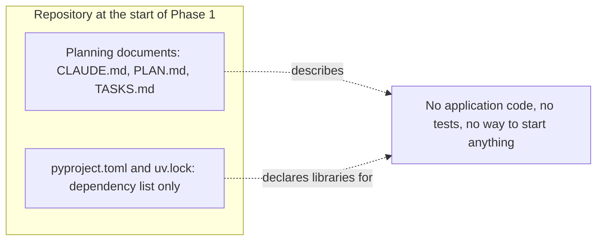
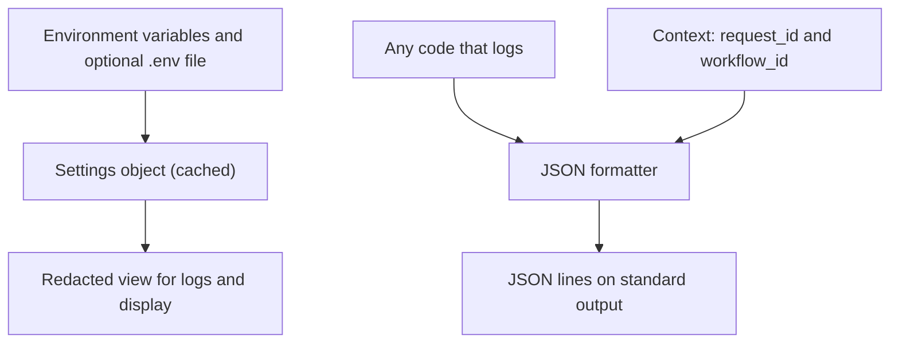
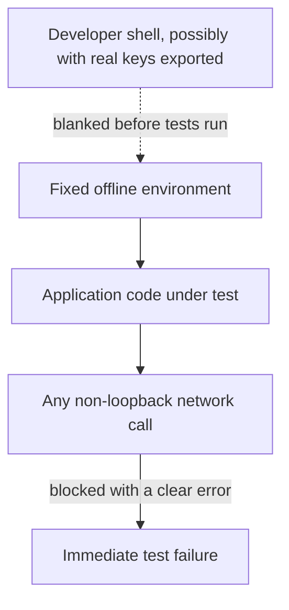
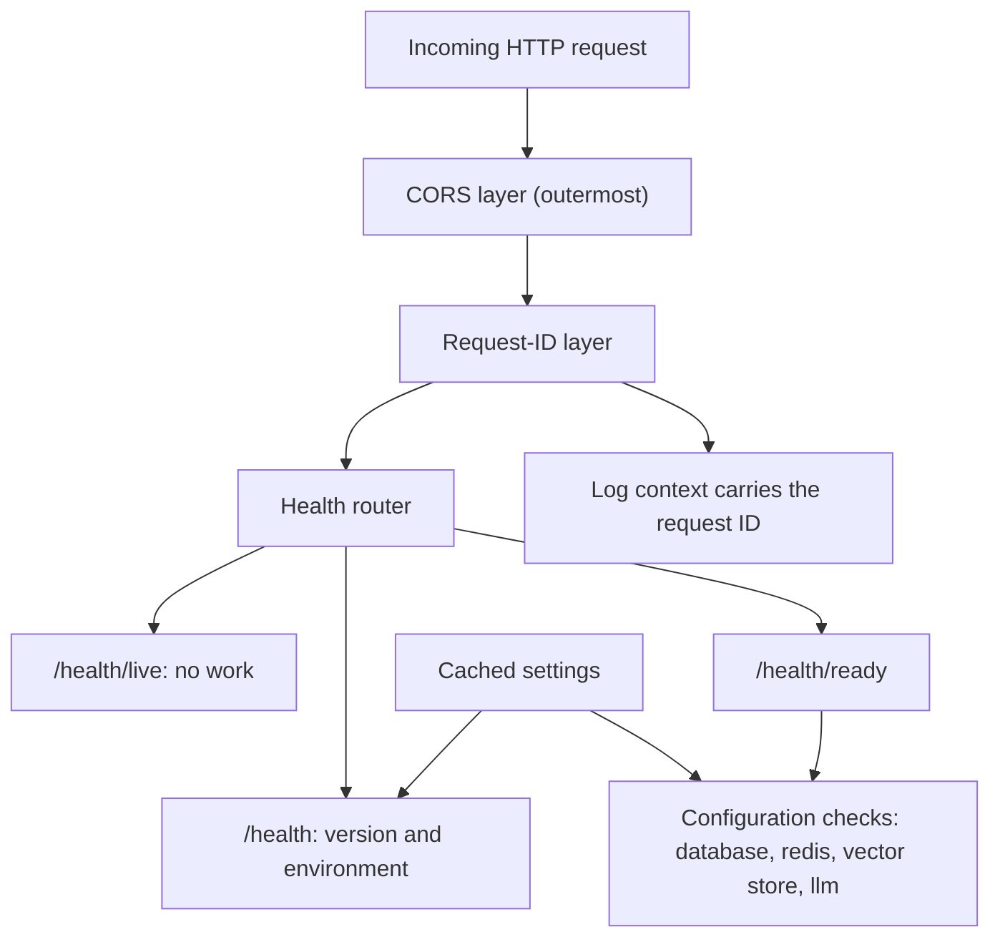
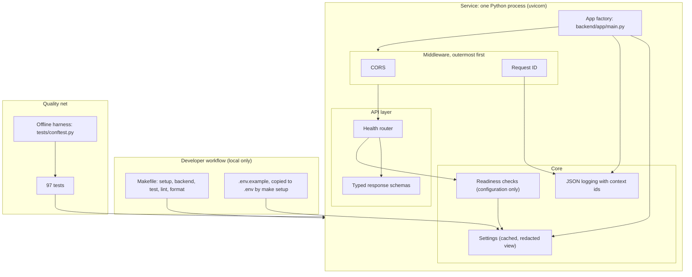
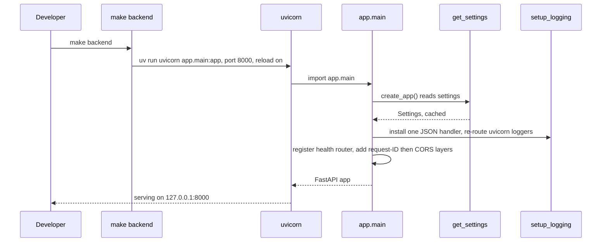
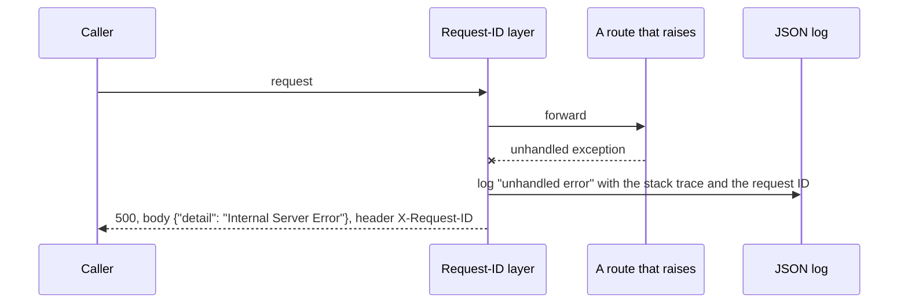

# Phase 1: system design evolution

> **What this document is.** How the architecture grew during Phase 1, from an empty repository to a small, observable, testable service. It describes only what exists. Where something is planned, it says so.
>
> **Related documents:** [codebase explanation](./01_CODEBASE_EXPLAINED.md) and [infrastructure evolution](./03_INFRA_EVOLUTION.md).
>
> **Status:** implemented and checked locally on 2026-10-31 and since. 97 tests pass and lint is clean (run while writing this). Not deployed.

---

## A. Phase overview

**Objective.** A process that boots offline, writes JSON logs carrying a request ID, and answers health probes (the phase goal stated in `PLAN.md`).

**Requirements addressed.** F14 (the offline demo profile, through the settings and harness) and N3 (a request ID on every response).

**Initial state.** Planning documents, a dependency file and a lockfile. No application code and no tests.

**Major additions, in the order they were merged:**

| Order | Task | Pull request | What it added |
|---|---|---|---|
| 1 | P1-1 | #3, with a follow-up commit on the same branch landed as #4 | Settings and JSON logging |
| 2 | P1-3 | #5 | The offline test harness |
| 3 | P1-2 | #6 | Health routes, request-ID middleware, readiness, the app factory |
| 4 | P1-4 | #7 | The Makefile and `.env.example` |

All four merged on 2026-10-31. The project record also notes that an earlier first attempt at Phase 1 was rolled back the same day and restarted from the plan, and that its commits remain reachable through a closed pull request. The design below is the second attempt.

**Important design changes within the phase:** the test harness was deliberately built *before* the code it tests, and the app factory was shaped to leave room for middleware that Phase 3 adds.

**Final capabilities.** An offline-runnable service with three health endpoints, request tracing, structured logs, redacted settings and a safety net of tests.

---

## B. Initial architecture

At the start of Phase 1 there was no system, only intent. This is the simplest reasonable starting point.

| | |
|---|---|
| Main components | None runnable |
| External dependencies | None |
| Data stores | None |
| Request entry points | None |
| Communication paths | None |
| Major limitations | Nothing could be started, observed or tested |

---

## C. Intermediate architectural evolution

### Step 1. Settings and logging (P1-1)

- **Original design.** Nothing.
- **Motivation.** Every later part needs configuration and a way to be diagnosed. Doing this first means no part invents its own.
- **Introduced.** A typed settings object (`backend/app/core/config.py`) and a JSON logger with request and workflow IDs held in context variables (`backend/app/core/logging.py`).
- **Effect on existing components.** None existed.
- **Benefits and trade-offs.** One source of truth and traceable logs. The cost is that settings are cached, so changing the environment needs a restart.
- **Status.** Completed and verified: 29 tests in `tests/unit/test_config_logging.py`.

### Step 2. The offline test harness (P1-3)

- **Original design.** Settings and logging existed but nothing verified them offline.
- **Motivation.** Without a guard, a test can quietly reach the internet, spend money or pick up a real key from a developer's shell.
- **Introduced.** `tests/conftest.py` fixes an offline environment *before* the application is imported, blanks every credential, blocks non-loopback network access, and clears the settings cache around each test. Its `client` fixture is written to skip itself until the application exists.
- **Effect.** Tests written afterwards inherit the guarantee automatically.
- **Benefits and trade-offs.** Free, hermetic tests. A test that genuinely needs a network has no opt-out yet.
- **Status.** Completed and verified: 24 tests in `tests/unit/test_harness.py`.

### Step 3. The service itself (P1-2)

- **Original design.** Settings, logging and a harness, but no service to run.
- **Motivation.** A hosting platform needs health probes, and a request needs a trace ID.
- **Introduced.** `backend/app/main.py` (the factory), `backend/app/api/health.py` with typed replies in `backend/app/schemas/health.py`, `backend/app/core/readiness.py` for configuration checks, and `backend/app/middleware/request_id.py`.
- **Effect on existing components.** The factory now calls the settings and logging set-up. The harness's `client` fixture stops skipping and starts building the real app.
- **Benefits and trade-offs.** A runnable, traceable service. Readiness checks configuration only, because there are no clients to connect with yet.
- **Status.** Completed and verified: 28 tests in `tests/api/test_health.py`, plus a live run for this document.

### Step 4. Developer ergonomics and the settings contract (P1-4)

- **Original design.** A service that only someone who knew the commands could start.
- **Motivation.** A new developer should be able to start, test and lint with one obvious command, and know exactly which variables exist.
- **Introduced.** A `Makefile` with five targets whose recipes start with `uv` or `git` (so they work in any shell), and `.env.example` listing the 27 variables with safe placeholders.
- **Benefits and trade-offs.** One documented way to work. No shell chaining, because the recipes must run in PowerShell too.
- **Status.** Completed and verified: 9 tests in `tests/unit/test_makefile.py` and 7 in `tests/unit/test_env_example.py`.

---

## D. Final architecture

**Layers present:** presentation (none), API (`backend/app/api/health.py`), business logic (none), domain (none), orchestration (none), data access (none), databases and vector stores (none), external integrations (none), AI models and tools (none), background workers (none), observability (JSON logs and request IDs), security boundaries (secret redaction and the request-ID allow-list), deployment components (none).

**Responsibilities.** The factory assembles. Middleware tags and protects. The router answers. Core holds configuration, logging and checks. The harness guards tests.

---

## E. End-to-end execution and data flow

### A representative request

The flow of a readiness request is drawn in the [codebase explanation](./01_CODEBASE_EXPLAINED.md#e-end-to-end-execution-flow). It is not repeated here.

### Start-up

### A crash

If the response had already begun, the layer re-raises instead of writing a second one.

**Phase 1 has no authentication, database access or external calls, so those steps of a request do not exist yet.**

---

## F. Architectural decisions and trade-offs

**Decision 1: build the test harness before the code it tests**

| Field | Description |
|---|---|
| Decision | Merge the offline harness (P1-3) before the health routes (P1-2) |
| Context | Tests should never be able to touch the network or a real key, from the first test |
| Alternatives | Write the harness after the first routes; rely on discipline |
| Rationale | Every test written afterwards is protected automatically |
| Benefits | No retrofit, and the `client` fixture skips cleanly until the app exists |
| Trade-offs | A harness reviewed before it has real code to guard |
| Status | Implemented |

**Decision 2: plain ASGI for the request-ID layer**

| Field | Description |
|---|---|
| Decision | Implement the middleware as a plain ASGI class |
| Context | The framework's own 500 handler sits outside ordinary middleware |
| Alternatives | The convenient `BaseHTTPMiddleware` |
| Rationale | The convenient version would skip the header on a crash |
| Benefits | Every response, including a crash reply, carries the ID. Tested. |
| Trade-offs | More code to read and maintain |
| Status | Implemented |

**Decision 3: configuration-only readiness**

| Field | Description |
|---|---|
| Decision | `/health/ready` checks that settings are sensible and opens no connection |
| Context | No database, cache, vector store or model client exists in Phase 1 |
| Alternatives | Omit readiness until Phase 2; fake a connection check |
| Rationale | It exercises the 200 and 503 behaviour now, with honest limits |
| Benefits | The route, the reply shapes and the no-leak rule are settled early |
| Trade-offs | A wrong but well-formed address reads as "ready" |
| Status | Implemented. Real connection checks are planned for later phases. |

**Decision 4: a liveness route that does no work**

| Field | Description |
|---|---|
| Decision | `/health/live` returns a constant and reads nothing |
| Context | A platform restarts a service that fails its liveness probe |
| Alternatives | Make liveness check dependencies |
| Rationale | A slow dependency must not cause a healthy process to be restarted |
| Benefits | Cheap and reliable |
| Trade-offs | It says nothing about whether the service can do real work |
| Status | Implemented. Tested to do no dependency I/O. |

**Decision 5: recipes that begin with `uv` or `git`**

| Field | Description |
|---|---|
| Decision | Keep every Makefile recipe free of Unix-only syntax |
| Context | The project is developed on Windows with PowerShell as well as Unix shells |
| Alternatives | A POSIX-only Makefile; separate scripts per shell |
| Rationale | One set of commands for everyone |
| Benefits | The same `make` targets work everywhere. Tested. |
| Trade-offs | No `&&`, `cp` or `rm` in recipes |
| Status | Implemented |

---

## G. Architectural improvements

Compared with the empty start, and only where the implementation or a test supports it:

| Quality | Improvement | Evidence |
|---|---|---|
| Separation of responsibilities | The API, core, middleware and schema code live in separate packages | The folder layout under `backend/app/` |
| Modularity | The app is built by a factory, so tests build fresh copies | `create_app()` in `backend/app/main.py` |
| Testability | Offline, hermetic tests and a lazily imported app | `tests/conftest.py` |
| Security | Secrets redacted in settings output; request IDs allow-listed; readiness reasons never echo a URL or key | Tests in `tests/unit/test_config_logging.py` and `tests/api/test_health.py` |
| Reliability | A crash returns a clean 500 with an ID | A test in `tests/api/test_health.py` |
| Maintainability | One settings object and one `.env.example`, checked against each other by a test | `tests/unit/test_env_example.py` |
| Extensibility | The middleware order has room for two more layers | A comment in `backend/app/main.py` |
| Scalability and performance | **No claim.** Nothing was measured. | None |

---

## H. Limitations and future evolution

**Existing weaknesses.**

- Readiness does not prove reachability.
- 18 of the 27 settings are declared but unread by Phase 1 code.
- The AI libraries are listed as dependencies but unused.
- No authentication, rate limiting or audit log.
- A mistyped environment variable name is silently ignored.
- No container image or deployment definition.

**Bottlenecks and scalability.** Not assessed. The service has one route group and no I/O.

**Technical debt (fixed in P1-14).** The `client` fixture's skip message said the app did not exist until P1-2, which was out of date. The fixture now imports the app directly, so a broken import fails instead of skipping.

**Recommendations (not implemented).**

| Recommendation | Where it fits |
|---|---|
| Replace configuration checks with real connection checks | When Phase 2 adds the database client |
| Add the rate-limit and audit layers | Phase 3, in the slot the factory's comment names |
| Add a container definition | Phase 14 |

---

## I. Phase completion summary

**Final architecture.** See section D.

**Major components introduced:** app factory, settings, JSON logging, request-ID middleware, three health routes, configuration readiness, offline harness, Makefile, `.env.example`.

**Important decisions:** build the harness first; plain ASGI middleware; configuration-only readiness; a work-free liveness route; shell-portable recipes.

**Verified outcomes.** 97 Phase 1 tests pass and lint is clean (run while writing this). The service was started on loopback and its three routes, request-ID rules, CORS behaviour and JSON logs were observed directly.

**Outstanding.** Real dependency checks, authentication, rate limiting, audit, containers.

**Carried into Phase 2.** The settings object (the database URL), the app factory, the harness, and the request ID and workflow ID that the logs already support.

**Not part of this document.** Tasks P1-5 to P1-10 in `TASKS.md` are developer tooling added to Phase 1's tracker after the runtime skeleton was finished. They add no runtime architecture.
