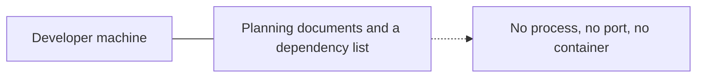
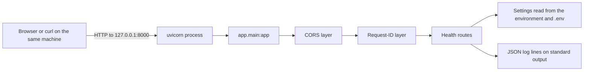
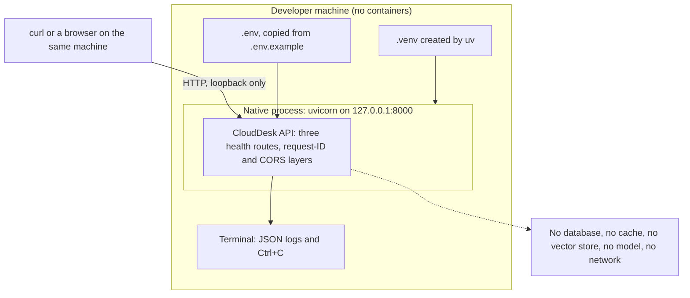

# Phase 1: infrastructure design evolution

> **Read this first.** Phase 1 has **no Docker, no Docker Compose, no containers, no database, no cache, no reverse proxy, no continuous-integration pipeline and no deployment**. I checked: there is no Dockerfile, no Compose file, no `.dockerignore`, no `.github/workflows` folder and no `deployment` folder.
>
> What Phase 1 *does* have is one local Python process, started with one command, configured from the environment. This document explains that honestly, and it explains the container ideas the spec asks about only as concepts, clearly marked as planned for a later phase. Nothing below claims a container exists.
>
> **Related documents:** [codebase explanation](./01_CODEBASE_EXPLAINED.md) and [system design evolution](./02_DESIGN_EVOLUTION.md).

---

## A. Infrastructure overview

| Question | Answer in Phase 1 |
|---|---|
| Where does it run? | On the developer's own machine, as one Python process |
| What runs in Docker containers? | Nothing |
| What is externally hosted? | Nothing. The offline profile needs no outside service. |
| How is it started? | `make backend`, which runs `uv run uvicorn app.main:app --app-dir backend --reload --port 8000` |
| How do components communicate? | A client calls the process over HTTP on the same machine. Inside the process, plain function calls. |
| How is configuration supplied? | Environment variables, plus an optional `.env` file copied from `.env.example` by `make setup` |
| How is it stopped? | Press Ctrl+C in the terminal that is running it |

**Development versus deployment.** Only development exists. No separate deployment configuration was written in this phase.

**A verified detail about stopping.** Ctrl+C in the terminal stops the whole thing. Stopping the `uv` wrapper alone, from another program, does *not* stop the server it launched: when I did that while testing this phase, the server survived and kept listening until I stopped its process tree. Stopping the whole tree (`taskkill /PID <pid> /T /F` on Windows) works.

---

## B. Initial infrastructure design

At the start of the phase there was nothing to run.



---

## C. Infrastructure evolution

| Step | What existed before | What changed | Why | Verified how |
|---|---|---|---|---|
| P1-1 settings and logging | Nothing | Settings read the environment; logs go to standard output as JSON | Everything later needs configuration and diagnosable output | 29 tests |
| P1-3 test harness | Nothing | Tests run with a fixed offline environment, a throwaway database path in a temporary folder, and outside network blocked | Tests must never touch the internet or a real key | 24 tests |
| P1-2 the service | No process to run | One uvicorn process listening on a port, with three health routes | A platform needs something to probe | 28 tests, and a live run for this document |
| P1-4 Makefile and `.env.example` | Commands known only to the author | Five `make` targets and a documented variable list | One obvious way to start, test and lint | 9 and 7 tests; `make test`, `make lint` and `make backend` were run for this document |

**Routing and communication changed once:** at P1-2, when the first network listener appeared. Before it nothing listened on any port.

---

## D. Docker and container explanation

**There are no containers in Phase 1, so there is no Compose service to describe.** To keep the spec's questions answerable, here is the one runtime component that exists, described with the same fields:

| Field | The local service process |
|---|---|
| Service name | None (not a Compose service) |
| Image or build | None. It is the Python 3.12 environment that `uv` creates in `.venv`. |
| Purpose | Serve the health routes |
| Ports | Listens on 8000 when started with `make backend`. The default bind address is `127.0.0.1`, because the Makefile passes no `--host`. |
| Networks | None. It is reachable only from the same machine. |
| Volumes | None. It writes no files. |
| Environment | See section H |
| Dependencies | None at runtime. The offline profile needs no database, cache, vector store or model. |
| Health checks | The routes exist (`/health`, `/health/live`, `/health/ready`), but nothing automatic calls them yet |
| Startup behavior | uvicorn imports the app, which reads settings and installs logging, then listens |
| Failure behavior | If the process stops, nothing restarts it. There is no supervisor. |

**Planned, not present:** a container image for the backend and one for the frontend, and a Compose file with the backend, a cache and a vector store. `TASKS.md` places container work in a later phase.

---

## E. Docker networking

**No Docker networks exist.** What does exist is ordinary local networking, and it is worth understanding because the container version will build on it.

| Concept | Phase 1 reality |
|---|---|
| The port the service listens on | 8000 under `make backend` |
| The address it listens on | `127.0.0.1`, meaning this machine only |
| What `localhost` means | This machine. A browser or `curl` on the same machine reaches it at `http://127.0.0.1:8000`. |
| Reachable from another machine | No, because it binds only to the loopback address |
| Hostnames that resolve to other services | None. There are no other services. |
| External APIs reached | None in the offline profile |

**Why this matters later.** When containers arrive, three different ports will matter: the port a program listens on *inside* its container, the port *published* on the host, and the port *other containers* use over the Docker network. Inside a container `localhost` will mean that container, not the host and not a neighbour. None of this applies yet, and nothing in Phase 1 should be read as a container networking design.

---

## F. Component wiring and routing



| Path | Exists in Phase 1? |
|---|---|
| Browser to frontend | No frontend yet |
| Frontend to backend API | No |
| Reverse proxy to services | No proxy |
| Backend to databases | No |
| Backend to AI providers | No |
| Workers to queues | No workers |
| Monitoring to metrics | No metrics endpoint |
| A client to the health routes on this machine | **Yes, and it is the only path** |

Local development and production are not separate here, because only local development exists.

---

## G. The actual lifecycle commands

There is no Compose lifecycle. These are the commands that exist, all from the `Makefile`:

| Goal | Command | Notes |
|---|---|---|
| Install dependencies and create `.env` | `make setup` | Runs `uv sync`, sets the shared git hooks path, and copies `.env.example` to `.env` **only if `.env` is missing** |
| Start the service | `make backend` | Port 8000, reloads on code edits |
| Run the tests | `make test` | Offline |
| Lint | `make lint` | `ruff check` |
| Format | `make format` | `ruff format`, which **rewrites files** |
| Stop | Ctrl+C | See section A for the verified caveat |
| View logs | They are printed to the same terminal | JSON lines |
| Check it is up | `curl http://127.0.0.1:8000/health/live` | |
| Rebuild after a dependency change | `uv sync` | |

**Destructive commands.** `make format` rewrites source files in place. `make setup` never overwrites an existing `.env`. Nothing here deletes data, because Phase 1 stores none.

**A note on tools.** `make` is not part of Windows by default. This project's notes record `winget install ezwinports.make` as the way to add it. The same steps can be run without `make` by calling the `uv` commands directly.

---

## H. Environment variables and secrets

The 27 variables are listed in `.env.example`, which holds names and safe placeholders only. Phase 1 code reads just 9 of them. The others are declared now for later phases.

| Variable | Read by Phase 1 code? | Purpose |
|---|---|---|
| `ENVIRONMENT` | Yes | Name shown by `/health` |
| `CORS_ORIGINS` | Yes | Browser origins allowed to call the service. Default `http://localhost:3000`. |
| `DATABASE_URL` | Yes (readiness check) | Database address. Its scheme is checked, no connection is made. |
| `REDIS_URL`, `USE_FAKE_REDIS` | Yes (readiness check) | Cache address; blank or fake means an in-memory stand-in |
| `VECTOR_STORE`, `QDRANT_URL` | Yes (readiness check) | Which store; Qdrant needs a URL |
| `LLM_PROVIDER`, `LLM_API_KEY` | Yes (readiness check) | A real provider needs a key; `fake` needs none |
| `DEMO_MODE`, `JWT_SECRET`, `SUPABASE_JWT_SECRET`, `CHECKPOINT_DB_PATH`, `LLM_MODEL`, `EMBEDDING_*`, `QDRANT_API_KEY`, `QDRANT_COLLECTION`, `APPROVAL_REQUIRED_FOR_REFUNDS`, `MAX_REFUND_WITHOUT_APPROVAL`, `TOOL_TIMEOUT_SECONDS`, `RATE_LIMIT_PER_MINUTE`, `SAMPLE_DATA_DIR`, `LANGCHAIN_*` | No | Declared for later phases |

**Safe defaults.** The defaults describe the offline demo profile, so the service starts with no `.env` at all.

**Secrets.**

- `.env` and `.env.*` are git-ignored, so local keys are never committed.
- In `.env.example` every secret is empty except `JWT_SECRET`, which holds an obvious demo placeholder. A test requires that.
- Secrets are held as `SecretStr`, and the redacted settings view prints `***`.
- A readiness failure names the setting at fault but never prints a URL, password or key.

**Development versus production.** Only development exists. How production secrets would be supplied is planned for the deployment phase and is not designed here.

---

## I. Persistent storage and data management

**Phase 1 stores nothing.** There are no named volumes, bind mounts, database files, uploads or cache. `.gitignore` already excludes `data/` and `*.db` so that later phases do not commit local data.

The test harness points `DATABASE_URL` at a SQLite file in a temporary folder. No Phase 1 code opens it, because no database engine exists yet. It is there so that, when Phase 2 adds one, tests are already isolated.

**Missing, and appropriately so for now:** backups, restore procedures, data initialization. They become relevant when Phase 2 introduces a database.

---

## J. Health checks, startup order, and resilience

| Topic | Reality |
|---|---|
| Service dependencies | None |
| Startup ordering | Not applicable. One process. |
| Health checks | Three routes exist. Nothing calls them automatically yet. |
| Readiness versus "the process is running" | They differ, and I verified it: with the vector store set to Qdrant and no URL, the process ran and answered `/health/live` with 200 while `/health/ready` answered **503**, naming the setting. |
| Restart policy | None. No supervisor restarts a stopped process. |
| Timeouts | None configured |
| Failure propagation | A crashing route returns a clean 500 with a request ID. It does not stop the process. |
| Recovery | Manual: restart the command |

**Recommended, not implemented:** a supervisor or container restart policy, and a platform probe wired to `/health/live` and `/health/ready`.

---

## K. Observability and troubleshooting

**What exists.** Application and uvicorn logs, all as one JSON object per line on standard output, each with `request_id` and `workflow_id` (null when unset). Three health routes.

**What does not exist.** Container logs, Prometheus metrics, Grafana dashboards and distributed tracing.

A real log line from this phase's run, shortened:

```text
{"level": "INFO", "logger": "uvicorn.access", "message": "127.0.0.1:65427 - \"GET /health HTTP/1.1\" 200", "request_id": "2a954464-...", "workflow_id": null}
```

| Symptom | Likely cause | Command and what it shows |
|---|---|---|
| "Address already in use" on start | Another process holds port 8000 | `netstat -ano \| findstr :8000` shows a LISTENING row and the owning PID |
| The service answers but `/health/ready` is 503 | A setting is wrong | `curl http://127.0.0.1:8000/health/ready`: each check's `detail` names the setting |
| The service will not start | An invalid value, such as an unknown `VECTOR_STORE` | The start-up error names the field |
| `make: command not found` | `make` is not installed | Install it, or run the `uv` commands directly |
| A change to `.env` has no effect | Settings are cached for the life of the process | Restart the service |
| A server is still listening after you "stopped" it | Only the `uv` wrapper was stopped | Stop the whole tree, as described in section A |

---

## L. Final infrastructure architecture



**Containers:** none. **Native processes:** one. **Networks:** none, loopback only. **Ports:** 8000. **Volumes:** none. **External dependencies:** none. **Monitoring components:** none.

---

## M. Infrastructure verification

Run on 2026-11-02 while writing this document. Where I could not check something, I say so.

| Check | Result | How |
|---|---|---|
| The service starts | **Verified** | `make backend` started it on 8000. It also started under the same uvicorn command on ports 8771 and 8772 for the other probes. |
| The required port is reachable | **Verified** | `GET http://127.0.0.1:8000/health/live` returned 200 `{"status":"alive"}` with an `X-Request-ID` |
| Health routes | **Verified** | `/health` 200, `/health/live` 200, `/health/ready` 200, each with a request ID |
| Readiness degrades on a bad setting | **Verified** | 503 with the setting named, while `/health/live` stayed 200 |
| A safe request ID is echoed, an unsafe one replaced | **Verified** | `abc-123` echoed; an ID with spaces and a slash replaced by a UUID |
| CORS | **Verified** | The console origin got `allow-origin` and `expose-headers: X-Request-ID`; an unknown origin got none |
| Logs are JSON and carry both IDs | **Verified** | 13 log lines, all with `request_id` and `workflow_id` |
| `make test`, `make lint` | **Verified** | Exit 0; 220 passed when checked (97 for Phase 1); "All checks passed!" |
| The server stops cleanly | **Verified with a caveat** | A tree kill frees the port; stopping only the `uv` wrapper does not |
| Internal DNS resolution | Not applicable | No other services |
| Application-to-database connectivity | Not applicable | No database client |
| Persistent storage behaviour | Not applicable | Nothing is stored |
| External integrations | Not applicable | None configured |
| Docker build, Compose, container networking | **Not tested, and cannot be** | None exist |
| `make setup` | **Not run** for this document, because it would create a local `.env` | Its recipe was read and is covered by `tests/unit/test_makefile.py` |
| Behaviour under load, or on another operating system | **Not tested** | |
