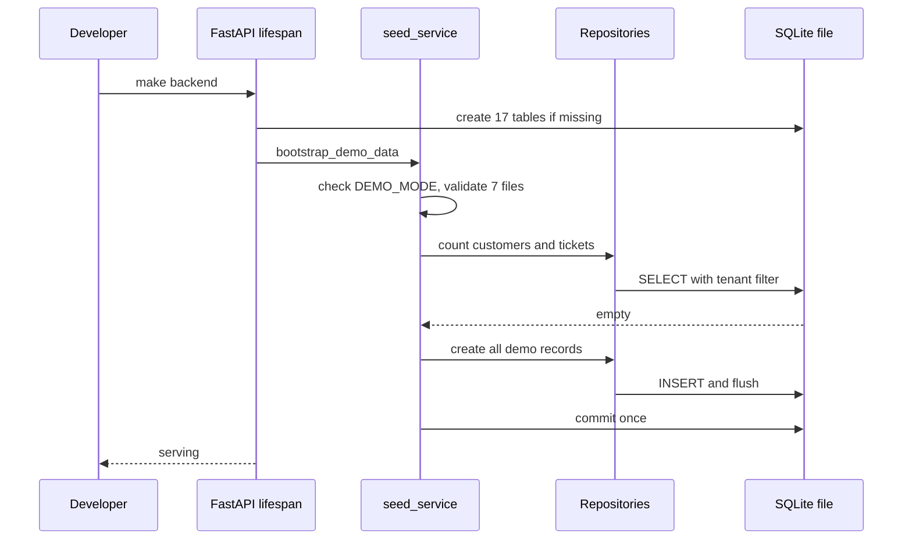

# Phase 2 explained: persistence and demo data

> **What this document is.** A plain-language explanation of the code written in Phase 2 of CloudDesk, meant to be spoken aloud to recruiters, hiring managers and interview boards. It describes only what exists in the repository today. Where something is planned for a later phase, it says so.
>
> **Status of this phase:** implemented and checked locally. In a run made for this document (2026-11-22) the whole suite passed (659 tests) and `ruff check .` reported no problems. Nothing is deployed. Phase 2 has **no ticket API, no login, no AI model, no Docker and no Postgres run**. The data layer is used only by tests, by `make seed` and by the startup code.
>
> **Related documents:** [system design evolution](./02_DESIGN_EVOLUTION.md), [infrastructure evolution](./03_INFRA_EVOLUTION.md) and the local-only interview Q&A, `04_INTERVIEW_QNA.md`. Phase 1 is explained in [the Phase 1 codebase document](../Phase01/01_CODEBASE_EXPLAINED.md).

---

## A. Executive summary

**The 30-second version, ready to say out loud:**

"After Phase 1 CloudDesk could start and report that it was healthy, but it had nowhere to keep anything. Phase 2 gave it a memory and a story. It built a database layout that works on a laptop file today and on a cloud database later, a single gatekeeper that every database question must go through so one customer organisation can never see another's data, and a set of made-up customers and tickets that load themselves the first time the service starts. There is still no screen and no AI. But for the first time there are thirteen realistic support tickets sitting in a database, waiting for the later phases to work on them."

**What the phase accomplished.**

- A data model: 17 tables (customers, subscriptions, tickets, messages, approvals and so on) described once in Python and once in Postgres SQL, with tests that keep the two in step.
- A "repository layer": the only code allowed to talk to the database, which automatically adds a tenant filter to every question it asks.
- Postgres security rules (row-level security) written as SQL, so the cloud database can enforce the same separation.
- A demo scenario: 8 fictional customers and 13 tickets, loaded on first start, once.

**What problem it solves.** A support platform needs tickets, customers and history to exist before any agent can investigate them. And it must keep different organisations' data apart from the first line of code, because adding that separation later means rewriting every table and every query at once.

**Why it was necessary.** Phase 3 (login and request guards) needs the profile and audit tables. Phase 4 (the support API) needs tickets and customers. Phase 9 (the agents) needs customer context. All of them read through the repositories built here.

**Before and after.**

| | Before Phase 2 | After Phase 2 |
|---|---|---|
| Where is data kept? | Nowhere | A SQLite file in `data/` for the demo; Postgres SQL written for the cloud |
| Can the service hold a ticket? | No | Yes, through `TicketRepository` (no HTTP route yet) |
| Is there demo content? | No | 8 customers, 13 tickets, 2 incidents, 5 products on first start |
| Is tenant separation enforced? | Only promised in a document | By a column on every table, a filter in one base class, and SQL policies; tested with two tenants |
| What does startup do? | Builds the app | Also creates tables and seeds data |

---

## B. Business problem and solution

**The real-world problem.** A support agent opens a ticket and needs to see who the customer is, what plan they pay for, what happened last time, and whether an outage is in progress. All of that is data. Without a place to keep it, there is nothing for an AI agent to investigate.

**Limits of a naive first version.** A quick prototype keeps data in a Python list or builds SQL strings in every endpoint. Both go wrong in predictable ways:

- *Data in memory* disappears when the process stops, and tests cannot share a realistic scenario.
- *SQL scattered through the code* means the rule "only show this organisation's rows" must be remembered in every query. Forgetting once is a data leak.
- *A model tied to one database* means the demo needs a database server installed, and the cloud version drifts from the demo version.
- *Demo data typed in by hand* means every developer's machine looks different.

**The solution in this phase.** One model that works on two databases, one gatekeeper that holds the tenant filter, matching Postgres SQL with row-level security, and a loader that fills an empty database from files.

**Business benefit.** A multi-organisation product can be built without a risky retrofit. The demo works offline with no setup. Every developer sees the same thirteen tickets with the same ids.

**Why this approach.** It follows the decision recorded as D1 on 2 November 2026: the tenant column is nearly free now and ruinous to add later across 16 tables.

---

## C. Application architecture in simple language

Think of Phase 2 as building the **records office** behind the front desk Phase 1 built.

| Part | Plain-language role | If it were removed |
|---|---|---|
| **Domain vocabulary** | The agreed list of words: which categories, statuses, severities and channels exist | Different files would spell "waiting on approval" differently |
| **Models** | The blueprint of every filing cabinet and its drawers | There would be no tables |
| **Engine and sessions** | The corridor and the door key to the records office | No code could reach the data |
| **Repositories** | The records clerks. Nobody else may open a cabinet, and each clerk only ever pulls files for the right organisation | Every part of the code would write its own queries and might forget the tenant rule |
| **Postgres schema, policies, migration** | The architect's drawings of the same office for the cloud building, with locks on every drawer | The cloud database would have to be hand-built |
| **Sample data** | A box of made-up case files | The database would start empty |
| **Seed loader** | The clerk who files the box on day one, checks that nothing is torn first, and refuses to file twice | The demo would have to be typed in |
| **Startup lifespan** | The opening routine: unlock, build cabinets, file the box | A developer would run steps by hand |

### The domain vocabulary

- **Purpose.** Define each fixed list once: 10 ticket categories, 7 statuses, 4 severities, 4 channels, and the smaller lists the tables need.
- **Does.** Python `StrEnum`s, which behave like text, so `"waiting_on_approval"` is both a label and a value.
- **Talks to.** The models import it; a test compares it with the API contract document `docs/design/06_API_CONTRACT.md`.

### The models

- **Purpose.** Describe 17 tables: `tenants` plus 16 data tables (profiles, customers, subscriptions, workspaces, products, tickets, ticket messages, support articles, incidents, workflow runs, workflow events, resolution actions, approval requests, escalations, customer memory, audit logs).
- **Receives / produces.** No input; it is a description. SQLAlchemy turns it into `CREATE TABLE` statements.
- **Portable on purpose.** Ids are 36-character text (a UUID written out), lists are stored as JSON, and fixed lists are stored as text with a rule that only the allowed words are accepted. That is why the same description works on SQLite and Postgres.
- **The tenant column.** *Tenant* means one customer organisation of the product. Every data table has a `tenant_id` that cannot be empty. Think of it as the organisation's name stamped on every page of every file.

### Engine and sessions

- **Purpose.** Open the database. The *engine* is the connection to the file or server. A *session* is one conversation with it, usually one transaction.
- **Does.** Creates the folder for the SQLite file if missing, and switches on foreign-key checking, which SQLite ignores by default.
- **Produces.** Sessions, and `create_tables()`, which builds any table that does not yet exist.

### Repositories

- **Purpose.** Be the only place SQL is written, and the only place the tenant filter is added.
- **Receives.** A session and a tenant id (the demo tenant by default).
- **Does.** Every read starts from a base query that already says "only this tenant's rows". Every insert stamps the tenant. An object that already belongs to a different tenant is refused.
- **Flush, not commit.** A repository writes into the open transaction but never finishes it. The caller decides when to commit, so several writes either all land or none do.
- **One exception.** `TenantRepository` is not filtered, because it manages the list of tenants itself.

### Postgres schema, policies and migration

- **Purpose.** The same 17 tables as plain SQL for the Supabase SQL editor, plus one rule per table: a row is visible only if its tenant matches the tenant the connection announced with `SET LOCAL app.tenant_id`. That kind of rule is *row-level security* (RLS).
- **Status.** Written and compared to the models by tests. **Never run against a real Postgres.**

### Sample data and the seed loader

- **Purpose.** Create the demo scenario from CLAUDE.md section 5.
- **Does.** Reads seven JSON files (eight today: Phase 3 added `profiles.json`, which is now seeded too), checks every record and every link between records before writing anything, then writes it all in one transaction. Ids are derived from names (uuid5), so CD-1002 gets the same id on every computer.
- **Refuses** to run unless `DEMO_MODE` is true, and refuses when the database already has a customer or a ticket.

---

## D. Codebase structure and file-by-file explanation

Paths are relative to the project root. Line counts are from the files as they stand today.

### `backend/app/schemas/common.py` (103 lines when this phase was written; 117 today, after later phases added enums)

| Item | Explanation |
|---|---|
| Responsibility | The single definition of the shared vocabulary |
| Reason for existence | CLAUDE.md says a new category or status is added here first, so models, API and UI cannot disagree |
| Main components | `Category`, `TicketStatus`, `Severity`, `Channel`, `Role`, `MemoryType`, `ApprovalStatus`, `ResolutionActionStatus`, `EscalationStatus`, `WorkflowStatus`, `MessageRole`, `WorkflowEventType` |
| Inputs | None |
| Processing | Declares enums |
| Outputs | The enum classes |
| Dependencies | None |
| Execution point | Imported by the models and by the seed loader |
| Interview explanation | "It is the dictionary. Everyone uses the same words." |

### `backend/app/models/entities.py` (325 lines)

| Item | Explanation |
|---|---|
| Responsibility | SQLAlchemy 2 definitions of all 17 tables |
| Reason for existence | One description of the data that runs on SQLite and Postgres |
| Main components | `Base`, `TimestampMixin`, `TenantMixin`, `enum_col`, `DEMO_TENANT_ID`, and the classes `Tenant`, `Profile`, `Customer`, `Subscription`, `Workspace`, `Product`, `Ticket`, `TicketMessage`, `SupportArticle`, `Incident`, `WorkflowRun`, `WorkflowEvent`, `ResolutionAction`, `ApprovalRequest`, `Escalation`, `CustomerMemory`, `AuditLog` |
| Inputs | None; it is declarative |
| Processing | The mixins add `created_at`, `updated_at` and the indexed, non-null `tenant_id`. Every composite index and unique constraint starts with `tenant_id`. `ResolutionAction` is unique on tenant plus `idempotency_key`, which later phases use so a retry cannot act twice. |
| Outputs | Table metadata used by `create_all` |
| Dependencies | `backend/app/schemas/common.py`, SQLAlchemy |
| Execution point | Imported at startup by `backend/app/core/database.py` |
| Interview explanation | "It is the blueprint. The tenant stamp is part of the blueprint, so no table can forget it." |

`DEMO_TENANT_ID` is the fixed value `00000000-0000-4000-8000-000000000001`. It is a valid UUID because the Postgres policy casts to `uuid`.

### `backend/app/core/database.py` (66 lines)

| Item | Explanation |
|---|---|
| Responsibility | Engine, session factory and table creation |
| Reason for existence | One place decides how the database is opened |
| Main components | `get_engine`, `get_sessionmaker`, `get_session`, `create_tables`, `dispose_engine` |
| Inputs | `DATABASE_URL` from the settings |
| Processing | Caches one engine per URL. For SQLite it creates the parent folder and runs `PRAGMA foreign_keys=ON` on each new connection. |
| Outputs | An async engine, sessions, created tables |
| Dependencies | `backend/app/core/config.py`, `backend/app/models/entities.py` |
| Execution point | The app lifespan; `get_session` is ready for request-scoped use in Phase 4 |
| Interview explanation | "It opens the door to the data. It also turns on a safety check SQLite normally skips." |

### `backend/app/repositories/base.py` (92 lines)

| Item | Explanation |
|---|---|
| Responsibility | The tenant-scoped base class for every repository |
| Reason for existence | The tenant filter must live in exactly one place (D1) |
| Main components | `ScopedRepository` with `_select`, `_get`, `_add`, `_update_where`, `_delete_where`, `_page`; `contains_any`; `MAX_PAGE_SIZE` (100) |
| Inputs | A session and a tenant id |
| Processing | `_select` adds `WHERE tenant_id = ...`. `_add` stamps the tenant, rejects another tenant's object, sets a strictly increasing `created_at`, adds and flushes. `_page` clamps page size to 1 to 100. |
| Outputs | Rows, counts, or a flushed object |
| Dependencies | `backend/app/models/entities.py` |
| Execution point | Every repository call |
| Interview explanation | "Every question automatically starts with 'for this organisation only'." |

### The repository modules in `backend/app/repositories/`

| File | What it offers |
|---|---|
| `backend/app/repositories/tickets.py` | `TicketRepository` (create, get, `get_by_number`, filtered paged `list`, `list_for_customer`, update) and `TicketMessageRepository` (add, `list_for_ticket`) |
| `backend/app/repositories/customers.py` | `CustomerRepository` (create, get, `get_by_email`, searchable paged list), `SubscriptionRepository` and `WorkspaceRepository` (`get_for_customer`) |
| `backend/app/repositories/reference.py` | `IncidentRepository` (`list_active`), `ProductRepository`, `SupportArticleRepository` (`upsert_by_slug`) |
| `backend/app/repositories/workflow.py` | `WorkflowRunRepository`, `WorkflowEventRepository`, `ResolutionActionRepository` (lookup by idempotency key, `record_result`) |
| `backend/app/repositories/approvals.py` | `ApprovalRepository` (`decide`, `list_expired`) and `EscalationRepository` |
| `backend/app/repositories/memory.py` | `CustomerMemoryRepository` (list, `exists`, add, `delete_for_customer`) |
| `backend/app/repositories/audit.py` | `AuditLogRepository` (append, list) |
| `backend/app/repositories/profiles.py` | `ProfileRepository` (create, get, `get_by_email`) |
| `backend/app/repositories/tenants.py` | `TenantRepository.ensure`, the one unscoped repository |

Interview explanation: "One clerk per drawer group, all trained by the same base clerk." The workflow, approval, memory and audit repositories are ready but unused until Phases 3 and 8 to 11; their tests prove the tenant rule now.

### `database/schema.sql`, `database/rls_policies.sql`, `database/seed.sql`, `database/migrations/0001_initial.sql`

| Item | Explanation |
|---|---|
| Responsibility | The Postgres form of the data model and its security |
| Reason for existence | Supabase takes SQL, and the cloud type mapping differs from SQLite (`uuid`, `jsonb`, `timestamptz`) |
| Main components | 17 `CREATE TABLE`s in foreign-key order; `set_updated_at()` and one `BEFORE UPDATE` trigger per table; one `tenant_isolation` policy per table with `ENABLE` and `FORCE ROW LEVEL SECURITY`; a seed row for the demo tenant; the migration that is the schema followed by the policies |
| Inputs | Run by a person in the SQL editor (never run yet) |
| Processing | Policies compare `tenant_id` to `current_setting('app.tenant_id')::uuid` |
| Outputs | Tables and policies in a Postgres database |
| Dependencies | Must match `backend/app/models/entities.py`, enforced by tests |
| Execution point | Manual, in the cloud phases |
| Interview explanation | "It is the cloud version of the blueprint, with a lock on every drawer. I have checked it matches the Python blueprint by test, but I have not yet tried it on a real server." |

### `sample_data/*.json`

Seven files in Phase 2 (`profiles.json`, three demo users, joined in Phase 3): `customers.json` (8, all four plans), `subscriptions.json` (8), `workspaces.json` (8), `tickets.json` (13, CD-1001 to CD-1013), `incidents.json` (2), `products.json` (5) and `previous_resolutions.json` (6). All content is fictional. Each ticket carries a `customer_key` that links it to a customer. `previous_resolutions.json` is checked but not loaded into the database, because no table holds it; the Knowledge Agent in Phase 9 will read it from disk.

### `backend/app/services/seed_service.py` (296 lines when this phase was written; 312 today)

| Item | Explanation |
|---|---|
| Responsibility | Validate the sample files and load them once |
| Reason for existence | Every developer and every test gets the same demo scenario |
| Main components | `load_sample_data`, `bootstrap_demo_data`, `SeedReport`, `SEED_NAMESPACE`, strict Pydantic record classes, `main` (the `make seed` entry point) |
| Inputs | `SAMPLE_DATA_DIR`, `DEMO_MODE` |
| Processing | Parse every file (unknown fields are errors; Phase 2 parsed seven files), cross-check customer links and one subscription and workspace per customer, then ensure the tenant row, check emptiness, write through the repositories and commit once. Each ticket also gets its first customer message dated as the ticket. |
| Outputs | A `SeedReport` (`loaded`, reason, counts) |
| Dependencies | The repositories, `backend/app/core/database.py`, `backend/app/core/config.py` |
| Execution point | Startup lifespan and `make seed` |
| Interview explanation | "It checks the whole box is in order, then files it all in one go, and never files it twice." |

### `backend/app/main.py` (60 lines when this phase was written; 96 today, after later phases mounted their routers)

The Phase 1 factory now has a `lifespan` that runs `create_tables()` and `bootstrap_demo_data()` before serving, and `dispose_engine()` on shutdown. A database failure is logged as the exception class and a redacted URL, not swallowed silently, and not allowed to stop the process, so `/health/ready` can still say "degraded".

### Tests that carry the weight

| File | What it proves |
|---|---|
| `tests/unit/test_entities.py` | Tables exist; every data table has `tenant_id`, first in each composite index |
| `tests/unit/test_database.py` | `create_tables` works and is idempotent; a ticket round-trips; an unknown status is rejected by the database; SQLite enforces foreign keys; `core` does not import `agents` |
| `tests/unit/test_common_schemas.py` | The vocabulary equals the API contract document |
| `tests/unit/repositories/test_repositories_tenant_isolation.py` | Two tenants with the same natural keys cannot see or change each other's rows; every public method is classified |
| `tests/unit/repositories/test_repositories_layering.py` | Repositories import no agents, model clients or HTTP; none bypasses the filter; no other layer contains `tenant_id` |
| `tests/unit/test_schema_sql.py`, `tests/unit/test_rls_policies.py`, `tests/unit/test_migrations.py`, `tests/unit/test_seed_sql.py` | The SQL matches the models; every table has RLS; migrations equal the schema plus policies; the applied migration's hash is pinned |
| `tests/unit/sql_ddl.py`, `tests/unit/test_sql_ddl_parser.py` | The small SQL parser those tests rely on |
| `tests/unit/test_sample_data.py`, `tests/unit/test_seed_service.py`, `tests/api/test_startup_seed.py` | Sample data shape; deterministic ids; rollback on a bad record or a mid-write failure; skip gates; startup seeds once and survives a broken database |

---

## E. End-to-end execution flow

The only flow in this phase is "first start on an empty machine". Nobody calls an API yet.

1. A developer runs `make backend` (or `make seed`).
2. Uvicorn builds the app and runs the lifespan before the first request.
3. `create_tables()` opens `data/support.db`, creating the `data/` folder if needed, and builds the 17 tables.
4. `bootstrap_demo_data()` checks `DEMO_MODE`. If false it stops.
5. It reads the seven files and checks every record. One bad record stops the run with a message naming the file and record, and nothing is written.
6. It makes sure the demo tenant row exists, then asks the customer and ticket repositories how many rows exist. Rows present means "already seeded", so it stops.
7. It writes customers, subscriptions, workspaces, products, incidents, tickets and first messages, then commits once.
8. The service starts answering. `/health/ready` still checks configuration only.
9. On the next start step 6 finds rows, so nothing is added.

**Errors.** A bad sample file raises `ValueError` and the lifespan logs it; the database stays empty. A failure part-way through writing rolls everything back (tested). An unreachable database is logged with a redacted URL and the service still starts.

---

## F. Technical concepts explained simply

- **Database and table.** A table is a spreadsheet with strict columns. A foreign key says "this ticket belongs to a customer that must exist".
- **SQLite versus Postgres.** SQLite is a database in one file, needing no server. Postgres is a full server used in the cloud. CloudDesk uses the first for the demo and is written to move to the second.
- **ORM (SQLAlchemy).** Describe tables as Python classes and let the library write the SQL.
- **Async.** The code can wait for the database without freezing everything else. That is why functions are `async` and called with `await`.
- **Transaction, flush and commit.** A transaction is a batch of writes that succeeds or fails together. *Flush* sends writes to the database inside the transaction; *commit* makes them permanent.
- **Multi-tenancy and row-level security.** One system serving many organisations, with each organisation's rows invisible to the rest. RLS makes the database itself enforce that.
- **Migration.** A numbered SQL file that changes the database. Once applied it is never edited; changes go in a new file. A test pins the hash of `database/migrations/0001_initial.sql`.
- **Idempotent.** Doing it twice has the same effect as once. Seeding is idempotent by the emptiness check; later, actions use the idempotency key stored in `resolution_actions`.
- **Deterministic ids (uuid5).** An id calculated from a name, so the same name always gives the same id.
- **Validation.** Pydantic records with `extra="forbid"` reject any unexpected field in the sample files.

---

## G. Design decisions and trade-offs

These were decisions made while building the phase; each is also recorded in the [design evolution document](./02_DESIGN_EVOLUTION.md), section F.

- **One model for two databases.** Gives an offline demo. Costs native enums and JSONB.
- **Tenant column from day one (D1).** Cheap now, expensive later. Costs a column everywhere.
- **Filter in the repository only.** One place to audit. A method that skips `_select()` would leak, so tests scan for that.
- **Postgres id type differs from the model's (O1).** The SQL uses `uuid` and the models use text. When a real `asyncpg` connection exists, a type decorator will be needed. That is planned, not built.
- **Flush, never commit.** Gives all-or-nothing seeding. Costs the risk of a forgotten commit.

**Retrospective recommendations (not historical decisions).** Run the SQL on a real Postgres container as soon as Docker exists; make `/health/ready` run a trivial query.

---

## H. Error handling and failure scenarios

| Scenario | Actual behaviour |
|---|---|
| Malformed or inconsistent sample file | `ValueError` naming file and record; nothing written (tested) |
| Failure halfway through seeding | Everything rolls back (tested) |
| Database unreachable at startup | Logged as the exception class and a redacted URL; service still starts; `/health/ready` does not yet notice because it opens no connection |
| `DEMO_MODE` false | Nothing seeded; `make seed` refuses with a message and exit code 1 |
| Database already has data | Nothing added |
| Two workers seed at once | A unique key makes the second commit fail; reported as "not empty" |
| Row pointing at a missing tenant or customer | Rejected, because SQLite foreign keys are switched on (tested) |
| Value outside an enum | Rejected by the database CHECK rule (tested) |
| Object belonging to another tenant passed to a repository | `ValueError` |

**Missing safeguards.** No retry or timeout on database calls. No health check that really queries. No lock around concurrent seeding beyond the unique keys. No Postgres behaviour is verified.

---

## I. Testing and verification

**How to run.** `uv run pytest -q` and `uv run ruff check .` (or `make test` and `make lint`).

**Results from a run made for this document, 2026-11-22.** `.venv/Scripts/python.exe -m pytest -q` reported 659 passed in 31.48 s. `.venv/Scripts/python.exe -m ruff check .` reported "All checks passed!". The test files listed in section D account for roughly 301 of the 659 tests (counted from a collect-only run).

**What the results establish.** The Python models, the SQL text, the repositories and the seed loader agree with each other, and the tenant rule holds on SQLite.

**What remains untested.** Any Postgres: the SQL has never been executed, so policy behaviour, trigger syntax and the type mapping are unproven. Concurrent seeding in a real race. Performance of any query. The repositories under an API request, because no API exists.

---

## J. Interview-ready explanation

**30 seconds.** "Phase 2 gave CloudDesk a database. I described the data once so it runs on a laptop file now and on Postgres later, put one gatekeeper layer between the code and the database that always adds the organisation filter, wrote the cloud security rules as SQL, and added a loader that fills the demo with thirteen tickets on first start. There is still no AI or screen, but the data the agents will work on now exists."

**2 minutes.** "There are four pieces. First, a shared vocabulary file defines categories, statuses, severities and channels, and the models import it. Second, seventeen SQLAlchemy models, written to be portable: ids as text, lists as JSON, enums as text with a CHECK. Every data table carries a required tenant id, and it leads every index. Third, a repository layer. A base class adds the tenant filter to every read and stamps every write, and repositories flush but never commit, so the caller decides the transaction. Tests with two tenants prove neither can see the other. Fourth, a seed loader that validates seven JSON files, loads them in one transaction with deterministic ids, and only runs in demo mode on an empty database. Alongside this I wrote the Postgres schema, row-level security and a first migration, compared against the models by tests. I have to be honest that nothing has been run on a real Postgres yet."

**5 minutes (architecture and flow).** Cover section D's layering (vocabulary, models, engine, repositories, services), then walk the numbered startup flow in section E, then the failure table in section H, then the limits: Postgres unproven, RLS needs a `SET LOCAL` that nothing issues yet, and on SQLite the repository filter is the only boundary.

**For a non-technical interviewer.** "It is a filing system with a rule that every clerk only ever opens the right company's folders, and a starter box of thirteen made-up cases that gets filed automatically the first time and never twice."

**For an architect or engineering manager.** "Tenant isolation is defended in two layers: a repository-level filter that is the only boundary on SQLite, and Postgres RLS that is written, structurally tested against the models, and not yet exercised. The models are portable through JSON, String(36) ids and VARCHAR with CHECK; the SQL maps ids to uuid, so I know an asyncpg type decorator is owed before the first real connection. Repositories flush and callers commit, giving all-or-nothing seeding. Open items are the `SET LOCAL app.tenant_id` issuer, a real Postgres run, and a readiness probe that touches the database."

---

## K. Key takeaways and next-phase dependencies

**What was implemented.** Vocabulary, 17 models, engine and sessions, the repository layer, Postgres DDL with RLS and a pinned first migration, seven sample data files and a startup seed.

**Understand before explaining it.** The tenant column and where the filter lives; flush versus commit; why models and SQL differ on ids; why the seed uses deterministic ids and an emptiness gate.

**Important decisions.** D1, portable models, the repository-owned filter, the O1 type mapping.

**Limitations that remain.** No Postgres run; no `asyncpg`; no `SET LOCAL` issuer; no API; no seeded profiles (Phase 3 added three), articles or memory; startup failures are logged rather than fatal.

**Reused or extended later.**

| Later phase | Reuses |
|---|---|
| Phase 3 identity and guards | `Profile`, `ProfileRepository`, `AuditLogRepository`, `get_session` |
| Phase 4 support API | `TicketRepository`, `CustomerRepository` and the pagination helpers |
| Phase 5 knowledge | `SupportArticleRepository.upsert_by_slug`; `sample_data/previous_resolutions.json` for Phase 9 |
| Phase 8 memory | `CustomerMemoryRepository` |
| Phases 10 and 11 | `WorkflowRunRepository`, `ResolutionActionRepository` (idempotency), `ApprovalRepository`, `EscalationRepository` |
