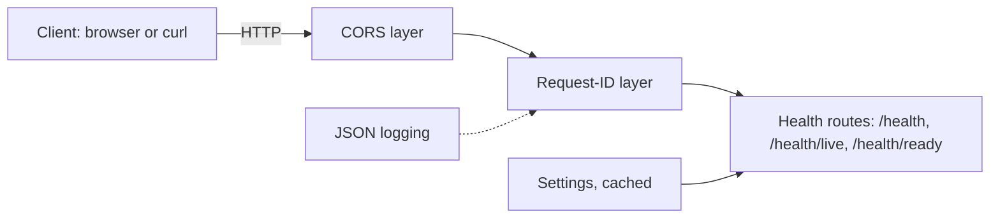
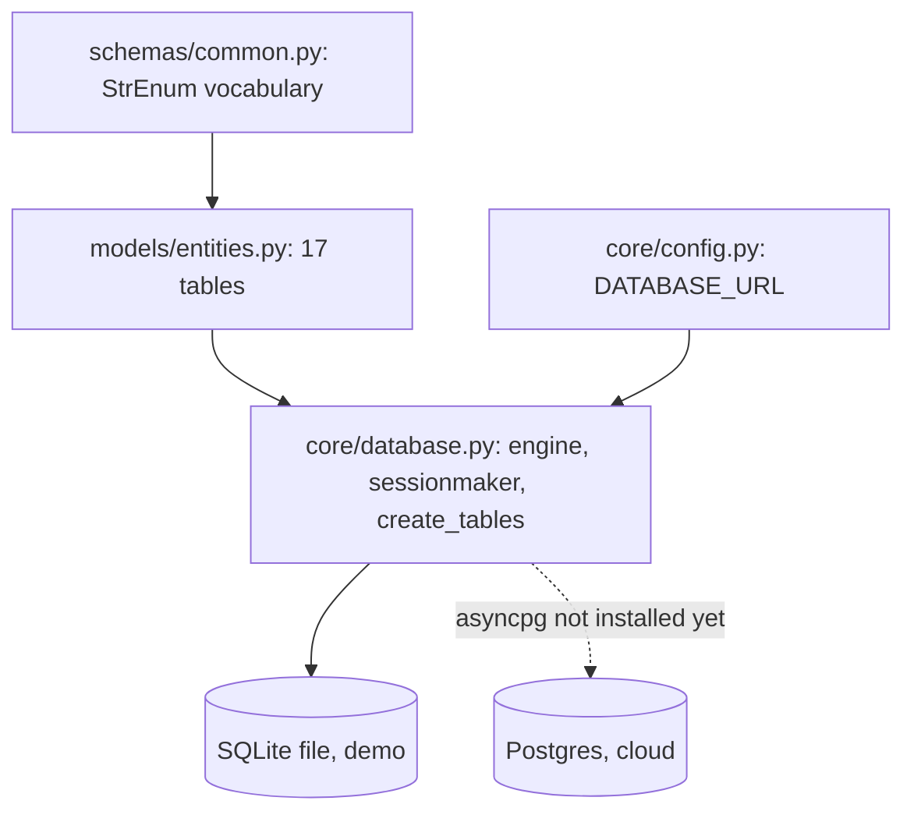
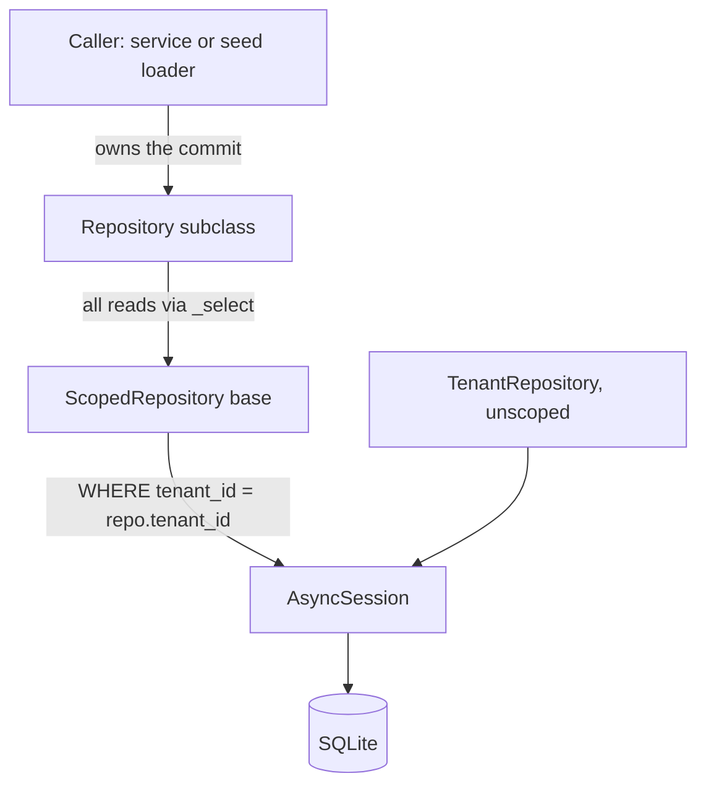
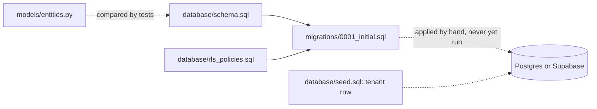
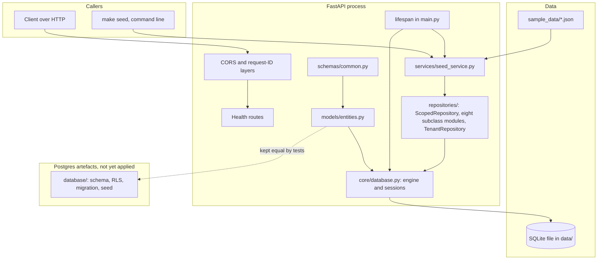
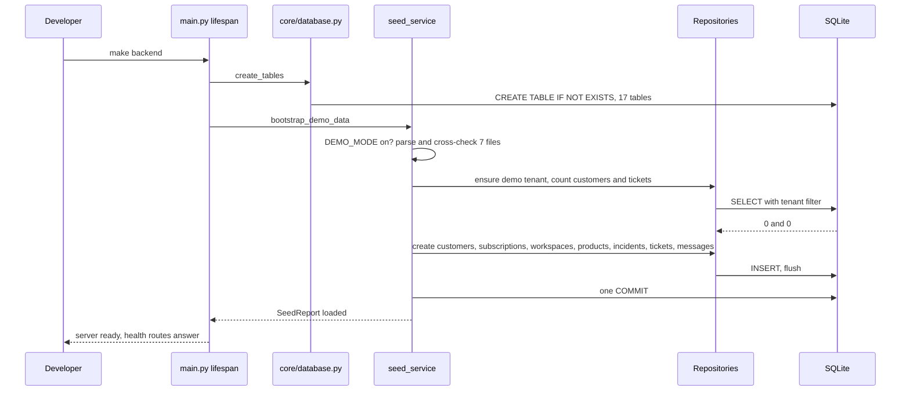

# Phase 2: system design evolution

> **What this document is.** How the CloudDesk architecture changed during Phase 2, "Persistence and demo data", from a service with no data at all to a service that owns a tenant-scoped data layer and fills it with a demo scenario at startup. It describes only what exists in the repository today. Where something is planned, it says so.
>
> **Status of this phase:** tasks P2-1 to P2-4 are merged (pull requests #26, #27, #28 and #29, merge commits `cee4332`, `ac7515b`, `7ddaadb` and `aa2ea62`, all on 2026-11-22). Checked locally only: 659 tests pass across the whole suite and `ruff check` is clean (run for this document, 2026-11-22). Nothing in this phase has ever run against Postgres, and nothing is deployed. The phase status tables in `CLAUDE.md` and `PLAN.md` are the owner's to update.
>
> **Related documents:** [codebase explanation](./01_CODEBASE_EXPLAINED.md), [infrastructure evolution](./03_INFRA_EVOLUTION.md) and [interview Q&A](./04_INTERVIEW_QNA.md) (local only). The previous phase is in [Phase 1 design evolution](../Phase01/02_DESIGN_EVOLUTION.md).
>
> **Mermaid.** Every diagram below was checked for structure only (`tests/unit/test_phase_doc_checks.py`). None was rendered, because no renderer is available offline.

---

## A. Phase overview

**Objectives.** Give CloudDesk somewhere to keep data and something to keep in it:

1. a portable data model that runs on SQLite for the demo and on Postgres in the cloud (P2-1);
2. one place where all SQL lives, and one place where the tenant filter lives (P2-3);
3. the Postgres version of the same schema, with row-level security and a migration (P2-2);
4. a fictional demo scenario that loads itself on first start (P2-4).

**Initial system state.** The Phase 1 skeleton: one FastAPI process with settings, JSON logs, request IDs and three health routes. No database engine, no table, no row.

**Requirements addressed.**

| Requirement | Where Phase 2 touches it |
|---|---|
| D1 (settled 2026-11-02): `tenant_id` on every data table, RLS keyed on it | `tenant_id` in every model, every index and every policy; one seeded tenant |
| F1 (tickets from several channels) | The `tickets` table, the channel enum, `TicketRepository.create` |
| F4 (customer, subscription, workspace, previous tickets, memory) | The customer, subscription, workspace, ticket and memory repositories, and the seeded data they read |
| F14 (runs offline in demo mode) | SQLite as the demo database, `DEMO_MODE`-gated seeding |
| Rule 12 (migrations are additive, an applied migration never changes) | `database/migrations/0001_initial.sql` and the test that pins its hash |

No API route for tickets exists yet. The data layer is reachable only from tests, from `make seed` and from the startup code.

**Major architectural additions.** A domain vocabulary module, 17 SQLAlchemy models, an async engine and session factory, ten repository modules, a Postgres schema with RLS policies, a seed loader, and a lifespan that creates tables and seeds data.

**Important design change.** The planned multi-tenant boundary moved from "a promise in CLAUDE.md" to code: a column on every table, a filter in one base class, and policies in SQL, each with tests.

**Final capabilities.** After `make backend` (or `make seed`) on an empty machine, a SQLite file holds 8 customers, 13 tickets and their first messages, ready to be read through repositories. Starting again adds nothing.

---

## B. Initial architecture

At the start of Phase 2 the system is the Phase 1 skeleton.

| Aspect | State at the start of Phase 2 |
|---|---|
| Main components | App factory, settings, logging, request-ID middleware, health routes |
| External dependencies | None |
| Data stores | None. `DATABASE_URL` existed as a setting but nothing opened it. |
| Request entry points | `/health`, `/health/live`, `/health/ready` |
| Communication paths | Client to process over HTTP; plain function calls inside |
| Major limitations | Nothing could be stored, read or seeded. The readiness route could only check that the database setting looked sensible. |

---

## C. Intermediate architectural evolution

The tasks merged in the order P2-1, P2-3, P2-2, P2-4. (P2-2 and P2-3 both needed only P2-1, and TASKS.md allows them in parallel.) The steps below follow that merge order.

### Step 1. The portable data model (P2-1, PR #26)

- **Original design.** No data model.
- **Motivation.** The demo must run offline on SQLite and the cloud build on Postgres. One model definition for both avoids two drifting copies.
- **Introduced.** `backend/app/schemas/common.py` holds the domain vocabulary as `StrEnum`s: 10 categories, 7 ticket statuses, 4 severities and 4 channels, plus the smaller enums the tables need (role, memory type, approval status, action status, escalation status, workflow status, message role, workflow event type). `backend/app/models/entities.py` holds the SQLAlchemy 2 models: `tenants` and 16 data tables. `backend/app/core/database.py` holds the async engine, session factory and `create_tables()`.
- **How portability is achieved.** JSON instead of JSONB, `String(36)` ids, and enum columns stored as VARCHAR with a CHECK constraint (`native_enum=False`), so Postgres needs no `CREATE TYPE`. The vocabulary is defined once and the models import it; a test compares it with `docs/design/06_API_CONTRACT.md`.
- **D1 in the model.** `TenantMixin` adds a not-null, indexed `tenant_id` with a foreign key to `tenants.id`, and it is the first column of every composite index and unique constraint. A test loops over `Base.metadata.tables`, so a table added later cannot omit the column. `DEMO_TENANT_ID` is a fixed, valid UUID, because the planned RLS policies cast with `::uuid`.
- **SQLite behaviour.** `backend/app/core/database.py` creates the database file's parent directory and runs `PRAGMA foreign_keys=ON` on every connection, so a row pointing at a missing tenant is rejected as Postgres would reject it.
- **Effect on existing components.** None. Nothing imported the model yet.
- **Benefits and trade-offs.** One definition for two databases. The cost is lowest-common-denominator types: no native enums, no JSONB operators, no database-side UUIDs.
- **Status.** Completed and verified on SQLite. Tests: `tests/unit/test_entities.py`, `tests/unit/test_database.py`, `tests/unit/test_common_schemas.py`.

### Step 2. The repository layer (P2-3, PR #27)

- **Original design.** Models existed, but nothing said who may query them or who adds the tenant filter.
- **Motivation.** D1 says no router, service, agent or tool may write `tenant_id` into a query, so it cannot be forgotten in one of them. SQLite has no RLS, so on the demo database the filter is the only boundary.
- **Introduced.** `backend/app/repositories/base.py` defines `ScopedRepository`, built with an `AsyncSession` and a tenant id (default `DEMO_TENANT_ID`). Every read goes through `_select()`, which adds the tenant filter. Every insert goes through `_add()`, which stamps the tenant and raises `ValueError` if the object already carries another tenant. Eight modules subclass it, one per group of tables. `backend/app/repositories/tenants.py` holds `TenantRepository`, the one unscoped repository, because it manages the `tenants` table itself.
- **Flush, never commit.** Repositories flush and leave the commit to the caller, so one request is one transaction. A caller that forgets to commit loses its writes.
- **Timestamps.** SQLite's `CURRENT_TIMESTAMP` has whole-second resolution and the Windows clock ticks about every 15 ms, so `_add` sets a strictly increasing microsecond `created_at` to keep insertion order recoverable.
- **Effect on existing components.** The engine and models are now used through one narrow interface. Pagination is capped at 100 rows a page (`MAX_PAGE_SIZE`).
- **Benefits and trade-offs.** The boundary is in one file and is testable. The cost is that a repository method that forgets `_select()` would silently leak, which is why two test files exist to catch exactly that.
- **Status.** Completed and verified on SQLite. Tests: 78 tests under `tests/unit/repositories/`.

### Step 3. The Postgres schema, RLS and migrations (P2-2, PR #28)

- **Original design.** The models could build SQLite tables, but the cloud database needs real DDL, policies and a migration history.
- **Motivation.** CLAUDE.md section 6 promised RLS on every data table, keyed on `tenant_id`. The Supabase SQL editor takes SQL, not Python.
- **Introduced.** `database/schema.sql` (17 tables in foreign-key order, indexes, `set_updated_at()` and one `BEFORE UPDATE` trigger per table). `database/rls_policies.sql` (RLS enabled and forced on every table, one `tenant_isolation` policy each). `database/seed.sql` (the demo tenant row only). `database/migrations/0001_initial.sql` (the schema followed by the policies).
- **Type mapping (owner decision O1).** Models keep `String(36)`; the SQL uses `uuid` for every id and `tenant_id`, because Postgres has no `varchar = uuid` operator and the policy text needs a uuid column. `String(n)` becomes `varchar(n)`, enums become `varchar(32)` plus a CHECK, `JSON` becomes `jsonb`, `DateTime(timezone=True)` becomes `timestamptz`, `Float` becomes `double precision`.
- **Verification without a database.** `tests/unit/sql_ddl.py` is a small parser for the constrained SQL format that raises on any statement it does not recognise. Tests compare `schema.sql` with the models (tables, columns, types, nullability, defaults, enum values, foreign keys, tenant-first indexes), check that every table found in `schema.sql` has RLS, and check that the migrations in order equal the schema plus the policies. `test_applied_migrations_are_unchanged` pins the SHA-256 of `0001_initial.sql` (rule 12).
- **Effect on existing components.** None at runtime. The SQL is used by hand, and the tests keep it in step with the models.
- **Benefits and trade-offs.** Drift between the Python models and the SQL fails a test. The cost is that "the SQL is valid Postgres" is unproven: nothing was applied to a real instance.
- **Status.** Written and checked against the models; **not applied to any Postgres**. Tests: `tests/unit/test_schema_sql.py`, `tests/unit/test_rls_policies.py`, `tests/unit/test_migrations.py`, `tests/unit/test_seed_sql.py`, `tests/unit/test_sql_ddl_parser.py`.

### Step 4. Sample data and the startup bootstrap (P2-4, PR #29)

- **Original design.** Tables could be created and queried, but they were empty, so no later phase had a ticket to work on.
- **Motivation.** F14 (the demo runs offline) and the demo scenario in CLAUDE.md section 5 need CD-1001 to CD-1013 present on a fresh machine.
- **Introduced.** `sample_data/` holds seven fictional JSON files. `backend/app/services/seed_service.py` validates them with strict Pydantic records, cross-checks them, and writes them through the repositories in one transaction. `backend/app/main.py` gains a lifespan, and `make seed` runs the same loader by hand.
- **Startup order.** `create_tables()`, then `bootstrap_demo_data()`, then the application serves, and `dispose_engine()` on shutdown. A database error at startup is logged as the exception class and a redacted URL, with no traceback, and is swallowed, so `/health/ready` can still answer `degraded` instead of the process refusing to start.
- **Gates.** Nothing is written unless `DEMO_MODE` is true, and nothing when the database already holds a customer or a ticket. The files are parsed and cross-checked before the first write, so a bad record raises `ValueError` naming it and the database stays empty. If two workers pass the emptiness check together, a unique key makes the second commit fail and that is reported as "not empty".
- **Deterministic ids.** Each id is `uuid5` of `kind:key` under a fixed namespace, so `CD-1002` has the same id on every machine.
- **Deliberately not loaded.** `sample_data/previous_resolutions.json` is validated and left on disk for the Knowledge Agent, because no table holds it and loading it as tickets would break the count of 13.
- **Effect on existing components.** `main.py` is no longer only a wiring file: its lifespan now performs I/O at startup. `/health/ready` is unchanged and still does not open a connection.
- **Benefits and trade-offs.** A fresh clone has data with no extra step. The cost is that a startup database failure is logged and hidden from the process exit code.
- **Status.** Completed and verified on SQLite only. Tests: `tests/api/test_startup_seed.py`, `tests/unit/test_seed_service.py`, `tests/unit/test_sample_data.py`.

---

## D. Final architecture

| Layer | Phase 2 component | Responsibility |
|---|---|---|
| Presentation | none | no screens |
| API | `backend/app/api/health.py` only | still only health routes; no ticket route exists |
| Services | `backend/app/services/seed_service.py` | the only service: load and validate demo data, one transaction |
| Domain vocabulary | `backend/app/schemas/common.py` | the single definition of categories, statuses, severities, channels |
| Data access | `backend/app/repositories/` | all SQL, all tenant filtering |
| Persistence | `backend/app/models/entities.py`, `backend/app/core/database.py` | portable models; engine, sessions, table creation |
| Database | SQLite (demo) | the only database that has actually run |
| Postgres artefacts | `database/` | DDL, RLS, migration; unproven against a server |
| Security boundary | the repository filter | on SQLite it is the only tenant boundary; RLS is written but unexercised |
| Orchestration, AI, workers, observability beyond logs | none | later phases |

---

## E. End-to-end execution and data flow

The representative flow of this phase is first startup on an empty database.

Numbered, with the failure paths:

1. `make backend` starts uvicorn; the lifespan runs before the first request.
2. `create_tables()` builds any missing table. It never alters or drops a table, so on an existing database it does nothing.
3. `bootstrap_demo_data()` returns at once if `DEMO_MODE` is false (reason `demo_mode_off`).
4. It parses all seven files. A malformed record raises `ValueError` naming the file and record. Nothing is written.
5. It ensures the demo tenant row exists, then counts customers and tickets through the scoped repositories. Any rows mean `not_empty` and a rollback.
6. It writes every record and commits once. An `IntegrityError` (another worker won the race) is reported as `not_empty`; any other failure rolls back and is re-raised.
7. The lifespan catches a raised error, logs the class and a redacted URL, and carries on. `/health/ready` still reports on configuration only.
8. A second start finds rows at step 5 and adds nothing.

---

## F. Architectural decisions and trade-offs

| Field | D1: tenant column and RLS from the first migration |
|---|---|
| Decision | Every data table carries `tenant_id`; RLS is keyed on it; one tenant is seeded and none is created at runtime |
| Context | CLAUDE.md promised RLS on all tables while the table list had no column to key a policy on |
| Alternatives | Single-tenant tables now and a retrofit later |
| Rationale | Adding the column later means migrating 16 tables, every query and every test at once |
| Benefits | Multi-tenant ready with no tenant features to maintain |
| Trade-offs | Every composite index leads with `tenant_id`; every row has an extra column |
| Status | Implemented in models, SQL and tests. Policies unexercised on a real Postgres. |

| Field | Portable models (JSON, String(36), VARCHAR plus CHECK) |
|---|---|
| Decision | One set of models for SQLite and Postgres |
| Context | Demo must run offline on SQLite; cloud runs Postgres |
| Alternatives | Postgres-native types plus a separate SQLite model; Postgres-only with Docker for the demo |
| Rationale | One definition, no Docker needed for a demo |
| Benefits | Offline tests that need no server |
| Trade-offs | No native enums or JSONB; the SQL needed an explicit type mapping (O1) |
| Status | Implemented |

| Field | The repository is the only place the tenant filter lives |
|---|---|
| Decision | `ScopedRepository._select()` adds the filter; no other layer writes the tenant column |
| Context | Forgetting a filter in one query is a data leak |
| Alternatives | A filter in each service; a SQLAlchemy event hook that rewrites every query |
| Rationale | One file to audit, plus static tests that scan other layers |
| Benefits | A leak needs a repository bug, not a developer lapse |
| Trade-offs | A method that bypasses `_select()` leaks; tests guard this by classification and by scanning for `session.get` and raw SQL |
| Status | Implemented and tested on SQLite |

| Field | Repositories flush, callers commit |
|---|---|
| Decision | No repository calls `commit()` |
| Context | One request should be one transaction |
| Alternatives | Commit inside each repository method |
| Rationale | The seed loader gets all-or-nothing loading; later services can group writes |
| Benefits | Atomicity at the caller's level |
| Trade-offs | Forgetting to commit silently loses writes |
| Status | Implemented |

| Field | UUID columns are `uuid` in SQL but `String(36)` in the models (O1) |
|---|---|
| Decision | Two representations of the same id |
| Context | Postgres has no `varchar = uuid` operator; the RLS policy compares to `current_setting(...)::uuid` |
| Alternatives | `varchar` columns and a cast in the policy; a SQLAlchemy UUID type in the models |
| Rationale | Keeps the models portable to SQLite |
| Benefits | Policies compare like with like |
| Trade-offs | With a real `asyncpg` connection, uuid columns return `UUID` objects, so the first task that connects must add a type decorator. That work is planned, not built. |
| Status | SQL and models implemented; the decorator does not exist |

| Field | Seed through the repositories with deterministic ids |
|---|---|
| Decision | `uuid5` ids; one transaction; validate before writing |
| Context | Tickets reference customers by key in the JSON; ids must be stable and valid UUIDs |
| Alternatives | Random ids with lookups; a SQL seed file |
| Rationale | Same id for CD-1002 everywhere, and the loader never names the tenant column |
| Benefits | Reproducible demo; reuse of the tested tenant-scoped path |
| Trade-offs | The loader must be kept in step with the JSON by hand |
| Status | Implemented on SQLite |

---

## G. Architectural improvements

| Quality | Initial design | Final design (supported by the code and tests) |
|---|---|---|
| Separation of responsibilities | Nothing to separate | Vocabulary, models, engine, repositories and loader are separate modules; a static test bans agents, HTTP and model clients from repositories |
| Modularity | Not applicable | One repository per table group; the one unscoped repository is explicit |
| Maintainability | Not applicable | One vocabulary file; SQL and models kept equal by tests; a migration pinned by hash |
| Scalability | Not applicable | Not improved. SQLite is one file; pagination is capped at 100. |
| Performance | Not applicable | Not measured. Composite indexes exist; no query was timed. |
| Reliability | Not applicable | All-or-nothing seeding; startup tolerates a bad database |
| Security | Not applicable | Tenant filter in one place, tested with two tenants; RLS written but unproven; secrets redacted in startup errors |
| Testability | Offline harness | Tests use a per-test SQLite file; no server needed |
| Extensibility | Not applicable | A new table needs a model, a repository and the SQL; tests fail if a table lacks `tenant_id` or RLS |

No performance or scalability claim is made, because none was measured.

---

## H. Limitations and future evolution

**Existing limitations.**

- No Postgres run exists. The DDL syntax, the policies and the type mapping are unproven. `asyncpg` is not installed.
- RLS depends on `SET LOCAL app.tenant_id` per transaction. Nothing issues it yet, and who does is an open question in CLAUDE.md section 6. Supabase's `service_role` has `BYPASSRLS`, so there the policies would not constrain the backend; the repository filter stays the boundary.
- `create_tables()` only creates missing tables. It does not migrate, so changing a model needs a new migration file and a manual apply on Postgres.
- There is no ticket API, no authentication and no `/health/ready` check that really opens the database.
- Demo login profiles, knowledge articles and customer memory are not seeded. `profiles`, `support_articles` and `customer_memory` have repositories but no data.
- A startup database failure is logged and hidden from the exit code.
- Seeding two workers at once is handled by unique keys, not by a lock, and was tested with an `IntegrityError` path rather than a real race.

**Recommendations, not built.** Run the SQL against a Postgres container once Docker exists; add the UUID type decorator before the first `asyncpg` connection; have `/health/ready` run a trivial query; decide who issues `SET LOCAL app.tenant_id`.

---

## I. Phase completion summary

| Item | Result |
|---|---|
| Components introduced | Domain vocabulary, 17 models, async engine and sessions, 10 repository modules, Postgres schema plus RLS plus migration, seed loader, lifespan bootstrap, seven sample data files |
| Important decisions | D1 (tenant column and RLS), portable models, repository-owned tenant filter, flush-not-commit, O1 uuid mapping, deterministic seeding |
| Verified outcomes | 659 tests pass in the whole suite and `ruff check .` is clean (run 2026-11-22). The files covering this phase hold about 301 of those tests. All of them ran on SQLite or on SQL text, never on Postgres. |
| Outstanding work | Real Postgres run; `asyncpg` and the uuid decorator; the `SET LOCAL` issuer; an API on top of the repositories; seeding of profiles, articles and memory |
| Carried into Phase 3 | `Profile` model and `ProfileRepository` (for login), `AuditLogRepository` (for the audit middleware), `get_session` (for request-scoped sessions) |
