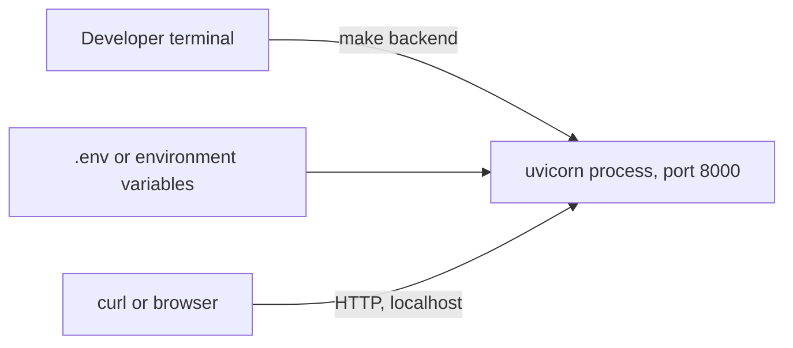
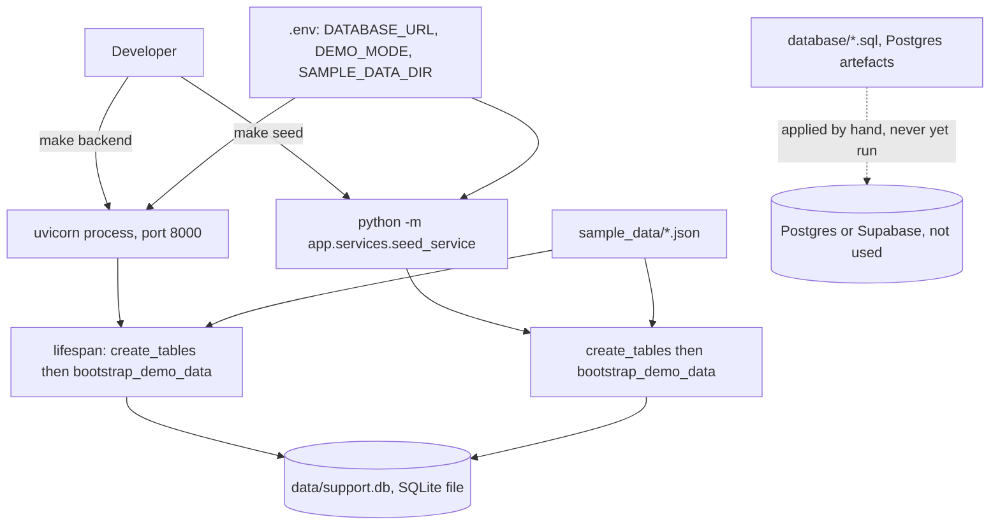
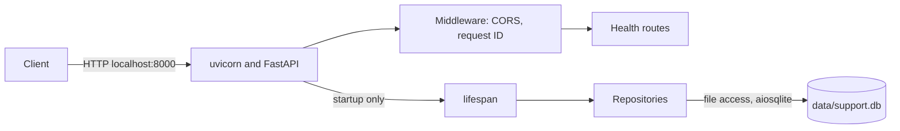
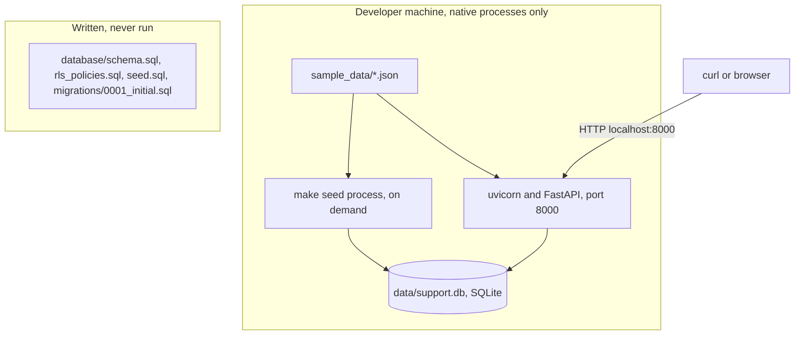

# Phase 2: infrastructure design evolution

> **Read this first.** Phase 2 still has **no Docker, no Docker Compose, no containers, no Postgres server, no Redis, no reverse proxy, no continuous-integration pipeline and no deployment**. I checked the repository root: there is no `Dockerfile`, no Compose file, no `.dockerignore`, no `.github` workflows folder and no `deployment` folder.
>
> What Phase 2 adds to the infrastructure is **one local file**, the SQLite database `data/support.db`, a startup routine that creates and fills it, one new Make target (`make seed`), and a set of Postgres SQL files that have been written but never run. This document explains that honestly. Container ideas appear only as concepts marked planned. Nothing below claims a container exists.
>
> **Related documents:** [codebase explanation](./01_CODEBASE_EXPLAINED.md), [system design evolution](./02_DESIGN_EVOLUTION.md) and [Phase 1 infrastructure evolution](../Phase01/03_INFRA_EVOLUTION.md).
>
> **Mermaid.** Diagrams were checked for structure only, not rendered.

---

## A. Infrastructure overview

| Question | Answer in Phase 2 |
|---|---|
| Where does it run? | On the developer's machine, as one Python process, plus one SQLite file next to it |
| What runs in Docker containers? | Nothing |
| What is externally hosted? | Nothing. The Postgres artefacts in `database/` are meant for a hosted Postgres (Supabase), but no such database is used. |
| How is it started? | `make backend`, which runs `uv run uvicorn app.main:app --app-dir backend --reload --port 8000`. The startup routine then creates the tables and seeds the demo data. |
| Seeding without the server | `make seed`, which runs `python -m app.services.seed_service` with `PYTHONPATH=backend` |
| How do components communicate? | Plain function calls inside one process. The database driver (`aiosqlite`) reads and writes the file in the same process. There is no database network connection. |
| How is configuration supplied? | Environment variables or `.env`: `DATABASE_URL`, `DEMO_MODE` and `SAMPLE_DATA_DIR` matter here |
| How is it stopped? | Ctrl+C. The lifespan then runs `dispose_engine()`, which closes the database connections. |

**Development versus deployment.** Only development exists. The cloud database is represented by SQL files only.

---

## B. Initial infrastructure design

At the start of Phase 2 the infrastructure is Phase 1's: one process, no storage.

`DATABASE_URL` already existed as a setting with the default `sqlite+aiosqlite:///./data/support.db`, but nothing opened it.

---

## C. Infrastructure evolution

### Change 1. A SQLite file as the demo database (P2-1)

- **Before.** No storage.
- **Added.** `backend/app/core/database.py` opens the URL in `DATABASE_URL`. For SQLite it creates the parent folder if missing (the SQLite driver will not) and runs `PRAGMA foreign_keys=ON` on every new connection. `create_tables()` builds missing tables.
- **Why.** The demo must run offline with no server to install.
- **Services affected.** The FastAPI process only.
- **Communication.** The process reads and writes `data/support.db` through the file system. No port.
- **Verified.** `tests/unit/test_database.py` runs it on temporary SQLite files: tables are created, creation is idempotent, a missing folder is created, and foreign keys are enforced.

### Change 2. Postgres SQL artefacts (P2-2)

- **Before.** The only database form was the Python models.
- **Added.** `database/schema.sql`, `database/rls_policies.sql`, `database/seed.sql` and `database/migrations/0001_initial.sql`, meant to be pasted into the Supabase SQL editor or run with a Postgres client.
- **Why.** The cloud database needs real DDL, row-level security and a migration history.
- **Communication.** None yet. The files are applied by hand. At run time the repositories would announce their tenant with `SET LOCAL app.tenant_id`, but nothing issues that statement yet.
- **Verified.** By text comparison only: tests parse the SQL and compare it with the models. **Nothing was applied to a Postgres instance**, so syntax, triggers and policy behaviour are unproven.

### Change 3. Demo data files and the startup routine (P2-4)

- **Before.** An empty database after `create_tables()`.
- **Added.** `sample_data/` (seven JSON files), the lifespan in `backend/app/main.py`, and the `seed` target in `Makefile`.
- **Why.** A fresh clone should have a working scenario with no manual step.
- **Gates that protect the file.** Seeding does nothing outside `DEMO_MODE`, and nothing if a customer or ticket exists.
- **Verified.** `tests/api/test_startup_seed.py` starts the app on a temporary database and checks 13 tickets and 8 customers appear once, a second start adds nothing, demo mode off creates tables but loads nothing, and an unusable database neither crashes startup nor leaks a secret into the log. `tests/unit/test_seed_service.py` covers the `make seed` entry point.

---

## D. Docker and container explanation

**There are no containers in Phase 2.** The table the specification asks for is not filled in, because no service, image or Compose file exists. CLAUDE.md section 15 plans a `backend/Dockerfile`, a `frontend/Dockerfile` and a Compose file with `redis` and `qdrant`; none is built. When they arrive, the SQLite file will need a named volume or the demo database will vanish with the container. That is a recommendation, not a fact about the repository.

## E. Docker networking

Not applicable. The only communication is a client calling `localhost:8000` over HTTP, as in Phase 1, and a same-process file access to the SQLite database. When Postgres runs in a container later, `localhost` inside the backend container will not reach it; the service name on the Compose network will. That is planned and untested.

## F. Component wiring and routing

There is still **no route that reads the database**. The three health routes are the only HTTP paths, and `/health/ready` still checks configuration without opening a connection.

## G. Lifecycle commands

| Command | Effect |
|---|---|
| `make setup` | Installs dependencies with `uv sync`, points git at `.githooks`, copies `.env.example` (removed 2026-11-27) to `.env` if absent |
| `make backend` | Starts the server with auto-reload on port 8000; creates tables and seeds on startup |
| `make seed` | Creates tables and seeds once, then prints "seeded: 8 customers, 13 tickets" or "already seeded"; exits with 1 and a message if `DEMO_MODE` is false |
| `make test`, `make lint` | Runs the suite or ruff |
| Stop | Ctrl+C in the terminal that is running the server |

**Resetting the demo database.** The `data/` folder is git-ignored, so deleting `data/support.db` while the server is stopped discards all demo data and the next start recreates it. This is destructive: any change made to the file is lost. There is no backup or restore procedure.

## H. Environment variables and secrets

| Variable | Used by | Safe default | Notes |
|---|---|---|---|
| `DATABASE_URL` | `backend/app/core/database.py` | `sqlite+aiosqlite:///./data/support.db` | For Postgres it would be an `asyncpg` URL, which needs a package that is not installed. It may contain a password, so startup errors print only a redacted form. |
| `DEMO_MODE` | `backend/app/services/seed_service.py` | `true` | Seeding refuses to run when false |
| `SAMPLE_DATA_DIR` | `backend/app/services/seed_service.py` | `./sample_data` | Folder of the seven JSON files |

Real values go only in `.env`, which is git-ignored. `.env.example` (removed 2026-11-27) holds placeholders. A cloud `DATABASE_URL` would be supplied by the deployment environment, never committed. No secret appears in this document.

## I. Persistent storage and data management

| Item | State |
|---|---|
| Database file | `data/support.db`, created at first start. `data/` and `*.db` are git-ignored. |
| Initialisation | `create_tables()` then `bootstrap_demo_data()` |
| Named volumes, bind mounts | None, because there are no containers |
| Cache persistence | None; no Redis yet |
| Migrations on SQLite | None. `create_tables()` only creates missing tables, so adding a column to a model does not change an existing file. Delete the file to rebuild. |
| Migrations on Postgres | `database/migrations/0001_initial.sql`, applied by hand, never yet applied |
| Backup and restore | **Missing.** Copying the stopped SQLite file is the only option and is not documented as a procedure. |

## J. Health checks, startup order and resilience

- **Startup order.** Tables, then seed, then serve. Both steps run inside one `try`; on failure the process logs the exception class and a redacted URL and still serves.
- **Readiness.** `/health/ready` does not open the database, so after a failed startup it can report "ready" on configuration while the data layer is broken. A trivial query is recommended, not built.
- **Timeouts and retries.** None on database calls.
- **Restart policy.** None; no supervisor or container.
- **Concurrency.** Two processes seeding at once are caught by unique keys (reported as "not empty"), tested through the `IntegrityError` path.

## K. Observability and troubleshooting

- **Logs.** JSON lines on standard output with `request_id`. A seed logs "demo data seeded" with row counts; a startup failure logs "database startup failed" with `error_type` and `database_url` (password redacted).
- **No** metrics, tracing or dashboards.

| Symptom | Check |
|---|---|
| No demo data after start | Was `DEMO_MODE` true? Does `data/support.db` already contain a customer or ticket? Look for "database startup failed" in the log |
| Seed refused | `make seed` prints "DEMO_MODE is false" when the setting is off; the setting is cached, so restart after editing `.env` |
| Unexpected data | The seed never overwrites; stop the server and delete `data/support.db` to rebuild |
| Port 8000 in use | Stop the other process or change `--port` in the `Makefile` |
| Postgres URL fails | `asyncpg` is not installed; not supported yet |

## L. Final infrastructure architecture

There are no containers, no networks, no volumes, no monitoring components and no external dependencies.

## M. Infrastructure verification

| Check | Result |
|---|---|
| Whole test suite and lint | 659 tests passed and `ruff check .` was clean (run 2026-11-22) |
| Tables created on SQLite | Verified by `tests/unit/test_database.py` on temporary files |
| Seed on first start, nothing on the second | Verified by `tests/api/test_startup_seed.py` |
| Broken database does not stop startup or leak a secret | Verified by the same file, using a bad URL |
| Foreign keys enforced on SQLite | Verified |
| Postgres SQL | **Not verified.** Only compared with the models as text. |
| `make backend` and `make seed` run by hand for this document | **Not run for this document.** The seed entry point is covered by a test; I did not start the server. |
| Docker, networks, DNS, health checks of containers | Do not exist |
| Persistent volumes, backup and restore | Do not exist |
