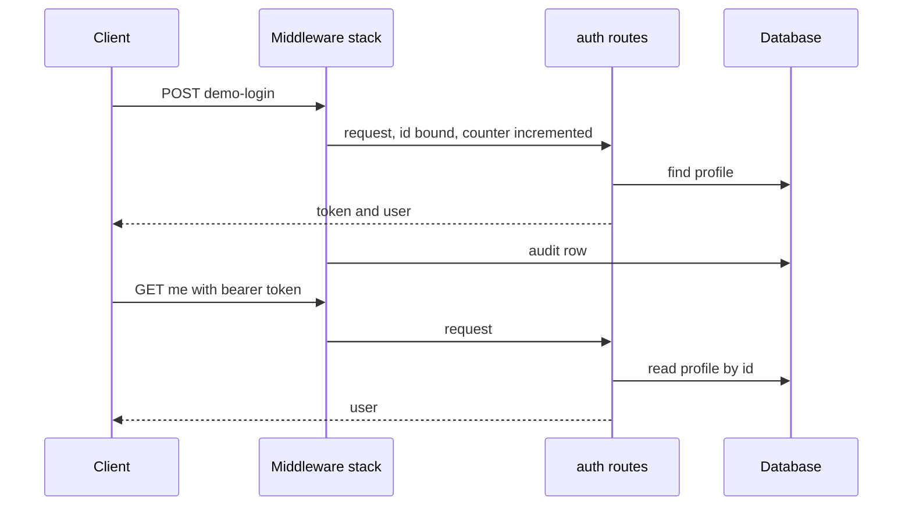

# Phase 3 explained: identity and request guards

> **What this document is.** A plain-language explanation of the code written in Phase 3 of CloudDesk, for explaining it to recruiters, hiring managers and interview boards. It describes only what exists in the repository today.
>
> **Status of this phase:** implemented and checked locally. In a run made for this document (2026-11-22) the whole suite passed (708 tests) and `ruff check .` reported no problems. Nothing is deployed. Phase 3 has **no ticket API, no login screen, no AI model, no Docker and no real Redis or Supabase run**.
>
> **Related documents:** [system design evolution](./02_DESIGN_EVOLUTION.md), [infrastructure evolution](./03_INFRA_EVOLUTION.md), the local-only `04_INTERVIEW_QNA.md`, and [Phase 2 explained](../Phase02/01_CODEBASE_EXPLAINED.md).

---

## A. Executive summary

**The 30-second version, ready to say out loud:**

"After Phase 2 CloudDesk had a database full of demo tickets but anyone could ask it anything. Phase 3 adds the front desk. A demo user can sign in and get a signed pass that expires after eight hours. The pass says who they are and whether they are a viewer, an agent or an admin, and any later route can say 'agents and above only'. On top of that, every visitor is limited to 120 requests a minute, every response carries a tracking number, and every request that changes something is written in a logbook with who did it. There are still no business screens, but the doors now have locks, a counter and a guest book."

**What the phase accomplished.**

- Signed tokens (JWT) and a role ladder: viewer, then agent, then admin.
- Two routes: demo login and "who am I".
- A rate limiter backed by Redis (or a built-in fake Redis).
- An audit middleware that logs state-changing requests to the `audit_logs` table.
- A fixed order for the four middleware layers.

**Why it was necessary.** Phase 4 (support API) must reject unauthenticated callers and viewers who try to act. Phases 11 and 12 need the audit trail and the login. Doing the guards before the routes means no route ever ships unguarded.

| | Before Phase 3 | After Phase 3 |
|---|---|---|
| Who is calling? | Unknown | A signed token names the profile and role |
| Can a role be required? | No | `require_role("agent")` on any route |
| Request volume | Unlimited | 120 per minute per client (configurable) |
| Record of changes | None | One `audit_logs` row per non-read request |
| Demo users | Not in the database | Three seeded profiles |

---

## B. Business problem and solution

1. **Problem.** Support agents handle money and accounts. The business must know who did what, and must ensure a read-only colleague cannot approve a refund.
2. **Limitation of before.** No identity, so no permission could be enforced, and nothing could be audited.
3. **Solution.** Identity by signed token, permission by role rank, accountability by an audit log, fairness and protection by a rate limit.
4. **Benefit.** Every later route gets all four for free, because three are middleware and one is a one-line dependency.
5. **Why appropriate.** JWT is what Supabase issues, so the demo token and a real one are read by the same code. Fixed-window counters are the simplest limiter that works across several server processes.

Analogy: a building with a reception desk. The desk issues badges (login), the doors check the badge level (roles), a turnstile counts entries (rate limit), and a security log records every time someone moves something (audit).

---

## C. Application architecture in simple language

| Component | What it is | Receives | Produces | If removed |
|---|---|---|---|---|
| Token and role module | The badge printer and the door reader | A role and id; or a token | A signed token; or a verified user or 401/403 | No route could know the caller |
| Auth routes and service | The reception desk | An email or role | A token and the user | Nobody could obtain a token |
| Redis client | The shared tally board | Counter commands | Counts | The limiter would have nowhere to count |
| Rate limit middleware | The turnstile | Every request | Pass, or 429 with `Retry-After` | One caller could flood the API |
| Audit middleware | The guest book | Every non-read request | A row in `audit_logs` | No record of changes (N6) |
| Request id middleware (Phase 1) | The tracking number | Every request | `X-Request-ID` on the response and in logs | The audit row and logs could not be tied to a request |

Technical terms. **JWT** (JSON Web Token): a small text that carries claims (who, role, expiry) and a signature made with a secret; anyone with the secret can check it was not altered. **Middleware**: code that wraps every request. **Fixed window**: counting requests per calendar minute.

---

## D. Codebase structure and file-by-file explanation

| File | Responsibility and key parts | Inputs, outputs | Interview explanation |
|---|---|---|---|
| `backend/app/core/security.py` | `create_access_token`, `decode_token`, `Principal`, `get_current_user`, `require_role`, `ROLE_RANK`. HS256 only; `exp` and `sub` required; unknown role refused. One 401 text for any bad token. | In: bearer header. Out: `Principal` or 401/403 | "The only place that knows what a valid token is." |
| `backend/app/core/config.py` | `effective_jwt_secret` (Supabase secret if set, else `JWT_SECRET`), `redis_url`, `use_fake_redis`, `rate_limit_per_minute`, `demo_mode` | Environment | "One place for every setting." |
| `backend/app/api/auth.py` | `demo_login` (404 if not demo mode, 401 for unknown user) and `me` | HTTP bodies | "Thin routes; rules live in the service." |
| `backend/app/schemas/auth.py` | `DemoLoginRequest` (needs email or role, extra fields refused), `User`, `TokenResponse` | JSON | "The shape of what goes in and out." |
| `backend/app/services/auth_service.py` | `demo_login` looks up the profile by email or by first of a role; a mismatch raises `DemoLoginRefused`; `get_user` | Session, email, role | "Decides who may sign in." |
| `backend/app/repositories/profiles.py` | `ProfileRepository`, including `get_first_by_role` | Session | "Database questions about users, tenant filter included." |
| `sample_data/profiles.json` | Three demo users: admin, agent, viewer | File | "Who can log in." |
| `backend/app/core/redis.py` | `get_redis`: real Redis if `REDIS_URL` is set and `USE_FAKE_REDIS` is off, else an in-process fake; cached | Settings | "The counter store, with no server needed for the demo." |
| `backend/app/middleware/rate_limit.py` | `RateLimitMiddleware`: key `ratelimit:{client}:{minute}`, `INCR` then `EXPIRE` on first hit, 429 above the limit, `/health` exempt, fails open if Redis errors | Request scope | "The turnstile." |
| `backend/app/middleware/audit.py` | `AuditMiddleware`: skips GET, HEAD, OPTIONS; actor from a valid token else `anonymous`; resource type and id from the path; status code in `details`; write failure logged and swallowed | Request scope, response status | "The guest book." |
| `backend/app/repositories/audit.py` | `AuditLogRepository.append` and `list` | Fields | "The only code that writes audit rows." |
| `backend/app/middleware/request_id.py` | Phase 1 file; binds the id that audit reads | Header | "The tracking number." |
| `backend/app/main.py` | Mounts the auth router at `/api/v1` and registers middleware in order: CORS, RequestId, RateLimit, Audit (outermost first) | App | "Where the order is decided." |
| `tests/api/test_auth.py`, `tests/api/test_auth_routes.py`, `tests/api/test_rate_limit.py`, `tests/api/test_audit.py` | See section I | | |

---

## E. End-to-end execution flow

Example: Sam, an agent, signs in and then asks who they are.

1. `POST /api/v1/auth/demo-login` with `{"email": "sam.agent@clouddesk.demo"}`.
2. RequestId gives it a tracking number. RateLimit increments this client's counter for the current minute; it is under 120, so the request continues.
3. The route checks `DEMO_MODE`, asks `auth_service`, which finds Sam's profile and signs a token (subject = profile id, role, email, expiry in 8 hours).
4. The response holds `access_token`, `token_type` and `user`, never the secret.
5. Audit, after the response, writes a row: actor `anonymous` (no token was sent), action `POST /api/v1/auth/demo-login`, resource `auth`, status 200.
6. `GET /api/v1/auth/me` with `Authorization: Bearer <token>`. The dependency verifies the token, the service reads the profile by id and returns it. GET requests are not audited.

Errors: no or bad token gives 401 with `WWW-Authenticate: Bearer`; too low a role gives 403; over the limit gives 429 with `Retry-After`; demo login with an unknown user gives 401, with demo mode off gives 404, with an empty or unknown-role body gives 422.

---

## F. Technical concepts explained simply

- **Authentication versus authorization.** Who are you (401) versus what may you do (403).
- **Stateless tokens.** The server stores no session; the signature is the proof.
- **Pinned algorithm.** The code accepts only HS256, so a forged token that claims "no signature needed" is refused.
- **Rate limiting.** A counter per client per minute in Redis; the counter deletes itself after two minutes.
- **Fake Redis.** A Python imitation of Redis inside the process, so the demo and tests need no server.
- **Middleware order.** Outer layers see the request first and the response last, so a 429 still carries the tracking number and CORS headers.
- **Audit log.** An append-only table of who did what.

---

## G. Design decisions and trade-offs

Historical decisions (made while building): HS256 pinned; one 401 message; 404 for demo login outside demo mode; socket peer rather than `X-Forwarded-For`; fail-open limiter; audit innermost and failure-swallowing. The table with alternatives is in [section F of the design evolution](./02_DESIGN_EVOLUTION.md). Retrospective recommendations, not built: a trusted-proxy setting, per-user limits, a sliding window, a durable audit queue, token revocation.

---

## H. Error handling and failure scenarios

| Scenario | Actual behaviour | Gap |
|---|---|---|
| Invalid input | 422 from the schema | None |
| Bad, expired or forged token | 401, same message | No lockout |
| Wrong role | 403 | None |
| Redis unreachable | Request allowed, "rate limiter unavailable" logged | No limit during the outage |
| Database failure during audit | Logged, response unaffected | Row lost |
| App raises | RequestId returns 500; audit records 500 | None |
| Missing configuration | Defaults apply; the default `JWT_SECRET` is a demo value | A deployment must override it |
| Invalid AI output | Not applicable; no AI yet | |

---

## I. Testing and verification

Run: `uv run pytest -q` and `uv run ruff check .` (or `.venv/Scripts/python.exe -m pytest -q`).

| File | Proves |
|---|---|
| `tests/api/test_auth.py` | Secret selection (Supabase preferred); the role ladder; 401 for missing, garbage, wrong-scheme, wrong-secret, expired, no-expiry, no-subject, unknown-role and `alg: none` tokens; 403 and 200 across roles; the shared auth fixtures |
| `tests/api/test_auth_routes.py` | Login for each demo user (8 hour token), login by role, `me`, 401 and 422 cases, 404 when demo mode is off, no secret in any response |
| `tests/api/test_rate_limit.py` | 429 after the limit with `Retry-After` and request id; reset next window; clients counted separately; health exempt; fail open; configured limit; fake client cached |
| `tests/api/test_audit.py` | Row with actor and request id; anonymous when no valid token; no row for GET; a failing write does not break the response; middleware order |

Results from this session: 708 passed, ruff clean. Untested: real Redis, real Supabase tokens, concurrency of many workers, a crash between response and audit write.

---

## J. Interview-ready explanation

**30 seconds.** Phase 3 adds identity and guards. A demo user gets a signed eight-hour token that carries a role; routes can demand a minimum role; every client is limited to 120 requests a minute; and every state-changing request is recorded in an audit table with who, what and the request id.

**2 minutes.** I built the token module first, with the algorithm pinned and expiry required, and a role ladder viewer, agent, admin. Then two demo routes: login for the three seeded users and a "me" route. Then a fixed-window rate limiter using Redis counters, with an in-process fake so nothing needs installing. Finally an audit middleware that writes a row for every non-GET request. The four middleware are registered in a deliberate order so a rejected request still carries its tracking number and a throttled one is not audited.

**5 minutes.** Walk the sequence in section E, then the order: CORS outermost so errors keep CORS headers; RequestId next so everything has an id; RateLimit before Audit because a throttled request never changed anything; Audit innermost so it sees the status of what the app really did. Then the failure choices: the limiter fails open and audit failure is swallowed, both because a guard outage should not become an API outage, and both recorded as limitations.

**Non-technical.** "Visitors get a time-limited pass that says what they may do. A counter stops anyone flooding the system, and a logbook records every change and who made it."

**Architect.** "HS256 JWT, algorithm pinned, `exp` and `sub` required, role from a claim; `require_role` as a dependency factory; plain ASGI middleware; Redis `INCR`/`EXPIRE` fixed window keyed on the socket peer; audit via the repository, after the response, errors swallowed. Known gaps: no revocation, per-address not per-user limits, audit not transactional with the request."

---

## K. Key takeaways and next-phase dependencies

- Implemented: sections A and D. Partial: demo-only authentication. Planned: login screen (Phase 12), `GET /audit` (P4-5), protected business routes (Phase 4).
- Know before explaining: 401 versus 403; why the order is what it is; why fail-open.
- Reused later: `require_role`, `AuditLogRepository`, `get_redis` (also for short-term memory later), the request-id log context.
- Limitations: see section H and the design evolution document.
