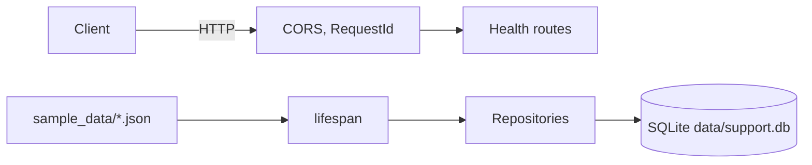
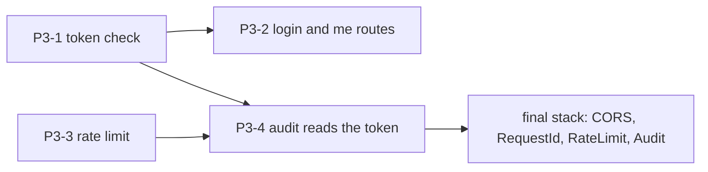
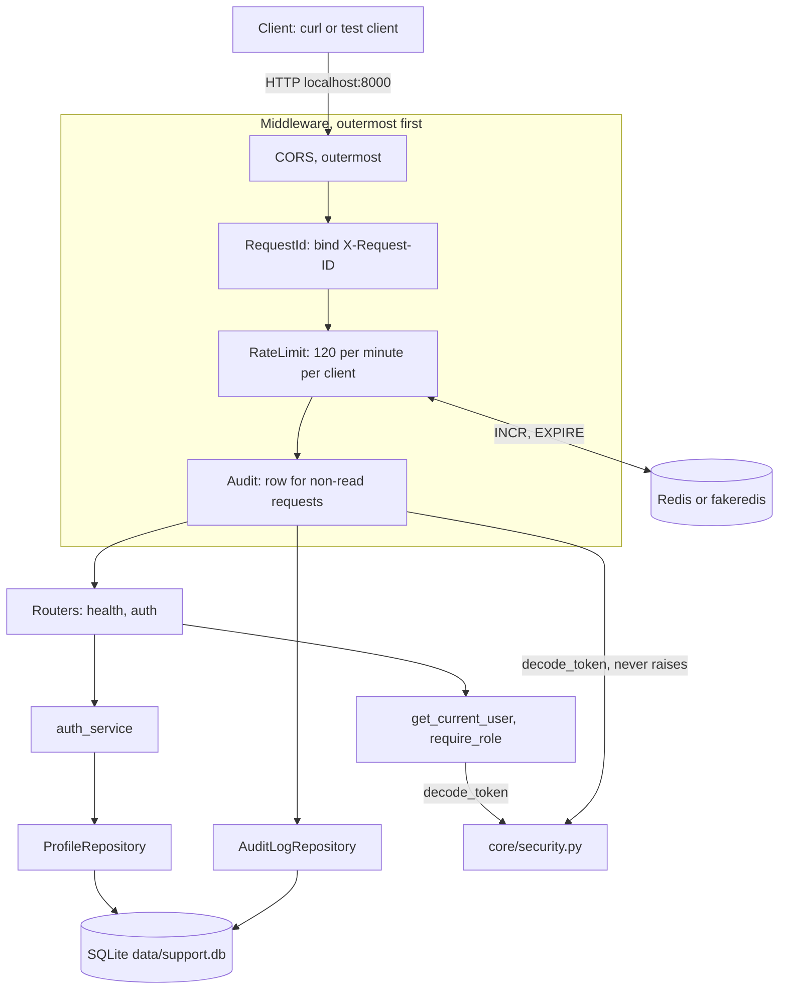
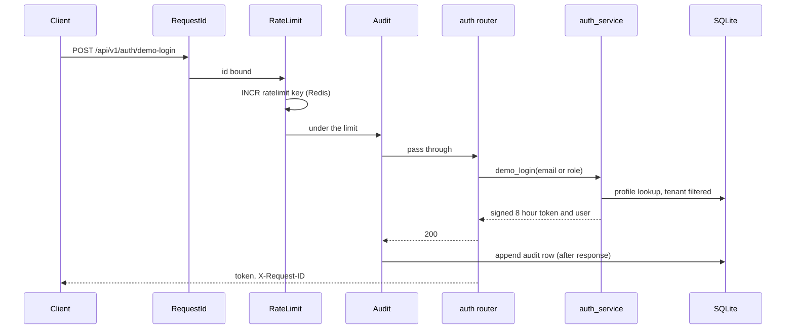

# Phase 3: system design evolution

> **Status of this phase:** implemented and checked locally. All four tasks (P3-1 to P3-4) are merged (pull requests #31 to #34). In a run made for this document (2026-11-22) the whole suite passed (708 tests) and `ruff check .` reported no problems. Nothing is deployed, no real Redis server was run, and no real Supabase token was tried.
>
> **Related documents:** [codebase explanation](./01_CODEBASE_EXPLAINED.md), [infrastructure evolution](./03_INFRA_EVOLUTION.md), the local-only interview Q&A `04_INTERVIEW_QNA.md`, and [Phase 2 design evolution](../Phase02/02_DESIGN_EVOLUTION.md).
>
> **Mermaid.** Diagrams were checked for structure only, not rendered.

---

## A. Phase overview

| Item | Content |
|---|---|
| Objective | Give the service an identity (who is calling, what may they do) and three guards on every request: a request id, a rate limit and an audit trail |
| Initial state | Phase 2: one FastAPI process, SQLite, repositories, demo data; only health routes; middleware CORS and request id |
| Requirements addressed | N1 (JWT auth), N2 (rate limiting), N6 (audit of state-changing requests); N3 (request id) is inherited from Phase 1 and now sits in the final order |
| Major additions | `backend/app/core/security.py`, `backend/app/api/auth.py`, `backend/app/services/auth_service.py`, `backend/app/core/redis.py`, `backend/app/middleware/rate_limit.py`, `backend/app/middleware/audit.py`, `sample_data/profiles.json` |
| Important design changes | The middleware stack grew from two to four layers with a fixed order; the seed gained a third kind of data (profiles); the service gained its first optional dependency, a Redis client (fake by default) |
| Final capabilities | A demo user can obtain a token, `GET /api/v1/auth/me` returns who they are, any future route can demand a minimum role, every client is throttled, every non-read request is written to `audit_logs` |

---

## B. Initial architecture

Limitations at the start: no way to identify a caller, no limit on request volume, no record of who changed what, and no route that reads the database.

---

## C. Intermediate architectural evolution

### C1. P3-1: JWT and `require_role`

- **Before.** No concept of a user.
- **Change.** `backend/app/core/security.py` validates HS256 tokens with PyJWT and exposes `get_current_user` and `require_role(minimum)`, a dependency factory over the ranking viewer 1 < agent 2 < admin 3. `Settings.effective_jwt_secret` returns the Supabase secret when set, else `JWT_SECRET`. No new environment variable.
- **Effect on existing parts.** None; nothing was protected because no `/api/v1` route existed. The module imports only the settings module, so `core` stays free of the agent layer.
- **Verified.** `tests/api/test_auth.py` on a throwaway app: missing, garbage, expired, no-expiry, no-subject, unknown-role, wrong-secret and `alg: none` tokens are 401; role ladder gives 403 or 200.
- **Not done.** A real Supabase token was never tried.

### C2. P3-2: demo auth routes and tokens

- **Before.** The role ladder existed but nobody could get a token.
- **Change.** `POST /api/v1/auth/demo-login` and `GET /api/v1/auth/me` (`backend/app/api/auth.py`), bodies in `backend/app/schemas/auth.py`, logic in `backend/app/services/auth_service.py`. `sample_data/profiles.json` seeds the three demo users; `ProfileRepository` gained `get_first_by_role`.
- **Effect.** The seed loads one more file; the router holds no rules.
- **Verified.** `tests/api/test_auth_routes.py` (login per user, by role alone, 401 and 422 cases, 404 outside demo mode, no secret in any response).
- **Not done.** No login screen (Phase 12).

### C3. P3-3: Redis rate limit

- **Before.** Unlimited requests.
- **Change.** `backend/app/core/redis.py` (`get_redis`) and `backend/app/middleware/rate_limit.py`, a plain ASGI fixed-window limiter, registered between RequestId and the app. `redis` and `fakeredis` became runtime dependencies because the demo runs on fakeredis.
- **Verified.** `tests/api/test_rate_limit.py` with an injected clock: 429 with `Retry-After` and request id, window reset, per-client counting, health exemption, fail-open on Redis error, configured limit read from settings, fake client cached.
- **Not done.** No real Redis server was run.

### C4. P3-4: audit middleware and the final order

- **Before.** No trace of state changes; the order was CORS, RequestId, RateLimit.
- **Change.** `backend/app/middleware/audit.py` writes one `audit_logs` row for each request whose method is not GET, HEAD or OPTIONS, through `AuditLogRepository` (`backend/app/repositories/audit.py`). `current_request_id()` was added to the logging module in `core` so the middleware reads the id RequestId already bound. `backend/app/main.py` registers the final order.
- **Verified.** `tests/api/test_audit.py`: row with actor and request id, anonymous for missing or invalid token, no row for GET, a failing write never breaks the response, and the registered order.
- **Not done.** See section H.

---

## D. Final architecture

Layer responsibilities: the router validates and maps errors to HTTP; `auth_service` decides who may log in and builds the token; repositories hold all SQL and the tenant filter; `backend/app/core/security.py` owns the token format and the role ladder; middleware owns cross-cutting concerns.

Security boundaries: the token signature (server secret), the role ladder, the per-client budget, the tenant filter in repositories. Observability: JSON logs with the request id, and the audit table.

---

## E. End-to-end execution and data flow

Errors: unknown user gives 401 "Unknown demo user"; demo mode off gives 404; a bad body gives 422; over the limit gives 429 and the request never reaches Audit; an unhandled exception is turned into 500 by RequestId and Audit records 500.

---

## F. Architectural decisions and trade-offs

| Decision | Context | Alternatives | Rationale | Benefits | Trade-offs | Status |
|---|---|---|---|---|---|---|
| HS256 with an algorithm pinned to HS256; `exp`, `sub` required; unknown role refused | A token must not be trusted on its own say-so | Accept the header's algorithm; RS256 | Supabase shares an HS secret; pinning blocks `alg: none` | Small, testable | A shared secret signs and verifies | Implemented |
| One 401 message for every bad token | Do not teach an attacker why | Distinct messages | Less information leaked | Simple | Harder to debug for a legitimate caller | Implemented |
| 401 versus 403 | Separate identity from permission | One status | Standard meaning | Clear client behaviour | None notable | Implemented |
| Demo login returns 404 when `DEMO_MODE` is false | The route is demo-only | 403 | The route appears not to exist | No hint it exists | Not distinguishable from a typo | Implemented |
| Fixed window, key `ratelimit:{client}:{minute}` | N2 needs a limit with little code | Sliding window, token bucket | `INCR` then `EXPIRE` on first hit; counter expires by itself | Cheap, shared across workers | Up to double the limit across a window boundary | Implemented |
| Client is the socket peer, not `X-Forwarded-For` | A forged header would give a fresh budget | Trust the header | Safe without a proxy | Not spoofable | Behind a proxy every caller looks like the proxy; a trusted-proxy setting is not built | Implemented |
| Limiter fails open | A limiter outage should not take the API down | Fail closed | Availability first | API stays up | No limit during a Redis outage | Implemented |
| Fake Redis by default | Demo and tests need no server | Require Redis | Offline first | Zero setup | Counters live in one process and vanish on restart | Implemented |
| Audit innermost, written after the response, errors swallowed | A throttled request is not a state change; auditing must not break a request | Audit outermost; write before | Sees the bound request id; never turns success into failure | Simple | A crash between response and write loses the row | Implemented |
| Audit reads only the Authorization header | No secret or ticket text in the log | Log the body | Safety | No leak by construction | Less forensic detail | Implemented |
| Plain ASGI middleware, not `BaseHTTPMiddleware` | Carry headers on error responses | Decorator style | Same as RequestId | Predictable ordering | More code | Implemented |

---

## G. Architectural improvements

| Quality | Evidence |
|---|---|
| Separation of responsibilities | Token logic in `core`, rules in a service, SQL in repositories, cross-cutting in middleware |
| Security | Algorithm pinned, role ladder, throttling, audit; tested with forged and expired tokens |
| Testability | Injectable clock, cache-clearable Redis, throwaway secured app |
| Reliability | Both limiter and audit degrade without failing the request |
| Scalability | Counters are in Redis, so several workers share one budget by design (untested with real Redis) |
| Performance | Not measured |

---

## H. Limitations and future evolution

- No protected business route exists yet; Phase 4 attaches `require_role`.
- The audit row is written after the response; 429 responses are not audited; reading the log (`GET /audit`) is P4-5.
- The limit is per address, not per user; behind a proxy it needs a trusted-proxy setting (not built).
- Demo tokens are only as strong as the shared demo secret. No refresh, revocation or logout.
- Behaviour against a real Supabase token and a real Redis is untested.
- No login screen; Phase 12.

---

## I. Phase completion summary

Final architecture: section D. New components: security module, auth router and service, Redis client, two middleware, profiles seed. Verified: 708 tests and a clean `ruff check .` (run 2026-11-22). Outstanding: see section H. Carried into Phase 4: `require_role`, `AuditLogRepository.list`, the rate limiter, and the request-id log context.
