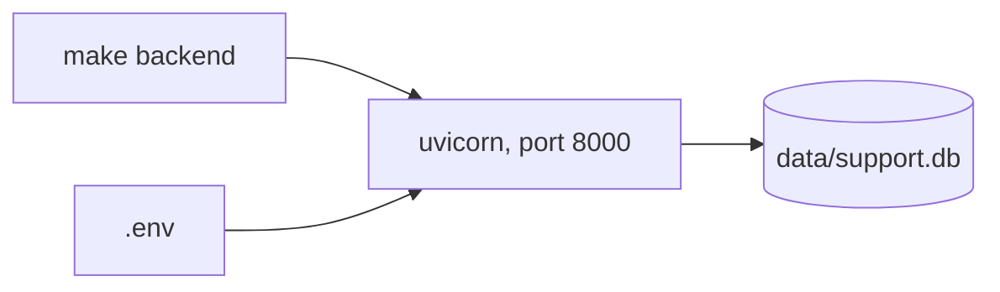
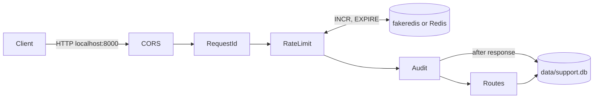
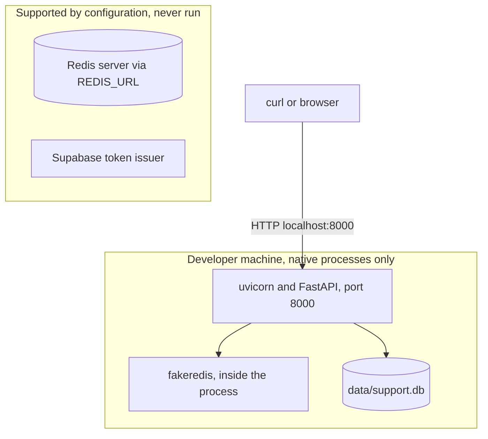

# Phase 3: infrastructure design evolution

> **Read this first.** Phase 3 still has **no Docker, no Docker Compose, no containers, no Postgres server, no real Redis server, no reverse proxy, no continuous-integration pipeline and no deployment**. There is no `Dockerfile` and no Compose file in the repository.
>
> What Phase 3 adds to the infrastructure is **a Redis client that defaults to an in-process fake**, three settings that matter (`REDIS_URL`, `USE_FAKE_REDIS`, `RATE_LIMIT_PER_MINUTE`) plus the token secrets, and nothing else. This document explains that honestly. Containers appear only as concepts marked planned.
>
> **Related documents:** [codebase explanation](./01_CODEBASE_EXPLAINED.md), [design evolution](./02_DESIGN_EVOLUTION.md), [Phase 2 infrastructure](../Phase02/03_INFRA_EVOLUTION.md).
>
> **Mermaid.** Diagrams were checked for structure only, not rendered.

---

## A. Infrastructure overview

| Question | Answer in Phase 3 |
|---|---|
| Where does it run? | One Python process on the developer's machine, plus the SQLite file |
| In Docker? | Nothing |
| Externally hosted? | Nothing. Supabase tokens are accepted by design, but no Supabase project is used. |
| Start | `make backend` (uvicorn on port 8000); tables and seed run at startup |
| Communication | Function calls in one process; the rate limiter talks to fakeredis in the same process |
| Configuration | Environment variables or `.env` |
| Stop | Ctrl+C |

Only development exists; there is no deployment configuration.

---

## B. Initial infrastructure design

Phase 2's: one process and one SQLite file, no cache.

---

## C. Infrastructure evolution

### Change 1. Redis client with a fake default (P3-3)

- **Before.** No cache and no counters.
- **Added.** `backend/app/core/redis.py` builds one async client per process. It is fakeredis unless `REDIS_URL` is set and `USE_FAKE_REDIS` is false. Packages `redis` and `fakeredis` are runtime dependencies in `pyproject.toml`.
- **Why.** The demo and tests must run offline; production needs a shared store so several workers share one budget.
- **Communication.** In the default mode, none (same process memory). With a real URL, a TCP connection to Redis (never exercised).
- **Verified.** `tests/api/test_rate_limit.py` (fake client used and cached when the URL is empty; counting, reset, outage behaviour with a failing client). A real server was not run.

### Change 2. Settings that carry secrets (P3-1, P3-2)

- **Added.** `JWT_SECRET` (demo default `change-me-demo-only`), `SUPABASE_JWT_SECRET` (empty by default, wins when set), `DEMO_MODE`. They are held as secret strings and never appear in a response (tested).
- **No new variable** was introduced by Phase 3; all already existed in `.env.example` (removed, then re-created 2026-11-27 as a placeholders-only template).

### Change 3. The request path got longer (P3-4)

Audit writes use their own database session, opened after the response, so they add a second database round trip to each non-read request.

---

## D. Docker and container explanation

No containers exist, so the per-service table is not filled in. `CLAUDE.md` section 15 plans a Compose file with a `redis` service; it is not built. Recommendation, not fact: when it exists, `REDIS_URL` should use the service name on the Compose network, and `USE_FAKE_REDIS` must be false.

## E. Docker networking

Not applicable. When Redis runs in a container, `localhost` inside the backend container will not reach it; the Compose service name will. Planned and untested.

## F. Component wiring and routing

Browser or curl to `localhost:8000`, then the four middleware, then the router. The rate limiter reads the **socket peer address**, not `X-Forwarded-For`, so behind a future reverse proxy every caller would look like the proxy until a trusted-proxy setting is added (not built).

## G. Lifecycle commands

| Command | Effect |
|---|---|
| `make setup` | Installs dependencies, sets up hooks, creates `.env` if absent |
| `make backend` | Starts the server with reload on port 8000 |
| `make test`, `make lint` | Runs the suite or ruff |
| Ctrl+C | Stops the server; the fake Redis counters vanish with the process |

Restarting the server resets all rate-limit counters when the fake is in use. The audit rows remain in `data/support.db`; deleting that file (destructive, discards everything) rebuilds the demo data.

## H. Environment variables and secrets

| Variable | Used by | Safe default | Notes |
|---|---|---|---|
| `JWT_SECRET` | `backend/app/core/security.py` through `effective_jwt_secret` | `change-me-demo-only` | A deployment must override it; the default is public |
| `SUPABASE_JWT_SECRET` | same | empty | When set it replaces `JWT_SECRET` |
| `DEMO_MODE` | `backend/app/api/auth.py` | `true` | Demo login is 404 when false |
| `REDIS_URL` | `backend/app/core/redis.py` | empty | Empty means fake Redis |
| `USE_FAKE_REDIS` | same | `true` in `.env.example` (removed, then re-created 2026-11-27 as a placeholders-only template) | Forces the fake even if a URL is set |
| `RATE_LIMIT_PER_MINUTE` | `backend/app/main.py` | `120` | Per client per minute |

Settings are cached: restart after editing `.env`. Real secrets go only in `.env` (git-ignored). No secret appears in this document.

## I. Persistent storage and data management

The audit rows live in the same SQLite file as everything else. Redis counters are not persisted (fake) and are not meant to be. No backup or restore procedure exists. No volumes or bind mounts exist.

## J. Health checks, startup order and resilience

- `/health` routes are exempt from the rate limit, tested.
- The limiter fails open on a Redis error and logs it; audit failure is logged and swallowed. Neither has a retry or timeout of its own.
- `/health/ready` does not probe Redis in this phase (not built).
- No restart policy exists; there is no supervisor.

## K. Observability and troubleshooting

JSON logs on standard output carry `request_id`. Relevant messages: "rate limiter unavailable" and "audit write failed", each with `error_type`. No metrics, tracing or dashboards.

| Symptom | Check |
|---|---|
| Unexpected 429 | Look at `Retry-After`; counters are per client address per minute; raise `RATE_LIMIT_PER_MINUTE` and restart |
| 401 on a valid-looking token | Token signed with a different secret, expired, or role missing; the message is deliberately the same |
| Demo login is 404 | `DEMO_MODE` is false |
| No audit row | Method was GET, HEAD or OPTIONS; request was throttled; or "audit write failed" is in the log |
| Redis URL ignored | `USE_FAKE_REDIS` is true |
| Port 8000 in use | Stop the other process |

## L. Final infrastructure architecture

No containers, networks, volumes or monitoring components exist.

## M. Infrastructure verification

| Check | Result |
|---|---|
| Whole suite and lint | 708 tests passed and `ruff check .` clean (run 2026-11-22) |
| Rate limit, audit and auth behaviour | Verified by the tests listed in the [codebase document](./01_CODEBASE_EXPLAINED.md) |
| Real Redis server | **Not run** |
| Real Supabase token | **Not tried** |
| `make backend` started by hand for this document | **Not run** |
| Docker, networks, DNS, container health checks, volumes, backups | Do not exist |
