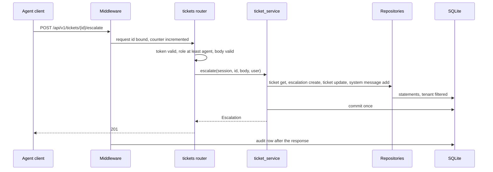

# Phase 4 explained: the support API

> **What this document is.** A plain-language explanation of the code written in Phase 4 of CloudDesk, for explaining it to recruiters, hiring managers and interview boards. It describes only what exists in the repository today.
>
> **Status of this phase:** implemented and checked locally. All five tasks (P4-1 to P4-5) are merged (pull requests #36 to #40). In a run made for this document (2026-11-22) the whole suite passed (807 tests) and `ruff check .` reported no problems. Nothing is deployed. Phase 4 has **no artificial intelligence (AI) workflow, no approvals, no knowledge search, no frontend, no Docker and no real Redis, Postgres or Supabase run**. The routes `POST /tickets/{id}/run`, `/workflow` and `/events` are in the contract but are not built yet.
>
> **Related documents:** [system design evolution](./02_DESIGN_EVOLUTION.md), [infrastructure evolution](./03_INFRA_EVOLUTION.md), the local-only `04_INTERVIEW_QNA.md`, and [Phase 3 explained](../Phase03/01_CODEBASE_EXPLAINED.md).

---

## A. Executive summary

**The 30-second version, ready to say out loud:**

"After Phase 3 CloudDesk knew who was calling but had nothing to show them. Phase 4 builds the working counter. A support agent can now create a ticket, list and search tickets, open one and see the whole story: the customer, their plan, their earlier tickets and every message. They can reply, ask the customer a question, escalate to a senior team or change a ticket's status. There is a dashboard with the counts, a read-only audit trail and a settings page that never shows a secret. Viewers can look but not touch. The AI that investigates tickets is not here yet; this phase builds the records that the AI will later read and write."

**What the phase accomplished.**

- Written, tested data shapes (Pydantic models) for tickets, customers and their parts, and a corrected application programming interface (API) contract.
- Ticket routes: create, list, get one with full context.
- Customer routes: list, get one with subscription, workspace, recent tickets and memory notes.
- Ticket actions: reply, request-info, escalate and update.
- Read-only routes for the dashboard, the audit log and settings.

**Why it was necessary.** The workflow in later phases reads a ticket and its customer and writes replies, escalations and status changes. Those records and the rules for changing them had to exist first, and the contract the frontend will mirror had to be fixed while it was cheap to change.

| | Before Phase 4 | After Phase 4 |
|---|---|---|
| Business routes | None (health and auth only) | 12 routes under `/api/v1` for tickets, customers, dashboard, audit, settings |
| Who may do what | Role ladder existed, nothing used it | Anyone signed in may read; `agent` and `admin` may change tickets; `viewer` gets 403 |
| Creating a ticket | Only through the seed file | `POST /api/v1/tickets` for email, chat, web and API channels |
| The 13 demo tickets | In the database only | Fetchable at `CD-1001` to `CD-1013` through the API |
| Audit trail | Written, not readable | `GET /api/v1/audit` with filters and paging |

---

## B. Business problem and solution

1. **Problem.** A support agent needs one place to see a ticket and everything around it, and a safe way to act on it. A manager needs a count of what is open and what has been resolved.
2. **Limitation of before.** The data existed and the guards existed, but no route exposed either.
3. **Solution.** A thin HTTP layer over small "use case" functions (services) that read and write through the repositories, with the role check on every route.
4. **Benefit.** The same use cases will be called by the AI workflow later, so a human clicking "escalate" and the AI escalating share the same rules and tables. The console can be built against a stable, tested contract.
5. **Why appropriate.** Keeping HTTP, rules and Structured Query Language (SQL) in separate layers means a rule can be tested without a web server and a route can change without touching SQL.

Analogy: a restaurant. The route is the waiter (takes the order, checks you are allowed in, brings the plate); the service is the kitchen (knows how to make the dish); the repository is the pantry (the only place ingredients are fetched, and it only ever opens this restaurant's shelves).

---

## C. Application architecture in simple language

| Component | What it is | Receives | Produces | If removed |
|---|---|---|---|---|
| Ticket routes | The ticket counter | HTTP requests with a token | JavaScript Object Notation (JSON), or 401, 403, 404, 422 | Agents could not reach tickets |
| Customer routes | The customer lookup desk | Search text, ids | Customers, or one customer with context | No customer view |
| Dashboard, audit, settings routes | The notice boards | A signed-in request | Counts, log rows, a redacted configuration view | No overview; the audit table could be written but not read |
| Ticket service | The ticket rulebook | A session and a request body | Response models; writes messages, escalations, status changes | Rules would leak into routes |
| Customer, dashboard, audit, settings services | Rulebooks for their areas | Session | Response models | Same |
| Schemas (`backend/app/schemas/`) | The forms: what each request and response must look like | JSON | Validated objects | Bad data would reach the database |
| Repositories | The pantry | Method calls | Rows, always for this tenant only | No data access |
| Audit middleware (Phase 3) | The guest book | Every non-read request | A row per request | Ticket changes would leave no trace |

Technical terms. **Route**: a uniform resource locator (URL) plus a method that does one job. **Schema**: a Pydantic model that checks data on the way in and shapes it on the way out. **Service**: a function holding a business rule. **Pagination**: returning results a page at a time (`page`, `page_size`).

---

## D. Codebase structure and file-by-file explanation

| File | Responsibility and key parts | Interview explanation |
|---|---|---|
| `backend/app/api/tickets.py` | Seven routes: `create_ticket`, `list_tickets`, `get_ticket`, `reply`, `request_info`, `escalate`, `update_ticket`. The router requires a valid token on everything; write routes add `require_role("agent")`. It maps the service's `TicketNotFound` and `CustomerNotFound` to 404. No rule lives here. | "The waiter: checks the badge, passes the order on, turns a kitchen 'not found' into a 404." |
| `backend/app/services/ticket_service.py` | Use cases and mappers. `create_ticket` (ticket plus first message in one commit, number retry up to three times), `list_tickets`, `get_ticket` (assembles `TicketDetail`), `reply`, `request_info`, `escalate`, `update_ticket`; helpers `_to_summary`, `_to_ticket`, `_to_workflow`, `_to_escalation`, `_note_status_change`. | "The ticket rulebook, and the only place a ticket changes." |
| `backend/app/schemas/ticket.py` | `TicketSummary`, `Ticket`, `TicketMessage`, `TicketPage`, and request bodies `TicketCreate`, `TicketReply`, `TicketRequestInfo`, `TicketEscalate`, `TicketUpdate`. Request bodies refuse unknown keys (`extra="forbid"`). | "The forms." |
| `backend/app/schemas/ticket_detail.py` | `TicketDetail`: a ticket plus messages, customer, subscription, history, workflow, resolution actions and escalation. Its own file to avoid an import cycle with `customer.py`. | "The full case file." |
| `backend/app/schemas/customer.py` | `Customer`, `Subscription`, `Workspace`, `CustomerMemory`, `CustomerDetail`, `CustomerPage`. | "The customer forms." |
| `backend/app/schemas/workflow.py` | A minimal `WorkflowState`, `ResolutionAction`, `Escalation`. `WorkflowState` keeps unknown keys so later phases can add fields. | "A placeholder shape for the AI's progress, so the ticket form can already carry it." |
| `backend/app/schemas/common.py` | Enums: `Category` (10), `TicketStatus` (7), `Severity`, `Channel`, `CustomerStatus`, `Plan` and others. One source for every allowed value. | "The list of allowed words." |
| `backend/app/api/customers.py` and `backend/app/services/customer_service.py` | `list_customers`; `get_customer` loads the customer, latest subscription, latest workspace, up to 10 recent tickets and up to 10 memory notes. Reuses `_to_summary` so a ticket looks the same everywhere. | "The customer file, assembled from the existing pantry." |
| `backend/app/api/dashboard.py` and `backend/app/services/dashboard_service.py` | `get_summary`: open tickets, resolved today (from Coordinated Universal Time (UTC) midnight), pending approvals, open escalations, average resolution minutes, counts by severity and category (every value listed, zeros included), five recent tickets, and an empty `agent_activity`. | "The scoreboard." |
| `backend/app/api/audit.py` and `backend/app/services/audit_service.py` | `list_audit` with `actor`, `action`, `page`, `page_size`, returning `{items, total}`. | "Reading the guest book." |
| `backend/app/api/settings.py` and `backend/app/services/settings_service.py` | `get_settings_view`: booleans and names only (`api_key_configured`, `redis` as `fake` or `real`, `database` as `sqlite` or `postgres`). `SettingsView` has no field that could hold a key or a URL. | "The status board that cannot leak a secret." |
| `backend/app/schemas/dashboard.py`, `backend/app/schemas/audit.py`, `backend/app/schemas/settings.py` | Response shapes for those three routes. | |
| `backend/app/repositories/base.py` | `ScopedRepository`: every query carries the tenant filter; `_page` clamps `page_size` to 100 (`MAX_PAGE_SIZE`); `contains_any` does a case-insensitive, wildcard-safe search. Repositories flush and never commit. | "The rule that every query is for this company only." |
| `backend/app/repositories/tickets.py` | Phase 4 added `next_ticket_number`, `count_open`, `count_resolved_since`, `count_by_severity`, `count_by_category`, `resolution_spans`. | |
| `backend/app/repositories/customers.py`, `backend/app/repositories/approvals.py`, `backend/app/repositories/workflow.py` | Phase 4 added `CustomerRepository.get_many`, `EscalationRepository.latest_for_ticket` and `count_open`, `ApprovalRepository.count_pending`, `ResolutionActionRepository.list_for_ticket`. | |
| `backend/app/main.py` | Mounts the five new routers (tickets, customers, dashboard, audit, settings) under `/api/v1`, beside the Phase 3 auth router. Middleware order is unchanged from Phase 3. | "Where the routes are plugged in." |
| `docs/design/06_API_CONTRACT.md` | The written contract, corrected in P4-1 where the models disagreed with it and extended with status codes in later tasks. | "The agreement the frontend will build against." |
| `tests/api/conftest.py` | `fresh_db`: a private database for tests that count whole-table rows. | |

---

## E. End-to-end execution flow

Example: Sam, an agent, creates a ticket and then escalates it.

1. `POST /api/v1/tickets` with a bearer token and `{"customer_id": ..., "subject": ..., "body": ...}`.
2. Middleware: RequestId binds a tracking number, RateLimit counts the call, Audit waits to record it.
3. The router checks the token (401 if missing or bad) and the role (403 for a viewer), and validates the body against `TicketCreate` (422 if wrong, for example an unknown field or an empty subject).
4. `ticket_service.create_ticket` looks the customer up (404 `Customer not found` if unknown), asks the repository for the next ticket number (one past the highest `CD-` number, 1001 for an empty database), inserts the ticket with status `new`, inserts the customer's first message, and commits once. It never starts a workflow.
5. The response is **201** with the `Ticket`. Audit then writes a row: action `POST /api/v1/tickets`, resource `tickets`.
6. `POST /api/v1/tickets/{id}/escalate` with `{"reason": "...", "priority": "urgent"}`. The service writes an `escalations` row (created by `human`, team `Tier 2 support`), sets the ticket to `escalated` with `escalation_required` true, adds an internal system message "Status changed from new to escalated by sam.agent@clouddesk.demo.", commits, and returns **201** with the `Escalation`.
7. `GET /api/v1/tickets/{id}` now shows the escalation, the new message and the status.

Errors: no token gives 401; viewer on a write route gives 403 and nothing is written; unknown ticket or customer gives 404 with `{"detail": ...}`; bad body or bad query value (`page=0`, `page_size=101`, unknown status) gives 422; over the limit gives 429.

---

## F. Technical concepts explained simply

- **HTTP methods and codes.** GET reads, POST creates (201), PATCH changes part of a record (200), 401 means not signed in, 403 means not allowed, 404 means not found, 422 means the request was malformed.
- **Validation.** The Pydantic schema rejects bad input before any rule runs.
- **Layers.** Route (HTTP), service (rules and transaction), repository (SQL and tenant filter). A transaction is a group of writes that all succeed or none do; the service commits once at the end.
- **Pagination.** `page` and `page_size` (1 to 100) with a `total`, so a screen can show page numbers.
- **Tenant filter.** Every repository query adds `tenant_id = <this tenant>`. SQLite has no row-level security, so this is the boundary on the demo database.
- **Idempotency of numbering.** Two simultaneous creates could pick the same number; the database's unique key refuses the second, and the service tries again up to three times.
- **Redaction.** The settings response is built from fields that cannot hold a secret, so none can leak even by mistake.

---

## G. Design decisions and trade-offs

Historical decisions (made while building): a separate `TicketDetail` module to break an import cycle; creating a ticket never starts a workflow; the service owns the transaction and repositories never commit; the three action POSTs return 201 (the contract did not state a code); transitions are recorded as internal system messages rather than a new table; escalation team is the constant `Tier 2 support`; the average resolution time is computed in Python for SQLite and Postgres parity. The table with alternatives is in [section F of the design evolution](./02_DESIGN_EVOLUTION.md). Retrospective recommendations, not built: a status state machine, keyset pagination, SQL-side aggregates, per-route audit read restriction.

---

## H. Error handling and failure scenarios

| Scenario | Actual behaviour | Gap |
|---|---|---|
| Invalid input | 422 from the schema; unknown fields refused | None |
| No, bad or expired token | 401 | No lockout |
| Viewer on a write route | 403; nothing is written (tested) | None |
| Unknown ticket or customer | 404 `{"detail": "Ticket not found"}` or `Customer not found` | None |
| Duplicate ticket number race | Retry up to three times, then the error escapes as a 500 | The retry is written but no test exercises it |
| Ticket whose customer row is missing | `LookupError`, which becomes a 500 | Treated as corruption, not a client error |
| Database unavailable | Startup logs the error and `/health/ready` says degraded; a route would raise a 500 | No retry, no specific error body |
| Redis unreachable | Request allowed (Phase 3 fail-open) | Unlimited during the outage |
| Missing configuration | Defaults apply | The demo `JWT_SECRET` is public |
| Invalid AI output | Not applicable; no AI yet | |
| Illegal status change | `PATCH` accepts any valid status value | No state machine; a human can set `waiting_on_approval` by hand |

---

## I. Testing and verification

Run: `uv run pytest -q` and `uv run ruff check .` (or `.venv/Scripts/python.exe -m pytest -q`).

| File | Proves |
|---|---|
| `tests/unit/test_ticket_customer_schemas.py` | Schema fields match the contract, nullable severity and category, JSON round trip, enums come from `common.py`, request body defaults and validation |
| `tests/api/test_tickets.py` | Each channel creates a ticket and its first message; channel defaults to `web`; numbers continue after the seed and never repeat; create starts no workflow; admin may create; viewer 403 and nothing written; no token 401; unknown customer 404; bad bodies 422; `CD-1001` to `CD-1013` fetchable; full detail; list shape newest first; filters by status, severity and search; paging without overlap; bad query values 422 |
| `tests/api/test_ticket_actions.py` | Reply stored as an agent message and `internal` honoured; empty body 422; request-info sets `waiting_on_customer` and records the transition; escalate writes a `human` escalation and sets the status; priority default and rejection; PATCH leaves untouched fields alone, records transitions and `resolved_at`, can unassign; admin may act; viewer 403 with no change; unknown ticket 404 and no token 401 |
| `tests/api/test_customers.py` | 401 without token; every role can list; detail loads subscription, workspace, tickets and memory; empty memory is an empty list; unknown id 404; list shape and search; paging; bad paging 422 |
| `tests/api/test_dashboard.py` | 401; every role can read; shape matches the contract; fresh demo counts (13 open, zeros elsewhere, 10 categories, 5 recent); counts follow ticket state |
| `tests/api/test_audit_api.py` | 401; a viewer can read; rows match the contract; filters by actor and action and paging; bad paging 422 |
| `tests/api/test_settings_api.py` | 401; defaults match the contract; a configured key appears only as a boolean and nothing secret is returned |
| `tests/unit/repositories/test_repositories_tenant_isolation.py` | A second tenant's rows stay invisible through the repository methods, including the ones Phase 4 added |

Results from this session: 807 passed, `ruff check .` clean (708 tests were reported at the end of Phase 3). Untested: the ticket-number retry under real concurrency, real Postgres, real Redis, large data volumes, and the `/run`, `/workflow` and `/events` routes, which do not exist.

---

## J. Interview-ready explanation

**30 seconds.** Phase 4 is the support API. Agents can create tickets, list and search them, open one with the customer, history and messages, reply, ask for information, escalate or change status. There is a dashboard, a read-only audit log and a redacted settings view. Everything needs a token and the write routes need an agent role.

**2 minutes.** I started by fixing the contract and the Pydantic models together, so the shapes were tested before any route existed. Then ticket create, list and get; then customers; then the actions; then three read-only routes. Each route is thin: it checks the badge and maps errors, while a service function holds the rule and commits once. Repositories add the tenant filter to every query. The 13 demo tickets are reachable through the API, and every action is also recorded by the audit middleware from Phase 3.

**5 minutes.** Walk the sequence in section E, then the layering: router, service, repository, with the transaction in the service. Then three details: ticket numbering with a unique-key retry; transitions recorded as internal system messages so the history is in the ticket; and the settings view built so a secret cannot be serialised. Finish with what is missing: no workflow, no approvals, no frontend.

**Non-technical.** "Agents now have a working counter: they can open a case, see everything about the customer, answer, escalate, and check the scoreboard. Anyone can look, only agents can change things, and every change is logged."

**Architect.** "FastAPI routers with router-level `get_current_user` and per-route `require_role`; Pydantic v2 request and response models with `extra="forbid"` on inputs; services own the unit of work, repositories flush and never commit and carry the tenant predicate; offset pagination clamped to 100; aggregates in repositories, the mean computed in Python for dialect parity; contract-first, with the contract corrected where models disagreed. Known gaps: no status state machine, no workflow routes, aggregates unbounded, numbering retry untested."

---

## K. Key takeaways and next-phase dependencies

- Implemented: sections A and D. Partial: the ticket detail, whose `workflow` field is `null` for every ticket until runs exist. Planned: `/run`, `/workflow`, `/events` (Phase 10), approvals (Phase 11), the console (Phases 12 and 13).
- Know before explaining: the layering and where the transaction is; why create does not start a workflow; the 401, 403, 404 and 422 meanings; why the settings view cannot leak.
- Reused later: `ticket_service` helpers (the workflow will call the same escalation and message writers), `TicketDetail`, `AuditLogRepository.list`, the contract as the source for `frontend/lib/types.ts` (planned).
- Limitations: see section H and the design evolution document.
