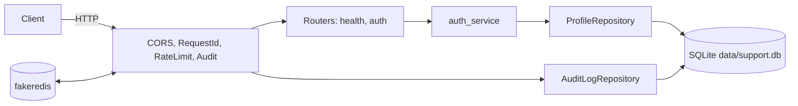
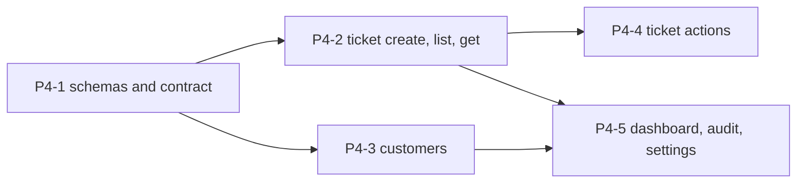
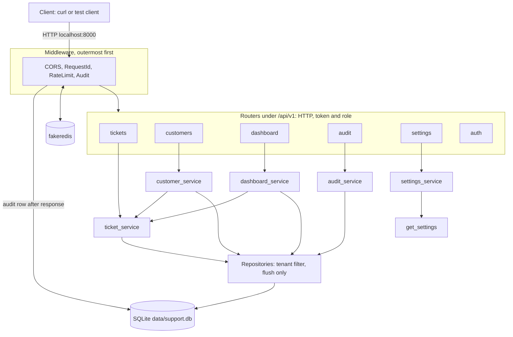
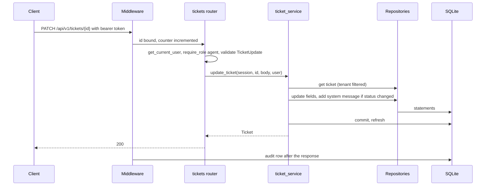

# Phase 4: system design evolution

> **Status of this phase:** implemented and checked locally. All five tasks (P4-1 to P4-5) are merged (pull requests #36 to #40). In a run made for this document (2026-11-22) the whole suite passed (807 tests) and `ruff check .` reported no problems. Nothing is deployed. There is no workflow, no approval flow, no knowledge search and no frontend yet.
>
> **Related documents:** [codebase explanation](./01_CODEBASE_EXPLAINED.md), [infrastructure evolution](./03_INFRA_EVOLUTION.md), the local-only interview Q&A `04_INTERVIEW_QNA.md`, and [Phase 3 design evolution](../Phase03/02_DESIGN_EVOLUTION.md).
>
> **Mermaid.** Diagrams were checked for structure only, not rendered.

---

## A. Phase overview

| Item | Content |
|---|---|
| Objective | Let agents create and read the records the workflow will later consume, and act on a ticket by hand |
| Initial state | Phase 3: one FastAPI process, SQLite, repositories, seeded demo data, four middleware, auth routes and health routes only |
| Requirements addressed | F1 (create ticket from any channel), F4 (read side of customer context), F12 (the data side of the one-screen actions), N6 (audit is now readable); the contract rule in `CLAUDE.md` section 12 |
| Major additions | Five new routers (`backend/app/api/tickets.py`, `customers.py`, `dashboard.py`, `audit.py`, `settings.py`), five new services, new Pydantic schema modules, new repository methods |
| Important design changes | The API gained its first business routes; the role ladder is applied for the first time; `TicketDetail` is assembled from many repositories; the API contract was corrected against the models |
| Final capabilities | 12 business routes under `/api/v1`; viewer reads, agent and admin write; every write is audited by the Phase 3 middleware |

---

## B. Initial architecture

Inherited from Phase 3.

Limitations at the start: no route read tickets or customers, nothing used `require_role`, the audit table could be written but not read, and the contract had never been checked against code.

---

## C. Intermediate architectural evolution

### C1. P4-1: schemas and contract first

- **Before.** The contract file described shapes; no code enforced them.
- **Change.** Pydantic v2 models for `TicketSummary`, `Ticket`, `TicketMessage`, `TicketDetail`, `Customer`, `CustomerDetail`, request bodies, plus `CustomerStatus` and `Plan` in `backend/app/schemas/common.py`. `TicketDetail` lives in `backend/app/schemas/ticket_detail.py` because it needs `Customer` while `CustomerDetail` needs `TicketSummary`; one module would be an import cycle. `WorkflowState` is a minimal, forward-compatible model that keeps extra keys, since agents do not exist yet.
- **Contract corrections.** Severity and category are nullable, `CustomerMemory` carries `confidence`, `Escalation.created_by` is a string, `channel` defaults to `web`.
- **Verified.** `tests/unit/test_ticket_customer_schemas.py`. No routes were added. The frontend type file will mirror the contract once the frontend exists.

### C2. P4-2: ticket create, list, get

- **Before.** No route touched tickets.
- **Change.** `backend/app/api/tickets.py` (HTTP and role only) over `backend/app/services/ticket_service.py` (models and the transaction). Create writes the ticket and its first `customer` message in one commit and never starts a workflow. Numbers come from `TicketRepository.next_ticket_number()`; the service retries up to three times if the unique key refuses a duplicate. `get_ticket` assembles `TicketDetail` from customer, subscription, messages, up to 10 other tickets of the customer, latest run, resolution actions and latest escalation.
- **New repository methods**, tenant-scoped and added to the isolation test: `CustomerRepository.get_many`, `EscalationRepository.latest_for_ticket`, `ResolutionActionRepository.list_for_ticket`, `TicketRepository.next_ticket_number`.
- **Effect.** `TicketDetail.workflow` is `null` for every ticket, because no run exists until Phase 10. Seeded tickets have no severity or category, so severity filtering is only exercised after a row is given one.
- **Verified.** `tests/api/test_tickets.py`. The numbering retry is written but not exercised by a test.

### C3. P4-3: customers

- **Change.** `backend/app/api/customers.py` and `backend/app/services/customer_service.py`: list with search and paging, and detail with subscription, workspace, up to 10 tickets and up to 10 memory notes (newest first). No repository method was added; `_to_summary` is reused from the ticket service so a ticket summary has one shape in both places.
- **Verified.** `tests/api/test_customers.py`.

### C4. P4-4: ticket actions

- **Change.** `POST /tickets/{id}/reply`, `/request-info`, `/escalate` (each 201) and `PATCH /tickets/{id}` (200), all `agent` or `admin`. Logic stays in the service; no repository method was added, so the tenant filter stays in the repositories.
- A reply is stored as an `agent` message and honours `internal`; nothing is sent because the email integration is a mock. `request-info` stores the numbered questions and sets `waiting_on_customer`. `escalate` writes an `escalations` row (`created_by` `human`, team `Tier 2 Support`, a default and not routing) and sets `escalated` and `escalation_required`. `PATCH` sets `resolved_at` on `resolved` or `closed` and clears it on reopening. A status change made by `request-info`, `escalate` or `PATCH` is recorded as an internal `system` message.
- **Deviation from the contract.** The three POST routes return 201; the contract table did not state a code and was amended.
- **Verified.** `tests/api/test_ticket_actions.py`.

### C5. P4-5: dashboard, audit, settings

- **Change.** Three read routes and services. New tenant-scoped aggregates: `TicketRepository.count_open`, `count_resolved_since`, `count_by_severity`, `count_by_category`, `resolution_spans`, `ApprovalRepository.count_pending`, `EscalationRepository.count_open`. Average resolution time is computed in Python from the (created, resolved) pairs so it behaves the same on SQLite and Postgres. `by_severity` and `by_category` always list every value, with zeros. `agent_activity` is an empty list until workflow events exist. "Resolved today" counts from UTC midnight.
- `SettingsView` has fields only for booleans and names, so a key, URL or password cannot be serialised. `approval_required_tools` is a constant in `backend/app/services/settings_service.py` until the tool registry exists (Phase 6).
- **Verified.** `tests/api/test_dashboard.py`, `tests/api/test_audit_api.py`, `tests/api/test_settings_api.py`. Tests that count whole-table rows use the private `fresh_db` fixture in `tests/api/conftest.py`, because the default test database is shared by the session.

---

## D. Final architecture

Layer responsibilities: routers validate, check token and role and map exceptions to HTTP; services hold rules, build response models and own the transaction (one commit per use case); repositories hold every query and the tenant filter and never commit; schemas define the wire format. Security boundaries: the token, the role ladder, the per-client budget and the tenant filter. Observability: JSON logs with the request id, and the audit table, now readable at `GET /api/v1/audit`.

Role table: reads (`GET` on tickets, customers, dashboard, audit, settings) need any valid token; writes (create, reply, request-info, escalate, PATCH) need `agent` or `admin`.

---

## E. End-to-end execution and data flow

Errors: missing or bad token gives 401; viewer gives 403; unknown id gives 404 `Ticket not found`; invalid body (unknown key, unknown status) gives 422; a duplicate-number race that fails three times, a ticket with a missing customer or a database failure gives 500 from the outer handler, and Audit records the 500.

---

## F. Architectural decisions and trade-offs

| Decision | Context | Alternatives | Rationale | Benefits | Trade-offs | Status |
|---|---|---|---|---|---|---|
| Contract and schemas first (P4-1) | The frontend and later agents need stable shapes | Write routes first and document afterwards | Disagreements between contract and models are cheapest to fix before routes exist | Contract matches code; tests pin the field lists | An up-front task with no visible route | Implemented |
| Router, service, repository layering | `CLAUDE.md` section 4.2 | Logic in routes | Rules testable without HTTP; SQL in one layer | Later workflow reuses services | More files for small features | Implemented |
| Service owns the commit; repositories flush only | A use case writes several rows | Commit in each repository call | One transaction per use case, so a ticket and its first message succeed or fail together | Atomic create | A caller that forgets to commit loses writes | Implemented |
| `TicketDetail` in its own module | `CustomerDetail` needs `TicketSummary`, `TicketDetail` needs `Customer` | One module with forward references | Avoids an import cycle | Simple imports | One more file | Implemented |
| Create never starts a workflow | The run is an explicit action with its own status code | Auto-start on create | Keeps F1 small; avoids a cost on every create | Predictable | Agent must call `/run` (Phase 10) | Implemented |
| Ticket number: max suffix plus one, retry three times on a unique-key conflict | Numbers must be `CD-NNNN` and unique | A database sequence; a UUID | Portable across SQLite and Postgres; numeric cast so `CD-10000` sorts above `CD-1013` | No new table | A race can still fail after three tries; untested | Implemented |
| Transitions as internal system messages | The ticket history should show who changed status | A separate history table | The message list is already shown on the ticket | No schema change | Not queryable as structured data | Implemented |
| `PATCH` accepts any valid status | v1 needs manual override | A state machine | Keeps the human in control | Simple | A human can set `waiting_on_approval` or `resolved` without the workflow | Implemented, state machine proposed |
| Escalation team fixed to `Tier 2 Support` | No routing exists yet | Ask the caller for a team | Honest default, labelled as such | Simple | Not real routing; arrives with Phase 11 | Implemented |
| Offset pagination, `page_size` 1 to 100 | Small tables, a page UI | Keyset cursors | Simple, supports page numbers | Easy to test | Deep pages are slow on large tables; rows inserted between pages can shift | Implemented |
| Aggregates in repositories, mean in Python | SQLite and Postgres differ in date arithmetic | SQL average | Same result on both | Portable | Loads every resolved row's two timestamps; unbounded | Implemented |
| Settings view with no secret-capable field | N7 and "never in responses" | Redact at serialisation time | A secret cannot appear if no field can hold it | Safe by construction | New settings need a deliberate field | Implemented |
| Reads open to every role, including audit | Contract says any authenticated role | Restrict audit to admin | Matches the contract and the viewer role in `CLAUDE.md` section 2 | Simple | A viewer can read actor emails and request ids | Implemented, open question |
| Three action POSTs return 201 | Each creates a record | 200 | A message or escalation is created | Consistent with create | Contract amended | Implemented |

---

## G. Architectural improvements

| Quality | Evidence |
|---|---|
| Separation of responsibilities | Routers hold no rules; services hold no HTTP; repositories hold all SQL (code layout above) |
| Modularity | One router and one service per area; `customer_service` and `dashboard_service` reuse `_to_summary` |
| Maintainability | One enum source in `backend/app/schemas/common.py`; the contract corrected to match |
| Security | Router-level token check, role on writes, `extra="forbid"` on inputs, settings view cannot hold a secret, tenant filter in repositories; tested including viewer 403 with no change |
| Testability | A private `fresh_db` fixture; services reachable without HTTP |
| Reliability | Atomic create; a unique-key retry (untested); no external service is called, so no external failure path exists yet |
| Scalability | Not claimed. Offset paging and unbounded aggregates are known limits |
| Performance | Not measured |
| Extensibility | `WorkflowState` keeps extra keys, and the escalation and message writers are reusable by the workflow |

---

## H. Limitations and future evolution

- `POST /tickets/{id}/run`, `/workflow`, `/events` and the approvals, knowledge, escalations, agents and MCP routes are in the contract and not built.
- `TicketDetail.workflow`, `resolution_actions` and `agent_activity` are empty or null until Phases 10 and 11.
- No status state machine; any status can be set by `PATCH`. `assigned_to` is free text and is not checked against a profile. Escalating twice creates two escalation rows.
- The number retry is untested; the unique-key conflict path was not exercised against real concurrency.
- `get_ticket` makes eight repository calls and the dashboard about ten; the aggregates and `resolution_spans` are not bounded.
- Search is a case-insensitive substring match with no index.
- In `list_tickets` the query parameter named `status` shadows the imported `status` module inside that function; harmless today, but easy to trip over.
- Reply sends nothing; the email integration is a mock (Phase 6).
- A viewer can read the audit log, and the audit write happens after the response (Phase 3 limit).
- Behaviour on Postgres is untested; only SQLite was run.

---

## I. Phase completion summary

Final architecture: section D. New components: five routers, five services, new schema modules, 11 new repository methods (`get_many`, `latest_for_ticket`, `list_for_ticket`, `next_ticket_number`, and the seven aggregates), a corrected contract. Important decisions: section F. Verified: 807 tests and a clean `ruff check .` (run 2026-11-22). Outstanding: section H. Carried into later phases: the services and schemas the workflow will reuse, the contract as the source for the frontend types, and the open questions on audit visibility and a status state machine.
