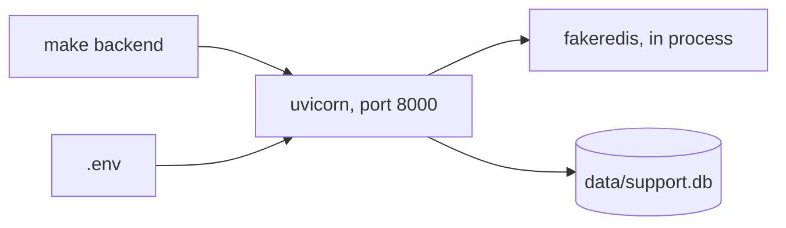
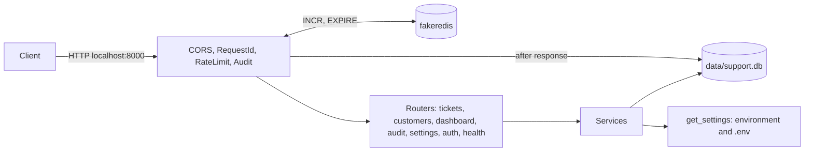
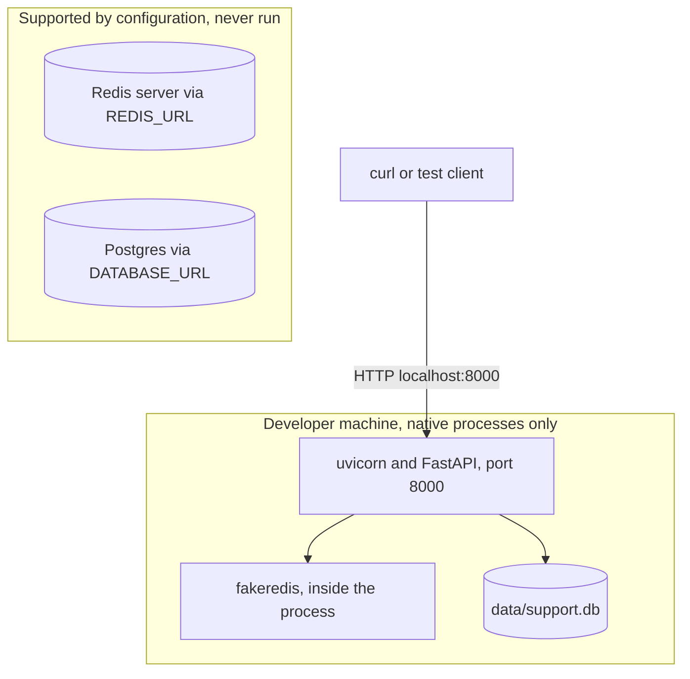

# Phase 4: infrastructure design evolution

> **Read this first.** Phase 4 still has **no Docker, no Docker Compose, no containers, no Postgres server, no real Redis server, no reverse proxy, no continuous-integration pipeline and no deployment**. There is no `Dockerfile` and no Compose file in the repository.
>
> Phase 4 adds **no infrastructure and no new environment variable**. It adds five routers to the one existing process and reads settings that already existed. This document says so honestly. Containers appear only as concepts marked planned.
>
> **Related documents:** [codebase explanation](./01_CODEBASE_EXPLAINED.md), [design evolution](./02_DESIGN_EVOLUTION.md), [Phase 3 infrastructure](../Phase03/03_INFRA_EVOLUTION.md).
>
> **Mermaid.** Diagrams were checked for structure only, not rendered.

---

## A. Infrastructure overview

| Question | Answer in Phase 4 |
|---|---|
| Where does it run? | One Python process on the developer's machine, plus the SQLite file |
| In Docker? | Nothing |
| Externally hosted? | Nothing |
| Start | `make backend` (uvicorn on port 8000); tables and seed run at startup |
| Communication | Function calls in one process; the rate limiter talks to fakeredis in the same process |
| Configuration | Environment variables or `.env` |
| Stop | Ctrl+C |

Only development exists; there is no deployment configuration.

---

## B. Initial infrastructure design

Phase 3's: one process, one SQLite file, fakeredis in the process.

---

## C. Infrastructure evolution

### Change 1. More routes on the same process (P4-2 to P4-5)

- **Before.** The process served health and auth routes.
- **Added.** Five routers mounted in `backend/app/main.py` under `/api/v1`: tickets, customers, dashboard, audit, settings. No new port, process, package or file on disk.
- **Communication.** Unchanged: client to uvicorn on `localhost:8000`, through four middleware, to the router, to SQLite.
- **Verified.** The application programming interface (API) tests in `tests/api/` call every route through the test client. The server was not started by hand for this document.

### Change 2. Database access grew (P4-2 to P4-5)

- **Before.** The seed and the audit and profile repositories were the only database users while serving.
- **Added.** Every business route opens a session through `get_session` and runs tenant-filtered queries. `GET /tickets/{id}` makes eight repository calls and `GET /dashboard/summary` about ten, on one SQLite file. Writes commit once per use case.
- **Effect.** The Audit middleware still writes through its own session after the response, so a write request has two database round trips (the use case, then the audit row). SQLite allows one writer at a time; this was not stressed.

### Change 3. A route that reports configuration (P4-5)

`GET /api/v1/settings` reads the cached settings and reports booleans and names (`demo_mode`, `environment`, provider names, `api_key_configured`, `redis` as `fake` or `real`, `database` as `sqlite` or `postgres`, `vector_store`, approval policy). It never returns a key, uniform resource locator (URL) or password (tested in `tests/api/test_settings_api.py`).

---

## D. Docker and container explanation

No containers exist, so the per-service table is not filled in. `CLAUDE.md` section 15 plans a Compose file with `frontend`, `backend`, `redis` and `qdrant`; it is not built. Recommendation, not fact: when it exists the backend should read the database and Redis through service names on the Compose network, and `USE_FAKE_REDIS` must be false.

## E. Docker networking

Not applicable. Planned and untested: inside a container `localhost` is the container itself, so the future frontend must reach the backend by its Compose service name, and the browser must reach it through a published port.

## F. Component wiring and routing

Browser or curl to `localhost:8000`, four middleware, router, service, repository, SQLite file. Cross-Origin Resource Sharing (CORS) allows the origins in `CORS_ORIGINS`; no browser frontend exists yet, so the CORS path was exercised only by tests. A reverse proxy does not exist; the rate limiter reads the socket peer, so behind one every caller would look like the proxy (Phase 3 limitation, still true).

## G. Lifecycle commands

| Command | Effect |
|---|---|
| `make setup` | Installs dependencies, sets up hooks, creates `.env` if absent |
| `make backend` | Starts the server with reload on port 8000 |
| `make test`, `make lint` | Runs the suite or ruff |
| Ctrl+C | Stops the server; fake Redis counters vanish |

Restarting resets rate-limit counters. Tickets, messages, escalations and audit rows created through the API stay in `data/support.db`. Deleting that file (destructive: it discards every ticket and audit row you created) rebuilds the 13 demo tickets at the next start.

## H. Environment variables and secrets

Phase 4 introduced no variable. The settings it reads or reports:

| Variable | Used by | Safe default | Notes |
|---|---|---|---|
| `DATABASE_URL` | `backend/app/core/database.py`, reported by `settings_service` | SQLite file under `data/` | Only the word `sqlite` or `postgres` is reported, never the URL |
| `DEMO_MODE`, `ENVIRONMENT` | `settings_service` | `true`, development | Reported as given |
| `LLM_PROVIDER`, `LLM_MODEL`, `EMBEDDING_PROVIDER`, `EMBEDDING_MODEL`, `LANGCHAIN_TRACING_V2` | `settings_service` | `fake` provider | Names only |
| `LLM_API_KEY` | `settings_service` | empty | Reported only as the boolean `api_key_configured` |
| `REDIS_URL`, `USE_FAKE_REDIS` | `settings_service` | empty, `true` | Reported as `fake` or `real` |
| `VECTOR_STORE` | `settings_service` | `memory` | Reported as given |
| `APPROVAL_REQUIRED_FOR_REFUNDS`, `MAX_REFUND_WITHOUT_APPROVAL` | `settings_service` | `true`, `0` | Reported in `approval_policy` |

Settings are cached: restart after editing `.env`. Real secrets go only in `.env` (git-ignored). No secret appears in this document.

## I. Persistent storage and data management

All rows, including tickets created by the new routes, live in the same SQLite file. There is no backup or restore procedure, no volume and no migration run against a server. Data written through the API survives a restart; the seed runs only when the database is empty.

## J. Health checks, startup order and resilience

- `/health`, `/health/live` and `/health/ready` are unchanged; `/health/ready` still does not depend on any Phase 4 code.
- A database failure at startup is logged and the server still starts; a business route would then fail with a 500. No retry or timeout is configured for database calls.
- No restart policy and no supervisor exist.

## K. Observability and troubleshooting

JavaScript Object Notation (JSON) logs on standard output carry `request_id`. The audit table records every non-read request and is now readable at `GET /api/v1/audit` (filters `actor`, `action`). No metrics, tracing or dashboards beyond the summary route.

| Symptom | Check |
|---|---|
| 401 on a business route | No bearer token, expired, or signed with another secret; get one from `POST /api/v1/auth/demo-login` |
| 403 on a write | The token's role is `viewer` |
| 404 on a ticket | The id is the row id, not the `CD-` number |
| 422 on a list | `page` below 1, `page_size` outside 1 to 100, or an unknown `status` or `severity` |
| Empty `recent_tickets` | The database is empty or `DEMO_MODE` is false and nothing was created |
| Missing audit row | The request was a GET, was throttled, or "audit write failed" is in the log |
| Port 8000 in use | Stop the other process |

## L. Final infrastructure architecture

No containers, networks, volumes or monitoring components exist.

## M. Infrastructure verification

| Check | Result |
|---|---|
| Whole suite and lint | 807 tests passed and `ruff check .` clean (run 2026-11-22) |
| Every Phase 4 route | Exercised through the test client in `tests/api/` |
| `make backend` started by hand for this document | **Not run** |
| Real Postgres, real Redis | **Not run** |
| Concurrent writers on SQLite | **Not tested** |
| Docker, networks, Domain Name System (DNS), container health checks, volumes, backups | Do not exist |
