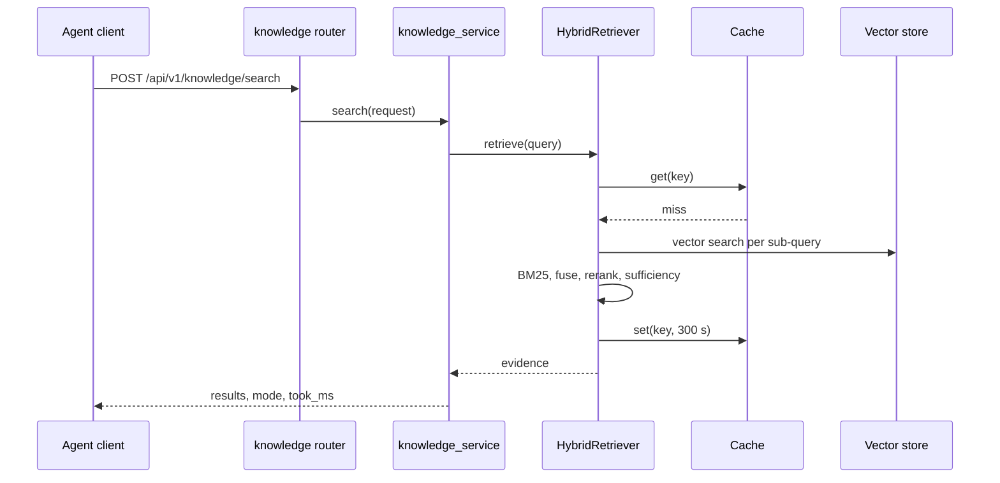

# Phase 5 explained: the knowledge pipeline

> **What this document is.** A plain-language explanation of the code written in Phase 5 of CloudDesk, for explaining it to recruiters, hiring managers and interview boards. It describes only what exists in the repository today.
>
> **Status of this phase:** implemented and checked locally. All four tasks (P5-1 to P5-4) are merged (pull requests #42, #46, #47, #48). In a run made for this document (2026-11-22) the whole suite passed (893 tests) and `ruff check .` reported no problems. Nothing is deployed. Phase 5 has **no language model, no agents, no workflow, no frontend page, and no real Qdrant or Redis run**. Search uses fake, offline embeddings.
>
> **Related documents:** [system design evolution](./02_DESIGN_EVOLUTION.md), [infrastructure evolution](./03_INFRA_EVOLUTION.md), the local-only `04_INTERVIEW_QNA.md`, and [Phase 4 explained](../Phase04/01_CODEBASE_EXPLAINED.md).

---

## A. Executive summary

**The 30-second version, ready to say out loud:**

"After Phase 4 an agent could open a ticket but the platform had no memory of how to solve anything. Phase 5 builds the library and the librarian. We have fifteen help articles. The code cuts them into small passages, indexes them, and when someone asks a question it finds the best passages using two methods at once: matching exact words and matching similar wording. It returns the top articles with a score and a source, so a person can check the answer. All of it runs offline on a laptop. No AI model is involved yet; this phase builds the evidence the AI will later read."

**What the phase accomplished.**

- A loader and chunker for the 15 articles (75 passages).
- Fake embeddings and a vector store that works in memory, with a Qdrant version behind the same interface.
- A hybrid retriever: keyword and vector search merged, reranked, de-duplicated by article, cached.
- An ingest command (`make ingest`) and four knowledge routes, including an admin-only reindex.

**Why it was necessary.** Every later answer must cite the knowledge base (CLAUDE.md section 8). The retrieval part had to exist and be measurable before any agent uses it.

| | Before Phase 5 | After Phase 5 |
|---|---|---|
| The 15 articles | Files nobody read | Loaded, chunked into 75 passages, indexed |
| Search | None | `POST /api/v1/knowledge/search` with three modes |
| Article routes | None | List with search and category filter; read one |
| Reindex | None | Admin-only `POST /api/v1/knowledge/reindex` |
| Offline | Yes | Still yes: fake embeddings, in-memory store, fakeredis |

---

## B. Business problem and solution

1. **Problem.** A support agent, human or AI, must give an answer grounded in company policy, not in a guess. The policy lives in articles.
2. **Limitation of before.** No way to find the relevant article for a ticket.
3. **Solution.** Break articles into passages, index them, and search with two complementary methods.
4. **Benefit.** Answers can carry a citation (title, source, score). A wrong or missing citation is visible.
5. **Why appropriate.** Keyword-only search misses rewordings ("locked out" versus "lockout"); meaning-only search can miss exact product terms. Using both is the common, defensible approach.

Analogy: a library. Chunking is cutting books into index cards, embeddings are filing each card by what it is about, BM25 is the word index at the back of a book, and the retriever is a librarian who checks both and hands over the two or three best cards with the book title.

---

## C. Application architecture in simple language

| Component | What it is | Receives | Produces | If removed |
|---|---|---|---|---|
| Chunker | The card cutter | Article files | Passages of up to 900 characters with a heading label | Search would match whole articles loosely |
| Fake embeddings | A word counter that turns text into numbers | Text | A list of 384 numbers | No vector search offline |
| Vector store | The card cabinet that can find "similar" cards | Passages and their numbers | The closest passages to a query | No semantic search |
| Hybrid retriever | The librarian | A question | Ranked evidence | No search |
| Ingest | The shelver | A folder of articles | Counts; a filled cabinet | The cabinet stays empty |
| Knowledge service | The front-desk clerk | HTTP requests | Responses; keeps the index in memory | Routes would hold logic |
| Retrieval cache adapter | A note pad for recent answers | A key and a value | Stored for five minutes | Repeated queries recompute |
| Knowledge routes | The counter | HTTP with a token | JSON, or 401, 403, 404, 422 | Nothing reachable |

Terms. **Embedding**: text turned into numbers so similar texts are close. **Vector store**: a database of those number lists. **BM25**: a classic keyword scoring formula. **Reciprocal rank fusion (RRF)**: merging two ranked lists by giving each item `1 / (60 + position)` from each list and adding. **Reranking**: a second pass that reorders the top candidates. **Evidence**: a result with title, source, snippet and score.

---

## D. Codebase structure and file-by-file explanation

| File | Responsibility and key parts | Interview explanation |
|---|---|---|
| `rag/chunking.py` | `load_article_files` (reads front-matter; raises `ValueError` if missing), `split_sections` (by heading; text before the first heading is "Overview"), `split_windows` (900 characters, 150 overlap), `chunk_article`. `Chunk.text` is `"{title} - {heading}"` plus the body; ids are `{slug}#{n}`. | "The card cutter." |
| `rag/embeddings.py` | `Embeddings` protocol; `FakeEmbeddings` hashes each word with md5 into one of 384 slots, counts, then normalises so length is 1. md5 rather than Python's `hash()` because the latter changes between runs. | "Counting words into 384 boxes: similar wording gives similar numbers, and it never changes between runs." |
| `rag/vector_store.py` | `Document`, `SearchHit`, `VectorStoreService` protocol (`add_documents`, `search`, `delete`, `count`, `clear`, `health`), `InMemoryVectorStore` (cosine similarity), `QdrantVectorStore` (lazy import of `qdrant_client`; ids converted to stable UUIDs), `get_vector_store(settings)` (cached), `reset_vector_store`. | "One socket, two plugs: memory for the demo, Qdrant for a real server." |
| `rag/retriever.py` | `HybridRetriever.retrieve`; `rewrite_query`, `tokenize`, `reciprocal_rank_fusion`, `documents_from_chunks`, `cache_key`; constants `RRF_K=60`, `CACHE_TTL_SECONDS=300`, `MIN_TOP_SCORE=0.3`, `MIN_COVERAGE=0.5`. Hooks: `rewriter`, `llm_rerank`, `chunk_filter`, `cache`. Returns `RetrievalResult` (evidence, sufficient, gaps, passes, cached). | "The librarian: two searches, a fair merge, a sanity check, one retry at most." |
| `rag/ingest.py` | `ingest` (returns `IngestResult` of article and chunk counts; `recreate=True` clears first), `load_documents`. Re-exports `get_vector_store`. | "Shelve every card; doing it twice changes nothing." |
| `backend/app/services/knowledge_service.py` | Module state `_articles` and `_documents`; `index_knowledge_base`, `reindex`, `list_articles`, `get_article`, `search`, `_ensure_indexed`; `ArticleNotFound`; a `__main__` block for `make ingest`. | "The clerk that owns the index in memory." |
| `backend/app/services/retrieval_cache.py` | `RedisRetrievalCache` with `get` and `set(ttl)` over the shared Redis client. | "The adapter that lets `rag/` use Redis without importing the app." |
| `backend/app/api/knowledge.py` | Router `/knowledge`, token required. `list_articles`, `get_article`, `search`, `reindex` (adds `require_role("admin")`). Maps `ArticleNotFound` to 404. | "The counter; no search logic." |
| `backend/app/schemas/knowledge.py` | `Article`, `ArticleDetail`, `Evidence`, `SearchRequest` (query 1 to 1000 characters, `top_k` 1 to 20, mode), `SearchResponse`, `ReindexResponse`. | "The forms." |
| `backend/app/main.py` | Mounts the knowledge router; `_index_knowledge` runs in the lifespan only when `VECTOR_STORE=memory` and logs, never raises. | "Warm up the library when the doors open." |
| `sample_data/knowledge_base/` | 15 Markdown articles with front-matter, for example `mfa-recovery.md` for CD-1012. | "The books." |
| `Makefile` (target `ingest`) | Runs `python -m app.services.knowledge_service` with `backend` on the path. | "One command to shelve everything." |
| `.claude/rules/rag.md` | The rule that `rag/` must not know tickets, repositories or agents. | "The fence around the package." |
| `tests/rag/` and `tests/api/test_knowledge.py` | See section I. | |

---

## E. End-to-end execution flow

Example: Sam asks "locked out after too many MFA attempts".

1. `POST /api/v1/knowledge/search` with a bearer token and a JSON body. The form checks it (422 if the query is empty, `top_k` is 21, or the mode is unknown).
2. Middleware gives the request an id, counts it, and will audit it. Auth rejects a missing token (401).
3. `knowledge_service.search` makes sure the index exists, then builds a `HybridRetriever` over the 75 passages.
4. The retriever looks for a cached answer under a key built from mode, category, `top_k` and the query.
5. Not found: it rewrites the question into up to three versions, searches by meaning and by BM25 for each, merges with RRF, adds a small bonus for words that match the article title, keeps the best passage per article, and checks that the top score and word coverage are good enough. If not, it runs one more search on the missing words and stops.
6. It stores the result for five minutes and returns evidence. The `mfa-recovery` article is in the top 3 (tested).

Errors: no token 401; viewer or agent calling reindex 403; unknown article 404 `Article not found`; invalid body 422.

---

## F. Technical concepts explained simply

- **Chunking.** Cut text into small overlapping pieces so a match points at the right paragraph. The 150-character overlap keeps a sentence that straddles a cut in both pieces.
- **Embeddings and cosine similarity.** Two texts with similar number lists point the same way; cosine measures that angle. Here the numbers are fake (word counts), so similarity means shared words.
- **Hybrid search.** Meaning-style plus keyword search, then merged.
- **Idempotent ingest.** Running it twice gives the same count because each passage has a stable id and the store replaces by id.
- **Caching.** Keep recent answers for 300 seconds in Redis (fakeredis in the demo).
- **Dependency injection.** The retriever is handed its cache, store and hooks instead of importing them, which keeps `rag/` independent and testable.
- **Lazy import.** The Qdrant client library is loaded only when first used, so offline runs do not need it.

---

## G. Design decisions and trade-offs

Historical decisions (made while building): `rag/` as a separate package; a protocol with an in-memory default; fake embeddings; RRF over score blending; a single bounded retry; the cache injected through an adapter; the CLI placed in `app` because it needs settings; indexing at startup only for the memory store. The decision table is in [section F of the design evolution](./02_DESIGN_EVOLUTION.md). Retrospective recommendations, not built: a real embedding provider, cache invalidation on reindex, a persisted keyword index, chunk screening.

---

## H. Error handling and failure scenarios

| Scenario | Actual behaviour | Gap |
|---|---|---|
| Invalid search body | 422 from the schema | None |
| No or bad token | 401 | |
| Non-admin reindex | 403 | |
| Unknown article | 404 | |
| Article with missing front-matter | `ValueError` naming the file, at load | Indexing at startup logs it; the service still starts with no index and the next call retries and raises |
| Startup indexing fails | Logged, service starts | Search then fails until fixed |
| Qdrant unreachable | `health()` returns false; other calls would raise | Never tried against a real server; only used when `VECTOR_STORE=qdrant` |
| Redis unreachable | Cache calls would raise | The cache path has no try/except; not tested with a real Redis |
| Poisoned article containing instructions | Not detected | `chunk_filter` hook exists, screening is Phase 7 |
| Empty result | Empty list, `sufficient` false in the retriever result | The route does not return that flag |
| Invalid AI output | Not applicable; no AI yet | |

---

## I. Testing and verification

Run: `.venv/Scripts/python.exe -m pytest -q` and `.venv/Scripts/python.exe -m ruff check .` (or `uv run`).

| File | Proves |
|---|---|
| `tests/rag/test_chunking.py` | 15 articles load; front-matter complete and categories valid; every demo topic has an article; chunks carry the prefix; windows respect size and overlap; missing front-matter is rejected; `rag/` states what it must not do and imports no ticket or repository code |
| `tests/rag/test_vector_store.py` | Embeddings are deterministic, 384 numbers, unit length; similar text scores higher; add, search, delete, count; the selector returns and caches the memory store; Qdrant is constructed lazily with no network and not imported at module level; nothing outside `rag/` names a concrete store |
| `tests/rag/test_retriever.py` | hit-rate@3 over 11 demo queries; evidence shape; each mode finds the article; modes rank differently; one hit per article; category filter and soft boost; RRF arithmetic; title rerank; query rewriting and the rewriter hook; chunk filter; LLM rerank hook; cache hit and key shape; insufficient evidence retries exactly once; sufficient evidence does not |
| `tests/rag/test_ingest.py` | 15 articles indexed with every chunk; a second ingest leaves the count unchanged; reindex drops stale chunks |
| `tests/api/test_knowledge.py` | 15 articles listed; filters; detail; 404; MFA article in the top 3; mode and `top_k` honoured and validated; reindex admin-only; search after reindex; 401 on every route; startup indexes an empty store |

Results from this session: 893 passed, `ruff check .` clean (807 were reported at the end of Phase 4). Untested: a real Qdrant server, a real Redis, real embeddings, latency under load, multi-process behaviour, and retrieval quality on real customer wording.

---

## J. Interview-ready explanation

**30 seconds.** Phase 5 builds the search over our help articles. They are cut into passages, indexed, and found by combining keyword and similarity search, merged, reranked and cached. It exposes search, list, read and reindex routes. It runs offline with fake embeddings and an in-memory store, with a Qdrant option behind the same interface.

**2 minutes.** I put retrieval in its own package that knows nothing about tickets, so it can be tested alone and reused by agents later. Chunking splits on headings and then into 900-character windows with a 150-character overlap, each labelled with its article and heading. Embeddings are a deterministic fake so tests need no key. The vector store is a protocol with an in-memory and a Qdrant class. The retriever runs semantic and BM25 searches per rewritten query, merges them with reciprocal rank fusion, reranks by title overlap and category, keeps one passage per article, and does a deterministic sufficiency check with at most one retry. Ingest is idempotent. The API reads this through a service and caches results in Redis.

**5 minutes.** Walk the sequence in section E, then the boundaries: `rag/` takes settings and the cache as arguments, and the adapter lives in the app. Then three details: why RRF (ranks, not incomparable scores); why one retry (a budget, not a loop); why startup indexes only the memory store. Finish with what is missing: no real embeddings, no real Qdrant run, no screening of retrieved text, no use by agents yet.

**Non-technical.** "We gave the system a reference library and a librarian. Ask a question and it hands back the three most relevant help articles, with where they came from, so a person can check them."

**Architect.** "A `VectorStoreService` protocol with in-memory and Qdrant implementations selected by settings; deterministic hashed embeddings for offline determinism; hybrid retrieval with multi-query rewrite, BM25 plus dense rankings fused by RRF (k=60), heuristic rerank, article-level de-duplication, a bounded sufficiency re-query, a 300 s result cache through an injected port, and injection points for rewrite, LLM rerank and chunk screening. Known gaps: BM25 rebuilt per request, per-process state, cache not invalidated on reindex, Qdrant unverified against a server."

---

## K. Key takeaways and next-phase dependencies

- Implemented: sections A and D. Partial: Qdrant (code, stubbed-client tests only), the Redis cache (fakeredis only). Planned: chunk screening (Phase 7), the Knowledge Agent and similar cases (Phase 9), the knowledge page (Phase 12).
- Know before explaining: chunking numbers; why hybrid; what RRF does; what the sufficiency check is and why it retries once; why `rag/` is separate.
- Reused later: the evidence shape, the `chunk_filter` hook, `VectorStoreService`, the cache adapter, the knowledge routes.
- Limitations: see section H and the design evolution document.
