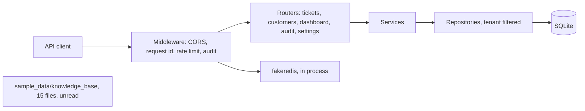
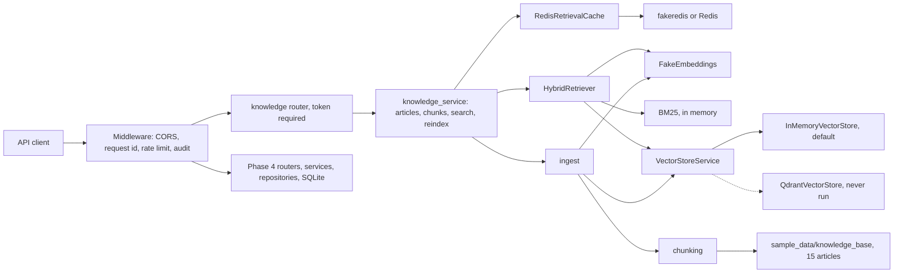
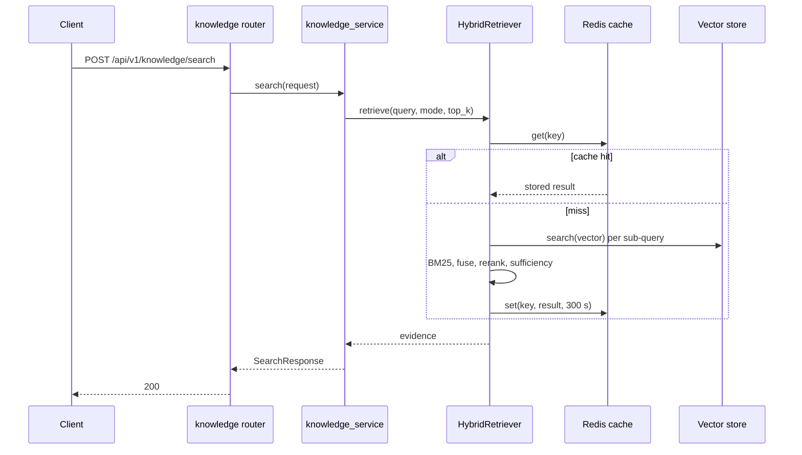

# Phase 5: system design evolution

> **Status of this phase:** implemented and checked locally. All four tasks (P5-1 to P5-4) are merged (pull requests #42, #46, #47 and #48). In a run made for this document (2026-11-22) the whole suite passed (893 tests) and `ruff check .` reported no problems. Nothing is deployed.
>
> **Not built in Phase 5:** no language model, no agent, no workflow, no frontend page for knowledge, no real Qdrant server run, no real Redis run, and no check that retrieved text is safe to put in a prompt (that is Phase 7). Retrieval quality was measured only with the offline fake embeddings.
>
> **Related documents:** [codebase explanation](./01_CODEBASE_EXPLAINED.md), [infrastructure evolution](./03_INFRA_EVOLUTION.md), the local-only `04_INTERVIEW_QNA.md`, and [Phase 4 design evolution](../Phase04/02_DESIGN_EVOLUTION.md).
>
> **Mermaid.** Diagrams were checked for structure only, not rendered.

---

## A. Phase overview

| Item | Content |
|---|---|
| Objective | Give the platform a way to find the knowledge-base articles that answer a question, with evidence a person can check, and expose it through the API. |
| Initial state | Phase 4's API: tickets, customers, dashboard, audit, settings. The 15 articles existed as files in `sample_data/knowledge_base/` and nothing read them. |
| Requirements addressed | F5 (cited evidence from the knowledge base, semantic plus keyword, reranked); the retrieval part of CLAUDE.md section 8; the Redis retrieval cache key from section 7.5. F6 (similar resolved cases) is a different feature and is not built. |
| Major additions | A new top-level package `rag/` (chunking, fake embeddings, vector-store protocol with in-memory and Qdrant classes, hybrid retriever, ingest); a knowledge service and four routes; a retrieval-cache adapter; indexing at startup; `make ingest`. |
| Important changes | `VectorStoreService` gained `clear()` in P5-4. `backend/app/main.py` lifespan now indexes the knowledge base. |
| Final capability | `POST /api/v1/knowledge/search` returns ranked evidence with a score and a source for a free-text query; articles can be listed and read; an admin can reindex. All offline. |

---

## B. Initial architecture

This is what Phase 4 left: a FastAPI process with middleware, services, repositories and one SQLite file. The articles were data files with no code reading them.

Limitations: no search at all; nothing could answer "which article explains an MFA lockout".

---

## C. Intermediate architectural evolution

### C1. P5-1: knowledge articles and chunking (PR #42)

- **Original design.** Articles were files only.
- **Motivation.** Retrieval works on small passages, not whole articles; a whole article dilutes the match and cannot be cited precisely.
- **Introduced.** `rag/` as a new top-level package that knows nothing about tickets. `rag/chunking.py` loads articles (YAML front-matter: title, category, tags, summary) and `chunk_article` splits on headings, then into 900-character windows with a 150-character overlap. The chunk text is prefixed `"{title} - {heading}"`; `Chunk.body` keeps the raw window so size and overlap can be tested. Text before the first heading is filed under "Overview". Missing or incomplete front-matter raises `ValueError` at load time. `pyyaml` is the one new dependency.
- **Boundary.** `.claude/rules/rag.md` and each module docstring say `rag/` must not import tickets, repositories or agents; a test in `tests/rag/test_chunking.py` checks the imports.
- **Effect on existing components.** None; nothing calls it yet.
- **Trade-off.** Fixed-size character windows can cut a sentence; the overlap softens that.
- **Verified.** `tests/rag/test_chunking.py` (15 articles, valid categories, every demo topic has an article, window size and overlap).

### C2. P5-2: vector store and fake embeddings (PR #46)

- **Motivation.** Semantic search needs vectors and somewhere to keep them, and tests must run with no network or API key.
- **Introduced.** `rag/embeddings.py`: the `Embeddings` protocol and `FakeEmbeddings`, which hashes lower-cased tokens (md5, stable across processes) into 384 buckets and L2-normalises, with no numpy. `rag/vector_store.py`: `Document`, `SearchHit`, the `VectorStoreService` protocol, `InMemoryVectorStore` (cosine similarity, equality filters, the same id replaces), `QdrantVectorStore`, and `get_vector_store(settings)`, which picks the class from `settings.vector_store` and caches it. The Qdrant class imports `qdrant_client` inside its methods, so offline runs never load it; chunk ids become stable UUID point ids; the collection is created on first write. `qdrant-client` is the one new dependency.
- **Effect.** `settings` is passed in, so `rag/` imports nothing from `app`. A test checks that no module outside `rag/` names a concrete store class.
- **Trade-off.** Fake embeddings are a bag of words: they match shared wording, not meaning. They make the pipeline testable, not smart.
- **Verified.** `tests/rag/test_vector_store.py`. Qdrant was only exercised with a stubbed client and constructed lazily; no server was run.

### C3. P5-3: hybrid retriever (PR #47)

- **Motivation.** Keyword search finds exact terms, vector search finds close wording; either alone misses cases. Combining them needs a fair way to merge two rankings.
- **Introduced.** `HybridRetriever` in `rag/retriever.py`. A query becomes up to three sub-queries (original, stop-word-stripped, longest-words variant; an optional `rewriter` hook can add one). Each sub-query gets a semantic ranking from the store and a BM25 ranking (`rank_bm25`). Rankings are fused by reciprocal rank fusion (k=60), reranked by title overlap plus a category bonus, optionally reordered by an injected `llm_rerank`, and reduced to one hit per article. Modes: `hybrid` (default), `semantic`, `keyword`. `category` is a hard filter unless `strict_category=False`, when it only boosts.
- **Sufficiency check.** Deterministic: top score at least 0.3 and at least half the query terms found in the top three hits. If it fails, ONE extra ranking pass runs on the uncovered terms, then retrieval stops. This is the bounded loop CLAUDE.md asks for.
- **Cache.** Results are cached 300 s under the key `rag:{mode}:{category}:{top_k}:{query}` through an injected object with `get` and `set(ttl)`. `backend/app/services/retrieval_cache.py` adapts the Redis client, so `rag/` imports nothing from `app`.
- **Hooks.** `chunk_filter` is where Phase 7 will drop injected chunks; the default passes everything. `rewriter` and `llm_rerank` are injected, so the retriever itself never calls a model.
- **Verified.** `tests/rag/test_retriever.py`: hit-rate@3 over 11 queries taken from the demo tickets is 1.0 with fake embeddings; modes, RRF arithmetic, category filter and boost, hooks, cache and the one-retry rule each have a test. The cache was exercised only with fakeredis.

### C4. P5-4: ingest command and knowledge API (PR #48)

- **Motivation.** The retriever needs an indexed store, and the console and agents need HTTP access.
- **Introduced.** `rag/ingest.py`: `ingest(store, embeddings, directory, recreate=False)` returns an `IngestResult` (15 articles, 75 chunks on the demo set). Chunk ids are stable and the store replaces a same-id document, so a second run changes nothing. `recreate=True` calls the new `clear()` (in-memory: empty the dict; Qdrant: delete the collection, recreated on the next write), so chunks of deleted articles go too. `backend/app/services/knowledge_service.py` keeps the in-process articles and embedded chunks and serves four routes in `backend/app/api/knowledge.py`: `GET /api/v1/knowledge/articles` (search, category), `GET /api/v1/knowledge/articles/{id}` (ids are file slugs), `POST /api/v1/knowledge/search`, and admin-only `POST /api/v1/knowledge/reindex`, whose `indexed` is the chunk count. The lifespan in `backend/app/main.py` indexes at startup only when `VECTOR_STORE=memory`; a failure is logged and never stops startup. `make ingest` runs `python -m app.services.knowledge_service` (the command lives in `app` because it needs settings, which `rag/` may not import).
- **Effect.** The service is now stateful in process: `_articles` and `_documents` in the knowledge service. `_ensure_indexed` refills an empty store on first use.
- **Verified.** `tests/rag/test_ingest.py`, `tests/api/test_knowledge.py` (list, filter, detail, 404, MFA article in the top 3, mode and top_k validation, admin-only reindex, search after reindex, 401 on every route, startup indexing).

---

## D. Final architecture

| Layer | Component | Responsibility |
|---|---|---|
| API | `backend/app/api/knowledge.py` | HTTP and roles only (any valid token reads; `admin` reindexes) |
| Service | `backend/app/services/knowledge_service.py` | Own index state, call ingest and the retriever, shape responses |
| Adapter | `backend/app/services/retrieval_cache.py` | Present Redis as `get` and `set(ttl)` |
| RAG | `rag/` | Load, chunk, embed, store, retrieve, ingest; no ticket knowledge |
| Data | Vector store (in-memory or Qdrant), BM25 index rebuilt per retriever, Redis cache | |

Security boundary: every knowledge route requires a token. Retrieved text is not yet screened; the hook exists, the screen does not.

---

## E. End-to-end execution and data flow

Example: an agent searches "locked out after too many MFA attempts".

1. `POST /api/v1/knowledge/search` with a bearer token and `{"query": "...", "top_k": 5, "mode": "hybrid"}`. The schema `SearchRequest` rejects an empty query, `top_k` outside 1 to 20 or an unknown mode with 422.
2. Middleware binds a request id and counts the call; auth rejects a missing token with 401.
3. `knowledge_service.search` calls `_ensure_indexed` (indexes if the store is empty), builds a `HybridRetriever` over the stored chunks, and asks it for evidence.
4. The retriever checks the Redis cache by key. A hit returns the stored result with `cached` true.
5. On a miss it rewrites the query, runs semantic and BM25 rankings per sub-query, fuses, reranks, keeps one hit per article, checks sufficiency (at most one more pass) and stores the result for 300 s.
6. The service returns `{results, mode, took_ms}`; each result carries id, title, source, snippet, score, url and article_id.

Errors: no token 401; bad body 422; unknown article id 404 `Article not found`; non-admin reindex 403. If startup indexing fails the error is logged and the service still starts; the first knowledge call retries through `_ensure_indexed`.

---

## F. Architectural decisions and trade-offs

| Decision | Context | Alternatives | Rationale | Benefits | Trade-offs | Status |
|---|---|---|---|---|---|---|
| `rag/` is its own package that imports nothing from `app` | Retrieval should be testable and reusable by agents | Put retrieval under `backend/app` | Settings and the cache are passed in | Offline tests; clear boundary, enforced by tests | Glue code (adapter, CLI) lives in `app` | Implemented |
| `VectorStoreService` protocol with in-memory default | Demo must run with no server | Qdrant only; a library such as Chroma | One protocol, two classes | Swap by setting; no network in tests | Two implementations to keep equal; Qdrant untested against a server | Implemented |
| Fake hashed embeddings | No API key offline | A local model | Deterministic and dependency-free | Fast, stable tests | Wording match only | Implemented |
| Hybrid with reciprocal rank fusion | Keyword and vector scores are not comparable | Weighted score sum | RRF uses ranks, so no score calibration | Robust merge | Ignores score magnitude | Implemented |
| One bounded extra retrieval pass | Budget rule: no unbounded loops | Loop until sufficient | Check is deterministic, one retry then stop | Predictable cost | Weak recall on hard queries stays weak | Implemented |
| Retrieval cache behind an injected object | Cache key is in CLAUDE.md 7.5 | `rag/` talks to Redis | Adapter in `app` | `rag/` stays pure | Cached results hide index changes for up to 300 s (not invalidated on reindex) | Implemented |
| Service keeps index state in module variables | One process, one tenant | Database table of chunks | Simple | No extra storage | Lost on restart, not shared across workers | Implemented |
| Startup indexes only for the memory store | A persistent store should not be rebuilt every boot | Always index | Memory is empty on start; Qdrant is filled by `make ingest` or reindex | Fast restarts with Qdrant | An empty Qdrant needs a manual step (the first knowledge call also fills it) | Implemented |
| Article id is the file slug | Stable, readable ids | Database ids | Files are the source of truth | Stable links | Renaming a file changes its id | Implemented |

---

## G. Architectural improvements

| Quality | Before | After (supported by code and tests) |
|---|---|---|
| Separation | Articles unread | Retrieval isolated in `rag/` with import tests |
| Modularity | None | Store, embeddings, retriever, ingest are separate; hooks injected |
| Testability | | 51 knowledge tests (41 under `tests/rag/` plus 10 in `tests/api/test_knowledge.py`) run offline in seconds |
| Reliability | | Startup indexing failure does not stop the service; one-retry cap |
| Performance | | A 300 s result cache (only fakeredis exercised); no latency measurement taken |
| Security | | Routes need a token; reindex needs admin; screening of retrieved text not yet |
| Extensibility | | Swap store by setting; add rerank, rewrite and filter without editing the retriever |

Scalability is not demonstrated: no load test, and the index is per process.

---

## H. Limitations and future evolution

- Fake embeddings do not understand meaning; hit-rate@3 of 1.0 is over 11 queries written from the demo tickets and says little about real queries.
- The in-memory index and article state are per process and rebuilt on restart; several workers would each hold a copy.
- BM25 is rebuilt each time `search` builds a retriever; cheap at 75 chunks, not at scale.
- The cache is not cleared by reindex, and keys embed the raw query text.
- Qdrant has been run only against a stub; payload filters, `clear()` and `count()` on a real server are unverified.
- Retrieved chunks are not scanned for instructions yet (Phase 7); articles are trusted data today.
- No similar-cases search (F6), no evidence use by agents (Phases 9 and 10), no knowledge screen (Phase 12).
- Recommendations, not built: a real embedding provider behind `Embeddings`, cache invalidation on reindex, a persisted BM25 index, per-chunk freshness.

---

## I. Phase completion summary

- **Final architecture:** section D.
- **Introduced:** `rag/chunking.py`, `rag/embeddings.py`, `rag/vector_store.py`, `rag/retriever.py`, `rag/ingest.py`, `backend/app/services/knowledge_service.py`, `backend/app/services/retrieval_cache.py`, `backend/app/api/knowledge.py`, `backend/app/schemas/knowledge.py`.
- **Verified outcomes (2026-11-22):** 893 tests passed, `ruff check .` clean, hit-rate@3 of 1.0 on the 11 demo queries (offline), 15 articles and 75 chunks indexed.
- **Outstanding:** a real Qdrant run, a real Redis run, real embeddings, chunk screening, F6.
- **Carried forward:** the retriever's evidence shape and `chunk_filter` hook (Phase 7 screening, Phase 9 Knowledge Agent); the `VectorStoreService` protocol; the Redis cache adapter; the knowledge routes (Phase 12 knowledge page).
