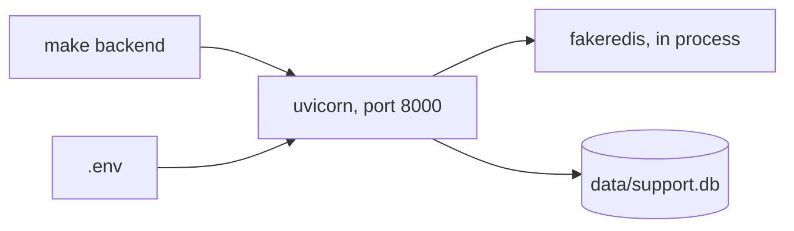
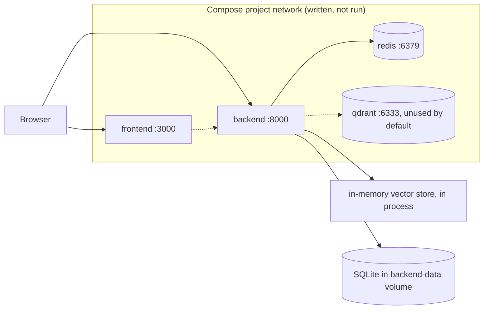
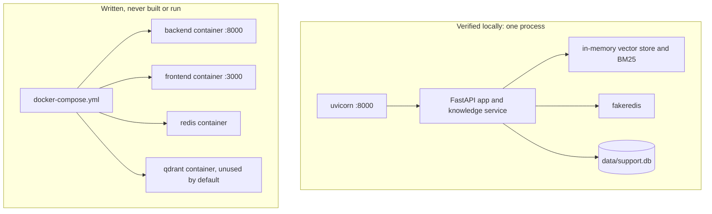

# Phase 5: infrastructure design evolution

> **Read this first.** In Phase 5 **no container was built and no Compose stack was brought up**. The files `backend/Dockerfile`, `frontend/Dockerfile`, `.dockerignore` and `docker-compose.yml` exist, because tasks P14-2 and P14-3 were pulled forward into this period, but the Docker daemon was not running, so `docker build`, `docker compose up` and every health check described below were **never executed**. Everything in this document about containers comes from reading those files and from the tests in `tests/deployment/` that parse them. Nothing was verified by running a container.
>
> Phase 5 itself adds **no new infrastructure and no new environment variable**. It adds one router and some in-process state to the existing Python process. Qdrant is **present in `docker-compose.yml` but unused by default** (`VECTOR_STORE=memory`). No real Qdrant server and no real Redis server were run.
>
> **Related documents:** [codebase explanation](./01_CODEBASE_EXPLAINED.md), [design evolution](./02_DESIGN_EVOLUTION.md), [Phase 4 infrastructure](../Phase04/03_INFRA_EVOLUTION.md).
>
> **Mermaid.** Diagrams were checked for structure only, not rendered.

---

## A. Infrastructure overview

| Question | Answer |
|---|---|
| Where does it run? | Verified path: one Python process on the developer's machine plus a SQLite file. Written but never run: four containers in Compose. |
| In Docker? | Not in any verified run. |
| Externally hosted? | Nothing. |
| Start (verified) | `make backend` (uvicorn, port 8000). The lifespan creates tables, seeds demo data and, with the memory store, indexes the 15 articles. |
| Start (written, not run) | `docker compose up --build` |
| Communication | In process: function calls, fakeredis, an in-memory vector store. |
| Configuration | Environment variables or `.env`; `.env.example` lists them. |
| Stop | Ctrl+C for the local process. `docker compose down` for the stack (never run). |

Development is the only environment that has been exercised; there is no production configuration beyond the files.

---

## B. Initial infrastructure design

Phase 4's: one process, one SQLite file, fakeredis in the process. The container files already existed in the repository but were unbuilt.

---

## C. Infrastructure evolution

### Change 1. A vector store and a keyword index inside the process (P5-2, P5-3)

- **Before.** No search state.
- **Added.** `InMemoryVectorStore` (a dictionary of 75 chunk vectors) and a BM25 index, both in the Python process memory. No port, file or container. They are rebuilt when the process starts and are lost when it stops.
- **Verified.** `tests/rag/test_vector_store.py` and `tests/rag/test_retriever.py`. Not measured: memory use or latency.

### Change 2. Redis as a retrieval cache (P5-3, P5-4)

- **Before.** Redis (really fakeredis) was used for rate limiting only.
- **Added.** The knowledge search stores results for 300 seconds under keys beginning `rag:` through `backend/app/services/retrieval_cache.py`. `get_redis` in `backend/app/core/redis.py` returns an in-process fakeredis unless `REDIS_URL` is set and `USE_FAKE_REDIS` is off. In Compose, the backend is set to the Redis service address and fake Redis off. That path was never run.
- **Verified.** The cache was exercised with fakeredis only.

### Change 3. Startup indexing (P5-4)

- **Added.** The lifespan in `backend/app/main.py` indexes the knowledge base when `VECTOR_STORE=memory`. For `qdrant` it does nothing; the store is filled by `make ingest` or `POST /api/v1/knowledge/reindex`.
- **Effect on startup.** Startup does a little more work (read 15 files, hash 75 passages). Failure is logged and does not stop startup.
- **Verified.** `tests/api/test_knowledge.py::test_startup_indexes_the_knowledge_base_into_an_empty_store`.

### Change 4. `make ingest` (P5-4)

Runs `python -m app.services.knowledge_service` with `backend` on the path and prints article and chunk counts. Against the in-memory store it only reports counts, because the store dies with the command. It is useful against Qdrant (not run).

### Change 5. Container files and Qdrant in Compose (P14-2, P14-3, pulled forward)

Not Phase 5 work, but they shape its future. The backend image copies `rag/` and `sample_data/` into the image, so the knowledge base is baked in. Qdrant appears in Compose so that a later switch to `VECTOR_STORE=qdrant` needs no new service. Details are in sections D to F. **None was built or started.**

---

## D. Docker and container explanation

All from `docker-compose.yml`. **Not executed.**

| Service | Image or build | Purpose | Ports | Volumes | Dependencies | Health check |
|---|---|---|---|---|---|---|
| `redis` | `redis:7-alpine`, started with append-only persistence | Cache and rate-limit store | None published | `redis-data` at `/data` | None | `redis-cli ping`, every 10 s |
| `qdrant` | `qdrant/qdrant:v1.12.4` | Vector database; **unused by default** | None published | `qdrant-storage` at `/qdrant/storage` | None | Opens a TCP connection to port 6333 with bash (the image has no curl) |
| `backend` | Built from `backend/Dockerfile`, context is the repository root | FastAPI service | `8000:8000` | `backend-data` at `/app/data` | `redis` and `qdrant` healthy | Python script calling `/health/live`, every 30 s |
| `frontend` | Built from `frontend/Dockerfile` | Next.js shell | `3000:3000` | None | `backend` healthy | `wget` to `/api/health` |

Environment for `backend` (names only): `DEMO_MODE`, `ENVIRONMENT`, `CORS_ORIGINS`, `JWT_SECRET` (default is a public demo value), `DATABASE_URL` (SQLite in `/app/data`), `CHECKPOINT_DB_PATH`, `REDIS_URL`, `USE_FAKE_REDIS` (false), `LLM_PROVIDER` (fake), `VECTOR_STORE` (memory), `QDRANT_URL`. All services restart `unless-stopped`.

Failure behaviour (from the configuration, untested): if `redis` or `qdrant` never becomes healthy, `backend` does not start and `frontend` waits. Because Qdrant is a startup dependency but not used by default, a broken Qdrant would block a demo that does not need it; this is a known cost of the current file. If Redis stops later, the cache path has no error handling.

---

## E. Docker networking

By Compose defaults (nothing is declared explicitly): one project network is created and every service joins it. Services resolve each other by service name: the backend would reach `redis:6379` and `qdrant:6333` by name, and the Compose file sets `REDIS_URL` and `QDRANT_URL` that way. Three different ports must not be confused.

| Kind | Example | Meaning |
|---|---|---|
| Container listening port | backend 8000 | What uvicorn binds inside the container |
| Host-published port | `8000:8000`, `3000:3000` | What your browser reaches at `localhost` |
| Port another container uses | `redis:6379`, `qdrant:6333` | Reached through the Docker network by service name |

`redis` and `qdrant` publish nothing, so they are reachable only from other containers. `localhost` inside the backend container means the backend itself, not Redis. The frontend is built with `NEXT_PUBLIC_API_URL=http://localhost:8000`, because the browser, not the container, calls the API. **None of this was observed**; it is read from the configuration.

---

## F. Component wiring and routing

Verified locally: client to uvicorn on `localhost:8000`, through the four middleware, to the knowledge router, to the service, to the in-process retriever and fakeredis.

Written but not run: browser to `localhost:3000` (frontend); browser to `localhost:8000` (backend); backend to `redis:6379`; backend to `qdrant:6333` only if `VECTOR_STORE=qdrant`; no reverse proxy.

---

## G. Lifecycle commands

Local (these were used):

| Task | Command |
|---|---|
| Start | `make backend` |
| Index and print counts | `make ingest` |
| Tests | `.venv/Scripts/python.exe -m pytest -q` |
| Lint | `.venv/Scripts/python.exe -m ruff check .` |

Compose (written in the repository, **never run for this document**):

| Task | Command | Note |
|---|---|---|
| Validate the file | `docker compose config -q` | Reads only |
| Build and start | `docker compose up --build` | |
| Stop | `docker compose down` | Keeps volumes |
| Logs | `docker compose logs -f backend` | |
| Status and health | `docker compose ps` | Shows the health column |
| Rebuild one service | `docker compose up --build backend` | |
| Remove everything including data | `docker compose down -v` | **Destructive**: deletes the named volumes, so the SQLite file, Redis data and Qdrant storage are lost |

---

## H. Environment variables and secrets

Phase 5 read these existing settings (all listed in `.env.example`, which has placeholders only):

| Variable | Purpose | Default |
|---|---|---|
| `VECTOR_STORE` | `memory` or `qdrant` | `memory` |
| `QDRANT_URL`, `QDRANT_API_KEY`, `QDRANT_COLLECTION` | Qdrant connection and collection name | empty, empty, `clouddesk_knowledge` |
| `EMBEDDING_PROVIDER`, `EMBEDDING_MODEL`, `EMBEDDING_DIMENSIONS` | Embeddings; only `FakeEmbeddings` is wired, and only the dimension count (384) is read | `fake`, empty, 384 |
| `SAMPLE_DATA_DIR` | Where `sample_data/knowledge_base` is read from | repository default |
| `REDIS_URL`, `USE_FAKE_REDIS` | Real or fake Redis | empty, `true` |

The Qdrant key is held as a secret value in settings and never logged. The settings route reports only booleans. Note that `EMBEDDING_PROVIDER` does not yet choose a class: the knowledge service always builds `FakeEmbeddings`. Supply any real key through the environment, never in a committed file.

---

## I. Persistent storage and data management

| Data | Where | Persistence |
|---|---|---|
| Tickets and customers | SQLite file (`backend-data` volume in Compose) | Survives restart |
| Vector index (default) | Process memory | Lost on restart; rebuilt at startup |
| BM25 index | Process memory | Rebuilt per search call from stored chunks |
| Article text | `sample_data/knowledge_base/`, baked into the image | Part of the repository |
| Retrieval cache | fakeredis (lost on restart) or Redis (append-only file in `redis-data`) | Expires in 300 s anyway |
| Qdrant vectors | `qdrant-storage` volume | Persists, if ever used |

Backup and restore are **not implemented** for any of these. Removing a container keeps its named volume; `down -v` removes it.

---

## J. Health checks, startup order and resilience

- Locally: `/health/live` does no I/O; `/health/ready` checks database, Redis, vector store and LLM (Phase 1). The vector store check calls `health()`, always true for memory.
- Compose (written): `backend` waits for `redis` and `qdrant` to report healthy, `frontend` waits for `backend`. A running container is not proof of readiness; the checks are what gate startup.
- No retry or circuit breaker around Redis or Qdrant calls in the knowledge path.
- Restart policy `unless-stopped` on all four services.
- Recommended, not built: do not make Qdrant a hard dependency while the default is memory; drop the cache on reindex.

---

## K. Observability and troubleshooting

- Logs: JSON with request id. Startup logs `knowledge indexed` with article and chunk counts, or `knowledge indexing failed` with the error class.
- Health endpoints: `/health/live`, `/health/ready`.
- No metrics, dashboards or tracing exist for retrieval; `took_ms` is returned by the search route.

| Symptom | Check |
|---|---|
| Search returns nothing | Is the store empty? `POST /api/v1/knowledge/reindex` as admin, or restart; the first knowledge call also refills an empty store |
| Startup log shows indexing failed | A front-matter error in an article names the file |
| Port 8000 busy | Another uvicorn is running; stop it |
| Container cannot reach Redis (Compose, untested) | Use `redis:6379`, never `localhost`; `docker compose ps` for health |

---

## L. Final infrastructure architecture

---

## M. Infrastructure verification

| Check | Status |
|---|---|
| Local process starts and serves knowledge routes | Verified through the test client (893 tests passed on 2026-11-22); the server was not started by hand for this document |
| `make ingest` prints 15 articles and 75 chunks | Recorded in `MEMORY.md` from the task run; not repeated here |
| Compose file and Dockerfiles parse and follow rules (non-root user, health check, services) | Checked by `tests/deployment/test_compose.py` and `tests/deployment/test_dockerfiles.py`, included in the passing run; this is a text check, not a build |
| Images build | **Not verified**: the Docker daemon was down |
| Containers start, health checks pass, service-name DNS works | **Not verified** |
| Backend to real Redis, backend to Qdrant | **Not verified** |
| Volume persistence, backup, restore | **Not verified, backup not built** |
| Cloud deployment | None |
