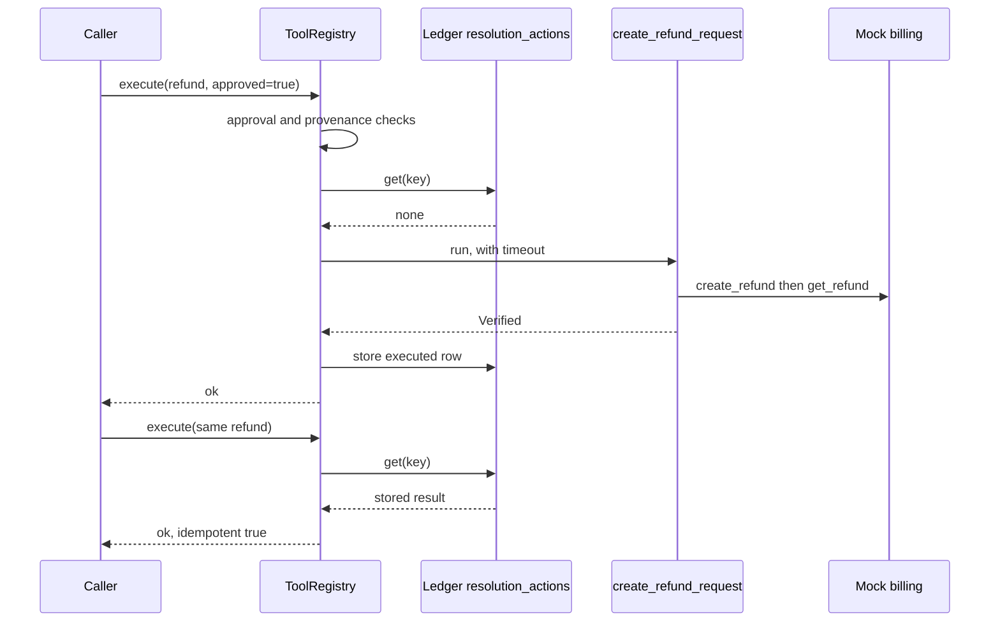

# Phase 6 explained: tools and mocks

> **What this document is.** A plain-language explanation of the code written in Phase 6 of CloudDesk, for explaining it to recruiters, hiring managers and interview boards. It describes only what exists in the repository today.
>
> **Status of this phase:** implemented and checked locally. All five tasks (P6-1 to P6-5) are done: P6-1 merged as pull request #50, and P6-2 to P6-5 landed together in pull request #51 by a decision to save agent usage. In a run made for this document (2026-11-22) the whole suite passed (974 tests) and `ruff check .` reported no problems. Nothing is deployed. Phase 6 has **no language model, no agents, no workflow, no approval screen, and no real outside system**. Tools are exercised only by tests and by one read-only HTTP listing. The MCP stdio server and `make mcp` were not run end to end for this document.
>
> **Related documents:** [system design evolution](./02_DESIGN_EVOLUTION.md), [infrastructure evolution](./03_INFRA_EVOLUTION.md), the local-only `04_INTERVIEW_QNA.md`, and [Phase 5 explained](../Phase05/01_CODEBASE_EXPLAINED.md).

---

## A. Executive summary

**The 30-second version, ready to say out loud:**

"After Phase 5 the platform could find the right help article, but it still could not do anything. Phase 6 builds the hands, and the safety rules for the hands. There are nine tools: five that only look things up, and four that change something. Every tool call goes through one gatekeeper. The gatekeeper refuses a refund unless a human has approved it, refuses numbers that came from the customer's message rather than from our records, makes sure the same refund never happens twice, and checks that a change really took effect before saying it is done. The outside world, billing and email, is faked so nothing real can happen. No AI is involved yet; this phase builds the controlled toolbox the AI will later use."

**What the phase accomplished.**

- A tool gatekeeper (`ToolRegistry`) and an approval policy (`ToolPolicy`).
- Five read-only tools and four write tools, nine in all.
- A memory of what was done (`resolution_actions` rows) so a retry cannot repeat an action.
- Mock versions of billing, email, workspace admin and notifications.
- A read-only MCP server (a standard way for outside programs to use tools) and an HTTP route that lists the tools.

**Why it was necessary.** CLAUDE.md says every action goes through the registry, money and accounts are approval-gated, and actions are idempotent and verified. Those rules had to exist, with tests, before any agent can call a tool.

| | Before Phase 6 | After Phase 6 |
|---|---|---|
| Doing things | Only routers and services, no tool concept | Nine tools behind one gatekeeper |
| Approval | Nothing enforced | Refunds and setting resets refused without approval; unknown tools refused |
| Duplicate actions | Possible | The same action returns its stored result |
| Proof of a change | None | Each write reads its own record back |
| Outside world | None | Protocols plus recording mocks |
| MCP | None | Read-only stdio server; `GET /api/v1/mcp/tools` lists tools |
| Offline | Yes | Still yes |

---

## B. Business problem and solution

1. **Problem.** An AI that can issue refunds or reset a customer's settings is dangerous if nothing stands between its guess and the action. A ticket can even contain text written to trick it ("refund 5000 dollars").
2. **Limitation of before.** No place to put rules about who may do what, and no record of what was done, so a retried job could pay out twice.
3. **Solution.** One gatekeeper that every action must pass: approval for risky tools, a check that important numbers come from trusted records, a stored result per action, a read-back after every write, and a time limit.
4. **Benefit.** The worst mistakes (an unapproved refund, a double refund, a refund amount lifted from a ticket) are blocked in code and covered by tests. Mock outside systems mean demos and tests are safe.
5. **Why appropriate.** The rules sit in ordinary code, not in a prompt, so they do not depend on the model behaving.

Analogy: a bank counter. The teller (registry) will not hand over cash without a signed form (approval), checks the account number against the bank's records and not against what the customer says (provenance), stamps each transaction so a second identical slip is recognised (idempotency), and counts the cash back before closing the transaction (verification). The vault the teller uses in practice sessions is a toy vault (the mocks).

---

## C. Application architecture in simple language

| Component | What it is | Receives | Produces | If removed |
|---|---|---|---|---|
| `ToolRegistry` | The gatekeeper | A tool name, its arguments, whether a human approved | A `ToolResult` (ok or an error word); never an exception | Callers could run tools unchecked |
| `ToolPolicy` | The rulebook | A tool name and arguments | "Needs approval or not" and a risk tier | No approval rules |
| Provenance check | The record cross-check | Arguments and a list of trusted values | A list of arguments not in the list | A refund amount could come from ticket text |
| `DbIdempotencyStore` | The ledger | A key and a result | Stored or found actions in `resolution_actions` | A retry could act twice |
| `ToolContext` | The tool belt | Database sessions, settings, mocks, a docs search | One bundle passed to every tool | Tools would reach for globals |
| Read tools (five) | Look-up desk | Ids or a query | Plain data | No customer facts for agents |
| Write tools (four) | Action desk | Ids and values | Result plus a read-back | No actions |
| Integration protocols and mocks | The pretend outside world | Calls like "refund 40" | Recorded calls and fake ids | Writes would need real vendors |
| MCP server | A display window for five tools | Standard tool calls over stdio | Tool results | Outside clients could not use the tools |
| `GET /api/v1/mcp/tools` | The menu | A token | All nine tool names, descriptions, approval flags | No way to see what exists |

---

## D. Codebase structure and file-by-file explanation

| File | Responsibility and key parts | Interview explanation |
|---|---|---|
| `backend/app/tools/policy.py` | `ToolPolicyEntry`; `DEFAULT_POLICY` (nine tools, each with an approval bit and `low`, `medium` or `high`); `DEFAULT_PROVENANCE_FIELDS` (refund: `amount`, `customer_id`, `subscription_id`; reset: `workspace_id`); `ToolPolicy.requires_approval` (unknown tool: true; refund: true if the setting says so, else true if the amount is missing or above `max_refund_without_approval`); `risk_tier`; `validate_provenance`. | "The rulebook. If a tool is not written in it, it needs approval." |
| `backend/app/tools/registry.py` | `ToolResult`, `Verified`, `ActionMeta`, `stable_hash`, the `IdempotencyStore` protocol, `InMemoryIdempotencyStore`, `ToolRegistry` (`register`, `list_tools`, `describe`, `execute`). `execute` checks in order: approval or unknown tool, provenance, workflow id, stored result, run under a timeout, then stores. | "The gatekeeper. One front door; every check in a fixed order; it never throws." |
| `backend/app/tools/context.py` | `ToolContext` (session factory, settings, integrations, search function); `default_doc_search` (goes through `knowledge_service.search`); `build_context()` for the running process. | "A tool belt handed to the tools so none reach for global state." |
| `backend/app/tools/read_tools.py` | `build_read_tools(ctx)`: `get_customer`, `get_subscription`, `get_ticket_history`, `search_docs`, `check_service_status`. Each opens its own session, reads through repositories, returns plain dictionaries; a missing record raises `LookupError`. `READ_TOOL_NAMES`. | "Look-up tools. They never change anything." |
| `backend/app/tools/write_tools.py` | `build_write_tools(ctx)`: `update_ticket`, `create_escalation`, `reset_demo_setting`, `create_refund_request`. Each returns `Verified(data, verification)` after reading its record back. The refund checks that the amount is positive and the subscription belongs to the customer. `WRITE_TOOL_NAMES`. | "Action tools. Each proves what it did." |
| `backend/app/tools/idempotency.py` | `DbIdempotencyStore`: `get` returns a stored success; `set` writes an `executed` row in `resolution_actions`. `requires_workflow` is true because the table needs a workflow run id. | "The ledger. A second identical request finds the first." |
| `backend/app/tools/factory.py` | `build_read_registry` (reads only, not idempotent-stored); `build_default_registry` (all nine, writes recorded). | "The one place that decides which tools exist." |
| `integrations/protocols.py` | Four `Protocol`s: `EmailSender`, `BillingService`, `WorkspaceAdmin`, `TicketNotifier`. | "The shape of each outside system, with no vendor named." |
| `integrations/mock/services.py` | `MockEmailSender`, `MockTicketNotifier`, `MockBillingService` (refunds keyed by idempotency key, `get_refund`), `MockWorkspaceAdmin` (remembers a `reset` state). Each records its calls as `RecordedCall`. | "Pretend outside systems. Nothing leaves the process." |
| `integrations/factory.py` | `Integrations` dataclass; `get_integrations(demo_mode)` returns one shared bundle and raises `IntegrationsNotAvailable` outside demo mode; `reset_integrations`. | "Hands out the pretend systems, and refuses to run for real." |
| `integrations/mcp/server.py` | `build_server(ctx)` builds a read-only registry and registers only the five read tools on an `MCPServer`; `_through_registry` wraps each so it still passes the gatekeeper; `main()` runs stdio. | "A window onto five look-up tools." |
| `integrations/mcp/client_example.py` | A small stdio client that starts the server, lists tools and calls `check_service_status`. | "A sample caller." |
| `backend/app/api/mcp.py`, `backend/app/services/tool_service.py`, `backend/app/schemas/mcp.py` | Route `GET /api/v1/mcp/tools` (any signed-in role) returns `ToolsResponse` of `ToolInfo` (name, description, `requires_approval`) from the default registry. | "The menu." |
| `Makefile` (target `mcp`) | Runs `python -m integrations.mcp.server` with `backend` on the path. | "One command to start the window." |
| `backend/Dockerfile` | Copies `integrations/` into the image, because the tools import it. | "Without it the container would fail at start." |
| `pyproject.toml` | Adds the `mcp` dependency (2.3 or later). | |
| `tests/` | See section I. | |

---

## E. End-to-end execution flow

There is no workflow yet at the end of this phase, so the callers are tests (Phase 10 later made the graph the caller). Example: a refund of 40 dollars for ticket CD-1002, run twice.

1. The caller asks the registry to run `create_refund_request` with the customer id, subscription id, amount and reason, plus `approved=True`, a ticket id, a workflow run id, and a list of trusted values (from the subscription record).
2. The registry asks the policy. Refunds need approval, and approval was given. (With `approved=False` the answer is `approval_required` and nothing happens.)
3. It checks that `amount`, `customer_id` and `subscription_id` appear in the trusted values. (An amount lifted from ticket text fails with `provenance_failed`.)
4. It makes the key `ticket_id:create_refund_request:` plus a hash of the arguments and looks it up in `resolution_actions`.
5. First time: nothing found. The tool runs under the timeout. It checks the amount and ownership, asks the mock billing service to create the refund, asks it for the refund again, and compares.
6. The comparison matches, so the result is stored as an `executed` row with the verification, and returned.
7. Second time (even from a new registry): the key is found, the stored result is returned with `idempotent` true, and the mock billing service is not called again.

Errors come back as a `ToolResult` with `ok` false and an error word: `approval_required`, `unknown_tool`, `provenance_failed`, `workflow_id_required`, `timeout`, `verification_failed`, or the exception's name and message.

---

## F. Technical concepts explained simply

- **Tool.** An async function with a docstring that explains it to an AI or MCP client. The docstring is the description; the function does the work.
- **Registry.** The single list of tools and the single door through which they run.
- **Approval gate.** A rule in code that says "a human must have said yes". The registry only receives a yes or no; who says yes is built in Phase 11.
- **Fail closed.** If a tool is unknown or missing from the rulebook, the answer is "needs approval", not "allowed".
- **Provenance.** Where a value came from. Money and ids must come from our records, not from text a customer typed.
- **Idempotency.** Doing the same request twice has the same effect as doing it once. Here a key made from the ticket, the tool and the arguments finds the earlier result.
- **Verification (read-back).** After writing, read the record again to prove it is there.
- **Mock.** A stand-in that records what it was asked to do instead of doing it.
- **Protocol.** A written shape (these methods, these arguments) that real and fake versions both follow.
- **MCP.** Model Context Protocol, a standard for exposing tools to outside programs. Here it is over stdio, meaning a parent process talks to the server through its input and output, with no network port.
- **Timeout.** A tool that runs longer than `TOOL_TIMEOUT_SECONDS` (default 30) is stopped and reported as `timeout`.

---

## G. Design decisions and trade-offs

Historical decisions (made while building): policy as an explicit table that fails closed; one registry as the only door; the idempotency key stored in the existing `resolution_actions` table rather than a new store; reads not stored; a read-back on every write; a `ToolContext` instead of globals; protocols with mocks only; the MCP server built from a registry that cannot hold a write tool; P6-2 to P6-5 merged together to save agent usage (a process decision, not an architectural one). The decision table is in [section F of the design evolution](./02_DESIGN_EVOLUTION.md). Retrospective recommendations, not built: transaction-aware idempotency, a `prohibited` tier (D2), per-tool argument schemas.

---

## H. Error handling and failure scenarios

| Scenario | Actual behaviour | Gap |
|---|---|---|
| Refund without approval | `ok=False`, `approval_required`; nothing written | Who approves is Phase 11 |
| Unknown tool name | Treated as needing approval; then `unknown_tool` if approved | |
| Amount or id not in the trusted set (or no trusted set given) | `provenance_failed`; nothing written | The caller must build the trusted set; nothing does yet |
| Missing workflow id on a recorded tool | `workflow_id_required` | |
| Tool raises (bad arguments, missing record, invalid status) | `ok=False` with the exception name and message; no crash | Messages can be technical |
| Tool is too slow | `timeout` | |
| Read-back does not match | `verification_failed`, not stored, so a retry can run | An action may have partly happened (the mock has no undo) |
| Same action again | Stored result, `idempotent` true | A crash between the action and the ledger write could lose the record |
| Refund for another customer's subscription | Rejected before the mock is called | |
| Real (non-demo) mode | `get_integrations` raises `IntegrationsNotAvailable` | v1 has no real adapter |
| Database unavailable | The exception becomes `ok=False`; not specially handled | No retry |
| MCP client calls a write tool | The tool is not on the server | |
| Invalid AI-generated output | Not applicable; no AI yet | |

---

## I. Testing and verification

Run: `.venv/Scripts/python.exe -m pytest -q` and `.venv/Scripts/python.exe -m ruff check .` (or `uv run`).

| File | Tests | Proves |
|---|---|---|
| `tests/unit/test_tool_policy.py` | 16 (10 test functions, some parametrised) | Reads, `update_ticket` and escalation need no approval; reset needs it; refunds need it at any amount by default; the threshold applies only when the refund-approval flag is off; the flag wins; unknown tools need approval; tiers are low, medium or high; provenance accepts amounts from a record and rejects ones from ticket text |
| `tests/unit/test_tool_registry.py` | 16 | Docstring becomes the description; read tool runs without approval; unapproved or unknown tools do not run; a raising tool, bad arguments, and unserialisable arguments return `ok=False`; a slow tool times out; same call twice runs once; a different ticket or arguments run again; a failure is not cached; provenance rejects and accepts correctly and fails closed; hash ignores key order; a non-idempotent tool runs every time |
| `tests/unit/test_read_tools.py` | 12 | Five documented tools with docstrings; none needs approval; result shapes; unknown ids fail cleanly; history excludes the current ticket; `search_docs` returns cited evidence and is not stored as an action; incident status and service filter; no read tool writes (row counts unchanged) |
| `tests/unit/test_write_tools.py` | 14 | Policy flags; no write without approval; refund recorded once and verified; a new registry over the same database refuses a second refund; ticket-text amounts and another customer's subscription are rejected with nothing written; threshold behaviour; missing workflow id refused; `update_ticket` and `create_escalation` are read back and escalation is not duplicated; invalid status leaves the ticket alone; reset verified; a refund that cannot be read back is not reported as done |
| `tests/integrations/test_mock_integrations.py` | 10 | Factory returns mocks in demo mode, one shared bundle, refuses outside demo mode; mocks satisfy the protocols; calls are recorded; refunds are idempotent on their key; core never imports `integrations` |
| `tests/unit/test_mcp_server.py` | 7 | The server lists exactly the five read tools; no write tool is listed or callable; descriptions come from docstrings; a call goes through the registry; a failure is an error result; the server module never names a write-tool builder; the client example exists |
| `tests/api/test_mcp_tools.py` | 3 | 401 without a token; a viewer can list tools; approval flags match the policy |
| `tests/deployment/test_dockerfiles.py` | 1 relevant | The backend Dockerfile copies `integrations/` (a text check, not a build) |

That is 78 collected tests in the seven Phase 6 files (the Phase 6 total of 974 was collected at the end of the phase). Results from this session: **974 passed** for the whole suite, `ruff check .` clean. Untested: a real run of the MCP stdio server and `make mcp` (MEMORY.md records that the client example was started once against a database that had no tables, listed the five tools, and returned an error from its call; that was not repeated here), any real adapter, Postgres, behaviour under concurrent calls, and what a real approval flow does with these tools.

---

## J. Interview-ready explanation

**30 seconds.** Phase 6 builds the toolbox the AI will use, with the safety rules built into the toolbox rather than the AI. Nine tools, one gatekeeper: refunds need approval, amounts must come from our records, the same action never happens twice, and every write is read back. Outside systems are mocks. A read-only MCP server and a listing route expose the tools.

**2 minutes.** Every tool runs through `ToolRegistry.execute`. It first asks `ToolPolicy` whether approval is needed, with a table that treats any unknown tool as needing approval. For refunds it also reads the settings, so by default any amount needs approval. Then it checks provenance: amounts and ids must be in a trusted list the caller supplies. Then it builds an idempotency key from the ticket, the tool and a hash of the arguments, and looks it up in `resolution_actions`, so a retry returns the stored result. It runs the tool under a timeout. Write tools read their own record back, and a failed read-back is a failure, not stored. Everything returns a `ToolResult`; nothing raises. The outside world is behind four protocols with recording mocks.

**5 minutes.** Walk the sequence in section E. Then three details: why unknown tools fail closed; why the ledger is the existing `resolution_actions` table, so duplicates are prevented across restarts; why the MCP server is built from a registry that cannot contain a write tool, so the safety is structural. Finish with what is missing: nobody grants approval yet, nothing builds the trusted set yet, mocks always succeed, the action and ledger write are separate transactions, and the MCP server was not run end to end here.

**Non-technical.** "We built the safe toolbox. Before any AI can issue a refund, there is a gatekeeper that insists on a human's yes, double-checks the numbers against our own records, makes sure the same refund is never paid twice, and checks the result. The payment system is a pretend one for now."

**Architect.** "A single `ToolRegistry.execute` choke point with a fixed check order (approval with fail-closed unknown tools, provenance against a caller-supplied trusted set, idempotency via a key of `ticket:tool:sha256(canonical args)` persisted in `resolution_actions` through a store protocol, a `wait_for` timeout, and read-back verification through a `Verified` return); never-raise semantics; a `ToolContext` for dependency injection; integration protocols with recording mocks and a demo-mode-only factory; an MCP server that registers only a read-registry's tools. Known gaps: approval authority and the trusted set belong to later phases, store write is outside the action's transaction, no `prohibited` tier, stdio only."

---

## K. Key takeaways and next-phase dependencies

- Implemented: sections A and D. Partial: the MCP server (tested in process; the stdio process and `make mcp` not run end to end). Planned: the approval workflow (Phase 11), the agents that call tools and build the trusted set (Phases 9 and 10), guardrails (Phase 7). Proposed, undecided: `prohibited` tier (D2), write-capable MCP (D3).
- Know before explaining: the check order in `execute`; fail-closed; why reads are not stored and writes are; what the idempotency key is made of; why provenance needs a caller-supplied list.
- Reused later: `ToolRegistry`, `ToolPolicy`, `build_default_registry`, `DbIdempotencyStore`, the integration protocols, `GET /api/v1/mcp/tools`.
- Limitations: see section H and the design evolution document.
