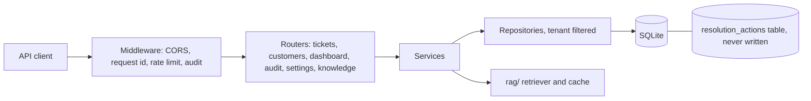
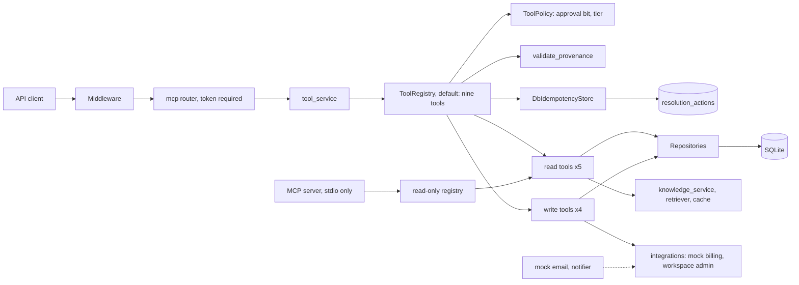
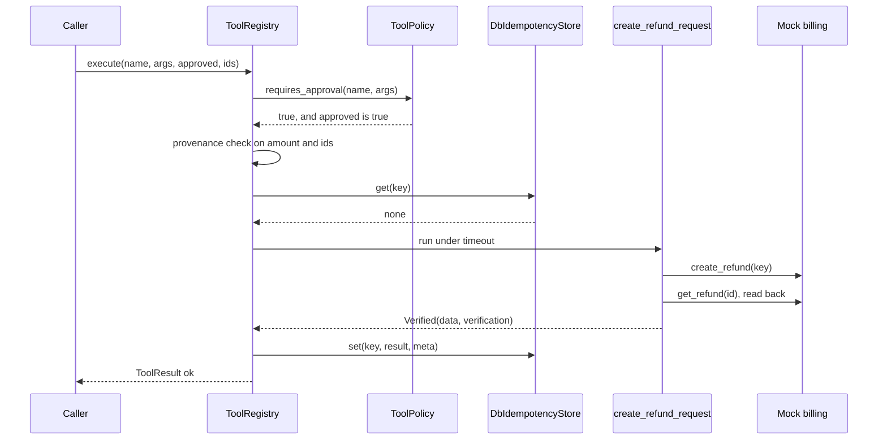

# Phase 6: system design evolution

> **Status of this phase:** implemented and checked locally. All five tasks (P6-1 to P6-5) are done. P6-1 merged as pull request #50; P6-2, P6-3, P6-4 and P6-5 landed together in pull request #51, by a decision to save agent usage (one commit, built in the order described below). In a run made for this document (2026-11-22) the whole suite passed (974 tests) and `ruff check .` reported no problems. Nothing is deployed.
>
> **Not built in Phase 6:** no language model, no agent, no workflow, no approval screen or approval service (Phase 11), no real email, billing or workspace adapter, no `prohibited` risk tier (D2), no write-capable MCP (D3), no network or authenticated MCP transport, and no run against Postgres. The tools exist but nothing calls them except tests and one read-only Hypertext Transfer Protocol (HTTP) listing.
>
> **Related documents:** [codebase explanation](./01_CODEBASE_EXPLAINED.md), [infrastructure evolution](./03_INFRA_EVOLUTION.md), the local-only `04_INTERVIEW_QNA.md`, and [Phase 5 design evolution](../Phase05/02_DESIGN_EVOLUTION.md).
>
> **Mermaid.** Diagrams were checked for structure only, not rendered.

---

## A. Phase overview

| Item | Content |
|---|---|
| Objective | Give the platform a single, controlled way to do things: read customer facts, search the knowledge base, and make changes, with approval, provenance, idempotency and read-back checks built in, and with mock outside systems. |
| Initial state | Phase 5's application programming interface (API): tickets, customers, dashboard, audit, settings, knowledge. Repositories, the retriever and the `resolution_actions` table existed; nothing could act on them as a "tool". |
| Requirements addressed | F9 (consequential actions need approval, at the tool layer), part of F4 (customer, subscription and history tools), F5 (`search_docs`), F7 (`check_service_status`); CLAUDE.md sections 7.4 (registry, policy, idempotency, verification, provenance) and 4.2 (tools may not bypass the registry). FR-16 and FR-17 from the upstream product requirements document (PRD). N6 and N8 are untouched. |
| Major additions | A `backend/app/tools/` package (policy, registry, context, factory, read tools, write tools, database (DB) idempotency store); an `integrations/` package (protocols, in-memory mocks, factory, MCP server and a client example); one route, `GET /api/v1/mcp/tools`; the `make mcp` target; the `mcp` dependency. |
| Important changes | The registry grew during the phase: a per-tool `idempotent` flag (P6-2), an async store, a `workflow_id` argument and a `Verified` result (P6-3). `backend/Dockerfile` copies `integrations/`. |
| Final capability | Nine tools registered behind one `ToolRegistry.execute`; a refund without approval writes nothing; the same approved refund run twice, even from a new registry, acts once; a five-tool read-only MCP server over stdio; an HTTP listing of all nine tools. All offline. |

---

## B. Initial architecture

What Phase 5 left: an API with services, repositories and an in-process retriever. Data could be read and written only by routers through services. There was no "tool" concept, no outside-world boundary, and nothing that could stop a caller from performing a refund-like write.

Limitations: no approval gate anywhere; no idempotency; the `resolution_actions` table (with its `idempotency_key` and `verification` columns, from Phase 2) existed but no code wrote to it; no modelling of the outside world.

---

## C. Intermediate architectural evolution

The order below is the order the work was done in (P6-1, then P6-4, P6-2, P6-3, P6-5), which differs from the task numbering: the mocks came before the tools that use them.

### C1. P6-1: tool registry and policy (PR #50)

- **Original design.** No tool layer.
- **Motivation.** CLAUDE.md 7.4: every tool call goes through one registry, unknown tools fail closed, tool failures never crash the graph, and actions are idempotent and have provenance.
- **Introduced.** `backend/app/tools/policy.py`: `ToolPolicy`, a table `DEFAULT_POLICY` that gives each of nine tool names an explicit approval bit and a `low`, `medium` or `high` tier; a name not in the table requires approval and reads as `high`. The refund tool is special: it needs approval when `approval_required_for_refunds` is true, and otherwise when the amount is missing, not a number, or above `max_refund_without_approval` (default 0). `validate_provenance` compares named arguments with a set of trusted values. `backend/app/tools/registry.py`: `ToolRegistry.execute(name, args, approved, ticket_id, workflow_id, trusted_values)` returns a `ToolResult` and never raises. Check order: approval (and unknown tool), provenance, workflow id, idempotency lookup, run under `asyncio.wait_for` with `TOOL_TIMEOUT_SECONDS`, store. Failed results are never stored, so a retry can succeed. The idempotency key is `ticket_id:tool:sha256(canonical JSON of args)`.
- **Effect on existing components.** None; the package imports only the configuration module from `app.core`, and core does not import it.
- **Trade-off.** Provenance compares values against a caller-supplied set, so the guard is only as good as the set the caller builds (the workflow, Phase 9 and later, must build it from customer context and tool results).
- **Verified.** `tests/unit/test_tool_policy.py` and `tests/unit/test_tool_registry.py` (26 test functions, 32 collected cases because some are parametrised). In this first form the idempotency store was in memory only.

### C2. P6-4: mock integrations

- **Original design.** No outside systems.
- **Motivation.** Refunds, emails and workspace resets must be written against a boundary, not against a vendor. v1 is not allowed to touch real money or real mail.
- **Introduced.** `integrations/protocols.py`: four `Protocol`s, `EmailSender`, `BillingService`, `WorkspaceAdmin`, `TicketNotifier`. `integrations/mock/services.py`: in-memory classes that record every call (`RecordedCall`); the billing mock returns the same refund for the same idempotency key and can read a refund back; the workspace mock remembers a `reset` state. `integrations/factory.py`: `get_integrations(demo_mode)` returns one shared bundle, and raises `IntegrationsNotAvailable` when `demo_mode` is false, because no real adapter exists.
- **Boundary.** The factory takes `demo_mode` as an argument, so `integrations/` imports nothing from `app`. A test fails if anything under `backend/app/core` imports `integrations`.
- **Trade-off.** The mocks are always successful; they cannot model a billing outage or a decline.
- **Verified.** `tests/integrations/test_mock_integrations.py` (10 tests).

### C3. P6-2: read-only support tools

- **Original design.** Registry existed with no tools.
- **Motivation.** The agents of Phase 9 need to load customer facts, search docs and check incidents, through the registry.
- **Introduced.** `backend/app/tools/context.py`: `ToolContext` (session factory, settings, integration bundle, a doc-search callable) and `build_context()`, so no tool reaches for a global. `backend/app/tools/read_tools.py`: `build_read_tools(ctx)` returns five async functions with documented return shapes: `get_customer`, `get_subscription`, `get_ticket_history`, `search_docs` (default goes through `knowledge_service.search`, so it uses the hybrid retriever and Redis cache) and `check_service_status` (active incidents, optionally for one service). A missing record raises `LookupError`, which the registry turns into `ok=False`. `backend/app/tools/factory.py`: `build_read_registry`.
- **Change to the registry.** `register(..., idempotent=False)` skips the store so reads are always fresh. Read tools use it.
- **Trade-off.** The doc-search default imports the knowledge service lazily, to avoid a cycle; that ties the read tools to a process-wide index.
- **Verified.** `tests/unit/test_read_tools.py` (12 tests), including one that counts database rows before and after calling every read tool.

### C4. P6-3: approval-gated write tools

- **Original design.** In-memory idempotency store; `verification` a placeholder.
- **Motivation.** A retried or resumed run must not refund twice (FR-16), and a write must be read back (FR-17), and both must survive a restart.
- **Introduced.** `backend/app/tools/write_tools.py`: `build_write_tools(ctx)` returns `update_ticket`, `create_escalation`, `reset_demo_setting`, `create_refund_request`. Each returns `Verified(data, verification)` after reading its own record back: the ticket row, the escalation row and the ticket flag, the mock workspace state, the mock refund. `create_refund_request` also checks that the amount is positive and that the subscription belongs to the customer. `backend/app/tools/idempotency.py`: `DbIdempotencyStore` keeps each successful action as a `resolution_actions` row (key, arguments, result, verification, `requires_approval`, `executed_at`). `build_default_registry` in `backend/app/tools/factory.py` registers all nine tools with that store.
- **Changes to the registry.** The store protocol became async, `execute` gained `workflow_id`, a store may declare `requires_workflow` (the DB store does, because the table's `workflow_id` is required), and a `Verified` result with `verified` false becomes `ok=False` with error `verification_failed` and is not stored.
- **Trade-offs.** The store write happens after the action, in a separate transaction: a crash between the two could leave an action done and unrecorded (see H). The refund and the mock billing refund are both idempotent, which gives two layers.
- **Verified.** `tests/unit/test_write_tools.py` (14 tests): a refund without approval writes nothing; with approval it is recorded once and a new registry over the same database refuses a second; ticket-text amounts are rejected before anything is written; a refund that cannot be read back is not reported as done.

### C5. P6-5: MCP read-only server and `GET /api/v1/mcp/tools`

- **Original design.** Tools reachable only in process.
- **Motivation.** CLAUDE.md 7.4: MCP exposes read-only tools; ADR-0004 keeps writes in process behind approval.
- **Introduced.** `integrations/mcp/server.py`: `build_server(ctx)` builds a registry with `build_read_registry`, which cannot hold a write tool, and registers each read tool on an `MCPServer` through a wrapper that keeps the function's signature and docstring and calls `ToolRegistry.execute`; a failed result raises, which MCP reports as an error result. `main()` runs it over stdio. `integrations/mcp/client_example.py` is a stdio client. `Makefile` target `mcp`. `backend/app/api/mcp.py`, `backend/app/services/tool_service.py`, `backend/app/schemas/mcp.py`: `GET /api/v1/mcp/tools`, any signed-in role, lists all nine registered tools (name, description, `requires_approval`). `backend/Dockerfile` copies `integrations/` into the image.
- **Dependency.** `mcp` 2.3 (the 2.x `MCPServer`).
- **Trade-off.** The HTTP listing shows write tools because it describes the registry, not the MCP surface. The names in the listing and the server's tools differ on purpose.
- **Verified.** `tests/unit/test_mcp_server.py` (7 tests, with the in-process MCP client; one lists the server's tools and tries to call each write tool) and `tests/api/test_mcp_tools.py` (3 tests). The stdio process itself and `make mcp` were not run end to end for this document.

---

## D. Final architecture

| Layer | Component | Responsibility |
|---|---|---|
| API | `backend/app/api/mcp.py` | HTTP and token only |
| Service | `backend/app/services/tool_service.py` | Build the registry and list it |
| Tools | `backend/app/tools/registry.py`, `policy.py` | The one execution path; approval, provenance, idempotency, timeout, never raising |
| Tools | `backend/app/tools/read_tools.py`, `write_tools.py` | The nine tool bodies; writes read themselves back |
| Tools | `backend/app/tools/idempotency.py` | Persist successful actions |
| Integrations | `integrations/` | Protocols, mocks, factory (no import of `app`) |
| MCP | `integrations/mcp/server.py` | Expose the five read tools over stdio |

Security boundaries: writes happen only through the registry and need `approved=True` (or no approval flag in policy); the MCP server cannot hold a write tool by construction; core never imports `integrations`; mocks never leave the process. Phase 6 does not yet decide *who* approves; that is Phase 11.

---

## E. End-to-end execution and data flow

There is no workflow yet, so the representative request is a test-driven call. Example: an approved refund.

1. A caller (a test in this phase; the graph from Phase 10) runs `registry.execute("create_refund_request", args, approved=True, ticket_id, workflow_id, trusted_values)`.
2. Policy: refunds need approval (default), and `approved` is true, so it continues. Without approval the result is `ok=False`, `approval_required`, and nothing is written.
3. Provenance: `amount`, `customer_id` and `subscription_id` must be in `trusted_values` (taken from the subscription record, not the ticket text). Otherwise `provenance_failed`.
4. `DbIdempotencyStore.requires_workflow` is true, so a missing workflow id gives `workflow_id_required`.
5. The key `ticket_id:tool:hash` is looked up in `resolution_actions`. A stored success is returned with `idempotent` true and the tool does not run.
6. The tool runs under the timeout: it checks the amount and the subscription's owner, asks the mock billing service for a refund (itself idempotent), reads it back, and returns `Verified`.
7. `verified` true: the result is stored as an `executed` row with the verification; false: `ok=False`, nothing stored.

Errors, all returned not raised: `approval_required`, `unknown_tool`, `provenance_failed`, `workflow_id_required`, `timeout`, `verification_failed`, or `ExceptionName: message` from a tool or from bad arguments.

---

## F. Architectural decisions and trade-offs

| Decision | Context | Alternatives | Rationale | Benefits | Trade-offs | Status |
|---|---|---|---|---|---|---|
| One `ToolRegistry.execute` for every call | Policy must not be bypassable | Each agent calls tool functions directly | One choke point for approval, provenance, idempotency, timeout | Tested once, applied everywhere | Callers must pass ids and trusted values correctly | Implemented |
| Explicit approval table; unknown tool needs approval | A new or misspelt tool must fail closed | Deny-list of risky tools | Safe default | A typo cannot become an open door | The table must be edited for each new tool | Implemented |
| Rules, not the model, decide approval | CLAUDE.md 7.2, ADR-0003 | Ask the large language model (LLM) if approval is needed | Money and accounts are never left to probability | Deterministic and tested | No `prohibited` tier yet (D2) | Implemented (three tiers) |
| Idempotency key `ticket_id:tool:sha256(args)` stored in `resolution_actions` | A retried or resumed run must not refund twice | Cache in Redis; rely on the vendor's key only | Reuses the Phase 2 table and survives restart | One real record per action, visible in the database | Store write is a separate transaction after the action | Implemented |
| Read tools are not idempotent-stored | Reads must be fresh | Cache reads | Customer data changes | Always current | No per-call dedupe of reads | Implemented |
| Write tools verify by reading back | FR-17: do not trust "ok" | Trust the write | A failed read-back is a failure | Catches silent loss | Costs an extra read | Implemented |
| `ToolContext` passed in, no globals | Tests and MCP need different sessions | Module-level session | Explicit dependencies | Testable; same tools in MCP | Slightly more wiring | Implemented |
| Integrations behind protocols, mocks only | v1 may not move real money or send mail | Call a vendor software development kit (SDK) | Boundary now, adapter later | Offline; inspectable calls | Mocks never fail | Implemented |
| MCP exposes only a registry built from read tools | ADR-0004; write-capable MCP is D3 | One registry, filter at the server | Absence by construction, not by a filter | A test shows write tools are neither listed nor callable | The HTTP listing and MCP list differ | Implemented |
| Write-capable MCP and a `prohibited` tier | Upstream documents | Build now | Not decided, needs a `TASKS.md` row | | Not available | Proposed (ADR-0008, ADR-0009) |

---

## G. Architectural improvements

| Quality | Before | After (supported by code and tests) |
|---|---|---|
| Separation | No tool layer | Policy, registry, tool bodies, store and integrations are separate files with import tests |
| Modularity | | Tools take a `ToolContext`; integrations are protocols with swappable adapters |
| Testability | | 78 collected offline tests for this phase (72 test functions); mocks record calls |
| Reliability | | Never-raise registry; timeout; failed results not cached; read-back before "done" |
| Security | | Approval fails closed; provenance check; MCP cannot hold a write tool; approval is enforced before a write |
| Extensibility | | A new tool is a function plus one policy row |

Performance and scalability are not claimed: no measurement, and the integration bundle is per process.

---

## H. Limitations and future evolution

- Nothing decides *who* approves or records the approval: the registry only takes `approved=True`. The approval workflow, its timeout and the `approval_requests` link are Phase 11. Until then the guard is exactly as strong as the caller that sets that flag.
- The action is performed before its row is stored, in separate transactions. A crash between them leaves an executed action with no record, so a retry would act again. The mock billing key partly covers this for refunds; nothing covers `update_ticket` or `reset_demo_setting` beyond their being repeatable. A real adapter would need the vendor's own idempotency key and a transaction-aware design (recommendation, not built).
- Provenance is only as good as the trusted set the caller builds; nothing builds it yet.
- Mocks always succeed. Failure modes of a real billing system are untested.
- `update_ticket` and `create_escalation` need no approval by policy; the Phase 11 workflow may want to constrain what they can change.
- The MCP server speaks stdio with no authentication and no network transport; the HTTP listing needs only a token.
- The doc-search default uses process-wide index state from Phase 5.
- Not run against Postgres; the idempotency table's unique `(tenant_id, idempotency_key)` constraint is in the Structured Query Language (SQL) and was not exercised there.
- Recommendations, not built: the `prohibited` tier, transaction-aware idempotency, per-tool argument schemas, a rate limit per tool.

---

## I. Phase completion summary

- **Final architecture:** section D.
- **Introduced:** `backend/app/tools/policy.py`, `registry.py`, `context.py`, `factory.py`, `read_tools.py`, `write_tools.py`, `idempotency.py`; `integrations/protocols.py`, `factory.py`, `integrations/mock/services.py`, `integrations/mcp/server.py`, `integrations/mcp/client_example.py`; `backend/app/api/mcp.py`, `backend/app/services/tool_service.py`, `backend/app/schemas/mcp.py`; `Makefile` target `mcp`.
- **Verified outcomes (2026-11-22):** 974 tests passed, `ruff check .` clean. 78 of those are collected from the Phase 6 test files listed in the codebase document (72 test functions; some are parametrised).
- **Outstanding:** a real run of the MCP stdio server and `make mcp`; any real adapter; Postgres; containers.
- **Carried forward:** the registry and policy (Phase 9 specialist agents call them; Phase 11 supplies `approved` and the approval record); the provenance trusted set (Phase 9 and 10); `DbIdempotencyStore` and `resolution_actions` (Phase 10 retries and Phase 11 resume); the integration protocols (any future real adapter); the read-only MCP surface (D3 decides whether it ever grows).
