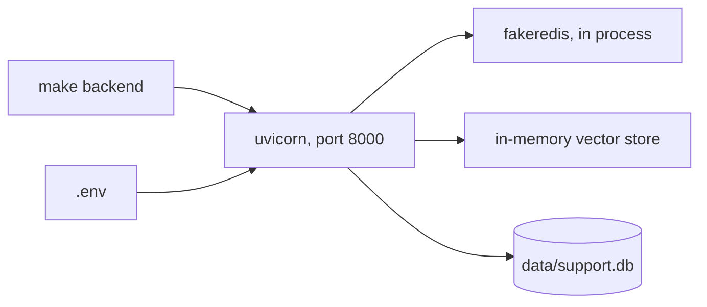
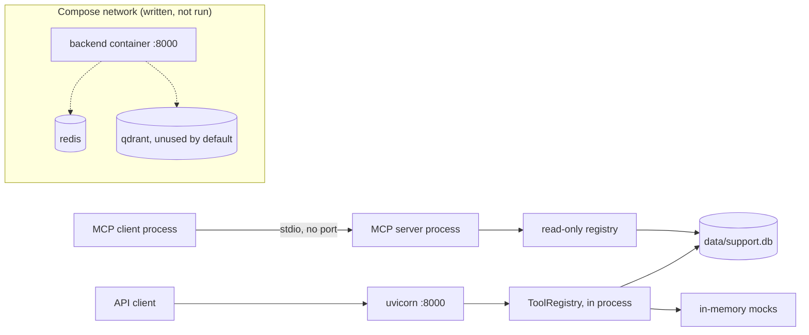
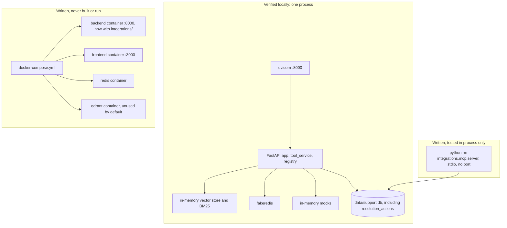

# Phase 6: infrastructure design evolution

> **Read this first.** In Phase 6 **no container was built and no Compose stack was brought up**. The files `backend/Dockerfile`, `frontend/Dockerfile`, `.dockerignore` and `docker-compose.yml` exist, because tasks P14-2 and P14-3 were pulled forward, but the Docker daemon was not used, so `docker build`, `docker compose up` and every health check described below were **never executed**. Everything here about containers comes from reading those files and from the tests in `tests/deployment/` that parse them.
>
> Phase 6 adds **no new service, no new port and no new environment variable**. It adds one route, one `Makefile` target and one Python dependency, and one line to the backend Dockerfile. The **Model Context Protocol (MCP) stdio server and `make mcp` were not run end to end** for this document. The MCP server is a process you start by hand on your own machine; it is not in Compose and has no container.
>
> **Related documents:** [codebase explanation](./01_CODEBASE_EXPLAINED.md), [design evolution](./02_DESIGN_EVOLUTION.md), [Phase 5 infrastructure](../Phase05/03_INFRA_EVOLUTION.md).
>
> **Mermaid.** Diagrams were checked for structure only, not rendered.

---

## A. Infrastructure overview

| Question | Answer |
|---|---|
| Where does it run? | Verified path: one Python process on the developer's machine plus a SQLite file. Written but never run: four containers in Compose. |
| In Docker? | Not in any verified run. |
| Externally hosted? | Nothing. The "outside systems" (billing, email, workspace admin) are in-process mocks. |
| Start (verified) | `make backend` (uvicorn, port 8000) |
| Start the MCP server (written, not run for this document) | `make mcp`, which runs `python -m integrations.mcp.server` with `backend` on the path |
| Start (written, not run) | `docker compose up --build` |
| Communication | In process: function calls, fakeredis, in-memory vector store, in-memory mocks. MCP is a separate process talking over standard input and output. |
| Configuration | Environment variables or `.env`; `.env.example` (removed, then re-created 2026-11-27 as a placeholders-only template) lists them. |
| Stop | Ctrl+C for a local process. `docker compose down` for the stack (never run). |

Development is the only environment exercised.

---

## B. Initial infrastructure design

Phase 5's: one process, one SQLite file, fakeredis and an in-memory vector store in the process. The container files existed but were unbuilt.

---

## C. Infrastructure evolution

### Change 1. In-memory mock integrations (P6-4)

- **Before.** No outside-system code.
- **Added.** Four mock classes in the Python process memory, shared by one bundle. They record calls and keep refunds and workspace states in dictionaries. No port, file, network call or container. They disappear when the process stops.
- **Why.** v1 may not send real email or move real money; a real adapter would also need credentials and a network path.
- **Verified.** `tests/integrations/test_mock_integrations.py`. Not measured: anything about a real vendor.

### Change 2. Tool actions stored in the existing database (P6-3)

- **Before.** The `resolution_actions` table existed (Phase 2) and was never written.
- **Added.** `DbIdempotencyStore` writes one row per successful tool action. Same SQLite file in the demo; the Structured Query Language (SQL) for Postgres has a unique constraint on tenant and idempotency key. No new table or migration.
- **Effect on infrastructure.** The idempotency guarantee depends on the database file persisting. In Compose the SQLite file would sit in the `backend-data` volume (written, not run). Not run against Postgres.
- **Verified.** `tests/unit/test_write_tools.py` includes a new registry over the same database refusing a second refund.

### Change 3. A tool listing route (P6-5)

- **Added.** `GET /api/v1/mcp/tools` on the existing port 8000, token required, any role. It builds a registry per call and lists nine tools. No new service.
- **Verified.** `tests/api/test_mcp_tools.py`.

### Change 4. An MCP server over stdio (P6-5)

- **Before.** Tools were not reachable from outside the Python process.
- **Added.** `integrations/mcp/server.py` runs an MCP server that a parent process talks to through its standard input and output. It listens on **no network port**, so it needs no container port, firewall rule or reverse proxy. It opens the same database through `build_context()`, so it needs the same `DATABASE_URL` and a seeded database (`make seed`). It exposes five read tools.
- **Dependency.** `mcp` (2.3 or later) in `pyproject.toml`.
- **Verified.** In process only: `tests/unit/test_mcp_server.py` uses the in-process MCP client. `MEMORY.md` records that the stdio client example was started once and listed the five read tools, and its call returned an error because that database had no tables. **That was not repeated here, and `make mcp` was not run.**

### Change 5. The backend image copies `integrations/` (P6-5)

- **Before.** The backend Dockerfile copied the app and `rag/` and `sample_data/`.
- **Added.** `COPY --chown=app:app integrations/ ./integrations/`, because `backend/app/tools` imports `integrations`; without it the image would fail at import time. The MCP server is therefore inside the image, but the image's command still starts uvicorn, not the MCP server.
- **Verified.** `tests/deployment/test_dockerfiles.py::test_backend_image_copies_the_integrations_package_the_tools_import` reads the Dockerfile text. **The image was never built.**

---

## D. Docker and container explanation

Unchanged from Phase 5 except the Dockerfile line above. All from `docker-compose.yml`. **Not executed.**

| Service | Image or build | Purpose | Ports | Volumes | Dependencies | Health check |
|---|---|---|---|---|---|---|
| `redis` | `redis:7-alpine`, append-only persistence | Cache and rate-limit store | None published | `redis-data` | None | `redis-cli ping` |
| `qdrant` | `qdrant/qdrant:v1.12.4` | Vector database, unused by default | None published | `qdrant-storage` | None | Transmission Control Protocol (TCP) check on port 6333 |
| `backend` | Built from `backend/Dockerfile`, context is the repository root | FastAPI service; now includes `integrations/` | `8000:8000` | `backend-data` | `redis` and `qdrant` healthy | Python call to `/health/live` |
| `frontend` | Built from `frontend/Dockerfile` | Next.js shell | `3000:3000` | None | `backend` healthy | `wget` to `/api/health` |

There is **no MCP service** in Compose. Failure behaviour is as in Phase 5 (configuration reading only). Tool-specific: if the backend container's database volume were lost, the ledger of past actions would be lost with it, and a retried action could repeat.

---

## E. Docker networking

By Compose defaults (nothing is declared explicitly): one project network; services find each other by service name (`redis:6379`, `qdrant:6333`). Container port, host-published port and the port another container uses are three different things; see the Phase 5 table. Phase 6 changes nothing here: the tool listing is served on the backend's port 8000 like any other route, and the MCP server uses no port. `localhost` inside a container is the container itself. **Not observed.**

---

## F. Component wiring and routing

Verified locally: client to uvicorn on `localhost:8000`, through the four middleware, to the mcp router, to `tool_service`, to the registry, to repositories and the SQLite file. Separately, an MCP client process starts the server process and speaks over stdio.

Written but not run: browser to `localhost:3000`, browser to `localhost:8000`, backend to `redis:6379`, backend to `qdrant:6333` only if `VECTOR_STORE=qdrant`. No reverse proxy. No route exists from outside the machine to the MCP server.

---

## G. Lifecycle commands

Local:

| Task | Command | Status |
|---|---|---|
| Start the application programming interface (API) | `make backend` | Used in earlier phases |
| Load demo data | `make seed` | Needed before the MCP server can read anything |
| Start the MCP server | `make mcp` | Written; **not run for this document**. It waits on stdin, so by itself it just sits there |
| Try the MCP example client | `uv run python -m integrations.mcp.client_example` (from the repository root) | Started once, recorded in `MEMORY.md`; not repeated |
| Tests | `.venv/Scripts/python.exe -m pytest -q` | Run for this document |
| Lint | `.venv/Scripts/python.exe -m ruff check .` | Run for this document |

Compose (written, **never run**): `docker compose config -q` (reads only), `docker compose up --build`, `docker compose down` (keeps volumes), `docker compose logs -f backend`, `docker compose ps`, `docker compose up --build backend` to rebuild one service. `docker compose down -v` is **destructive**: it deletes the named volumes, so the SQLite file (and with it the record of past tool actions), the Redis data and the Qdrant storage are lost.

---

## H. Environment variables and secrets

Phase 6 reads existing settings only (all in `.env.example` (removed, then re-created 2026-11-27 as a placeholders-only template), placeholders only). Nothing new was added.

| Variable | Purpose | Default |
|---|---|---|
| `DEMO_MODE` | Must be true for `get_integrations`; outside it the factory raises | `true` in the demo |
| `TOOL_TIMEOUT_SECONDS` | Time limit for a tool run | 30 |
| `APPROVAL_REQUIRED_FOR_REFUNDS` | Refunds always need approval when true | `true` |
| `MAX_REFUND_WITHOUT_APPROVAL` | Amount allowed without approval, only when the flag above is false | 0 |
| `DATABASE_URL` | Where the registry's sessions and the ledger live; the MCP process reads it too | SQLite file under `data/` |
| `SAMPLE_DATA_DIR`, `VECTOR_STORE` and the Redis settings | Used by `search_docs` through the knowledge service | as in Phase 5 |

No secret is involved in this phase's code. The MCP server has no authentication: it trusts whoever starts it, and runs with the same environment as its parent.

---

## I. Persistent storage and data management

| Data | Where | Persistence |
|---|---|---|
| Tickets, customers, incidents | SQLite file (`backend-data` in Compose) | Survives restart |
| Record of tool actions (`resolution_actions`) | The same database | Survives restart; this is what prevents a repeat after a restart |
| Mock billing refunds, mock workspace state, recorded calls | Process memory | **Lost on restart.** A refund "made" by the mock is forgotten when the process ends; only the ledger row remains |
| Vector index and cache | As in Phase 5 | |

A consequence worth saying aloud: after a restart the ledger still blocks a repeat, but the mock billing system no longer remembers the refund. A real adapter removes that mismatch by being the source of truth. Backup and restore are **not implemented**.

---

## J. Health checks, startup order and resilience

- `/health/live` and `/health/ready` from Phase 1 are unchanged. Readiness does not check tools or integrations.
- The MCP server has no health check and no restart policy; it is a hand-started process.
- Tool timeout (`TOOL_TIMEOUT_SECONDS`) bounds a single tool run; there is no retry and no circuit breaker around the database or around integrations.
- Compose startup order and restart policies are as in Phase 5 (written, not run).
- Recommended, not built: a readiness check for the ledger table; a real adapter with its own timeout and retry policy.

---

## K. Observability and troubleshooting

- Logs: JavaScript Object Notation (JSON) with request id, as before. The registry does not log tool calls itself; the workflow tracer that records `tool_called` events arrives in Phase 10.
- The mocks record every call in memory (`calls` list), which tests inspect; there is no endpoint for it.
- No metrics or tracing for tools exist.

| Symptom | Check |
|---|---|
| `GET /api/v1/mcp/tools` returns 401 | Send a bearer token (any role works) |
| MCP client call returns an error about missing tables | Run `make seed` against the same `DATABASE_URL` first (this is what happened in the recorded run) |
| `IntegrationsNotAvailable` | `DEMO_MODE` is false; v1 has no real adapters |
| Tool result `approval_required` | By design for refunds and resets; supply `approved=True` from the approval flow (Phase 11) |
| Tool result `workflow_id_required` | A recorded tool needs a workflow run id; the ledger row links to one |
| Container fails at import with a missing `integrations` module (Compose, untested) | The Dockerfile must copy `integrations/` (the test checks that line) |

---

## L. Final infrastructure architecture

---

## M. Infrastructure verification

| Check | Status |
|---|---|
| Local process serves `GET /api/v1/mcp/tools` | Verified through the test client (974 tests passed on 2026-11-22); the server was not started by hand for this document |
| Ledger prevents a second refund, including from a new registry | Verified by tests against the SQLite test database |
| MCP server lists five read tools and exposes no write tool | Verified in process by tests; **the stdio process was not run end to end** |
| `make mcp` | **Not run** |
| Backend Dockerfile copies `integrations/` | Checked as text by `tests/deployment/test_dockerfiles.py`; image **not built** |
| Containers start, health checks pass, service-name Domain Name System (DNS) works | **Not verified** |
| Postgres, real Redis, real Qdrant | **Not verified** |
| Volume persistence, backup, restore | **Not verified, backup not built** |
| Cloud deployment | None |
