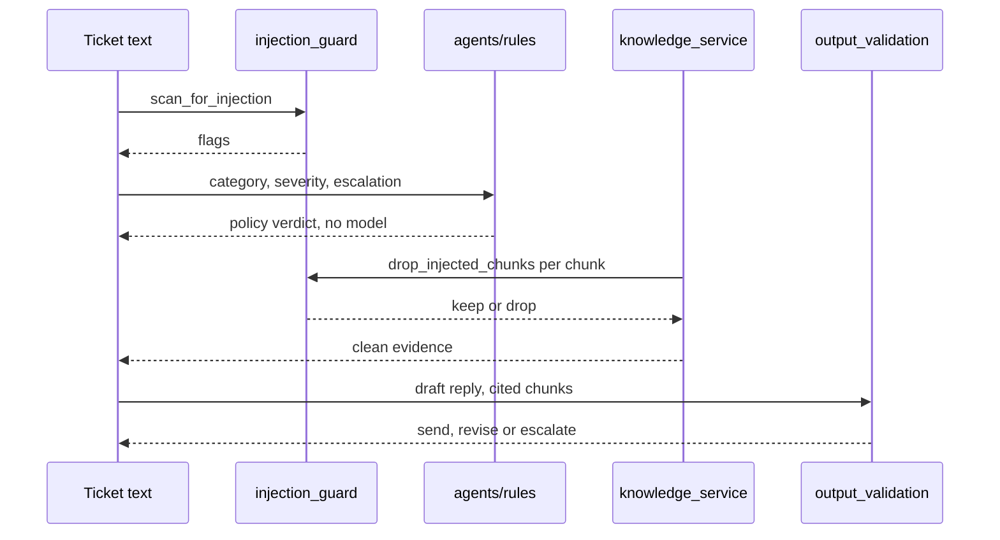

# Phase 7 explained: rules and guardrails

> **What this document is.** A plain-language explanation of the code written in Phase 7 of CloudDesk, for explaining it to recruiters, hiring managers and interview boards. It describes only what exists in the repository today.
>
> **Status of this phase:** implemented and checked locally. All four tasks (P7-1 to P7-4) are done. In a run made for this document (2026-11-27) the whole suite passed (1072 tests, 98 of them new in Phase 7) and `ruff check .` and `ruff format --check .` were clean. Nothing was committed or deployed when this document was written (the work has since merged as pull request #53, and nothing is deployed). Phase 7 has **no language model, no agent, no workflow graph and no prompt that is actually sent anywhere**. The rules and guards are pure functions that later phases will call; today only tests (and one retrieval wiring) call them.
>
> **Related documents:** [system design evolution](./02_DESIGN_EVOLUTION.md), [infrastructure evolution](./03_INFRA_EVOLUTION.md), the local-only `04_INTERVIEW_QNA.md`, and [Phase 6 explained](../Phase06/01_CODEBASE_EXPLAINED.md).

---

## A. Executive summary

**Say it aloud.** "Before any artificial intelligence (AI) model is allowed to touch a support ticket, I wrote the rules that must not depend on the AI. A set of plain, tested functions decides which tickets must go to a human team, how urgent a ticket is at minimum, whether a piece of text is trying to trick the assistant, whether a draft reply leaks something it should not, and whether a text contains a card number or a password. The AI will later add judgement only in the grey areas."

- **What the phase accomplished.** Four safety building blocks: policy rules (`agents/rules.py`), prompt-injection defence (`agents/prompts.py` and `backend/app/core/injection_guard.py`), customer-output validation (`backend/app/core/output_validation.py`) and a secret scrubber (`backend/app/core/scrub.py`).
- **Problem solved.** A model can be argued out of a rule, or talked into exporting records by text inside a ticket. Policy must therefore live in code, where it can be tested without a model (ADR-0003, `docs/adr/0003-policy-decided-by-rules-not-the-model.md`).
- **Before and after.** Before: tools existed behind a registry (Phase 6) but nothing decided which tickets are policy cases. After: all 13 demo tickets have a tested expected category and escalation, `CD-1013` is recognised as an attack, and a poisoned knowledge chunk is dropped from search evidence.

## B. Business problem and solution

1. **Real-world problem.** A support platform that reads customer text and writes replies can be attacked through that text, can leak another customer's details, can quote an internal link, and can repeat a customer's card number into its notes.
2. **Limitation of the basic approach.** Asking the model politely ("never reveal secrets") is a hope, not a control.
3. **Solution.** Deterministic checks that run outside the model, each with a named test.
4. **Benefit.** Disputes, deletions, security incidents, data loss, legal matters and enterprise outages always reach a named human team. Replies are blocked before a customer sees a leak. Secrets are removable from anything that will be remembered.
5. **Why appropriate.** It is auditable: to change policy you change a rule and a test, not a prompt.

Analogy: the model is a new support agent; these modules are the company policy handbook and the security guard at the door. The guard does not care how persuasive the visitor is.

## C. Application architecture in simple language

| Component | Purpose | Input and output | Needs it? |
|---|---|---|---|
| Policy rules, `agents/rules.py` | Decide category, minimum severity and mandatory escalation | Ticket text and plan name in; category, severity verdict, escalation verdict (with a team) out | Without it, a vague model answer would decide a payment dispute |
| Injection guard, `backend/app/core/injection_guard.py` | Spot text that tries to instruct the assistant | Text in; flagged yes or no and named attack families out | Without it, `CD-1013` and poisoned articles look like ordinary text |
| Prompt helpers, `agents/prompts.py` | Tell the model that delimited text is data; delimit it | Text in; text wrapped in `<untrusted_content>` out | Without it, data and instructions blur |
| Output validation, `backend/app/core/output_validation.py` | Check a draft reply before a customer sees it | Reply, cited chunks, customer context in; ok, reasons, groundedness, risk out | Without it, a leak or an invented promise could be sent |
| Secret scrub, `backend/app/core/scrub.py` | Remove card numbers, keys, tokens, passwords | Text in; text with `[REDACTED:kind]` markers out | Without it, memory notes could store secrets |

Layer rule: `agents/` holds the rules and prompts; `backend/app/core/` holds the guards and must not import `agents/`. `rag/` stays ignorant of tickets, so the retriever only offers a `chunk_filter` hook and the guard is plugged in from `backend/app/services/knowledge_service.py`.

## D. Codebase structure and file-by-file explanation

| File | What it does | Main parts | Interview line |
|---|---|---|---|
| `agents/__init__.py` | Creates the `agents/` package and states its rules (no Structured Query Language (SQL), not imported by core) | docstring | "The home of agent logic; today only rules and prompts." |
| `agents/rules.py` | Pure policy | `rule_category` (weighted keyword rules over the 10 categories, ties go to the safer reading), `rule_severity` (returns the higher of the rule floor and the model severity, with a reason and a `raised` flag), `ESCALATION_RULES` (six rules: security incident, data loss, account deletion, payment dispute, legal, enterprise outage, the last only for the enterprise plan), `matching_escalation_rules`, `rule_escalation` | "Words in, decision out. No model, no database." |
| `agents/prompts.py` | Shared prompt pieces | `SECURITY_PREAMBLE`, `wrap_untrusted` (puts text between `<untrusted_content>` tags and escapes any such tag already inside it) | "A label that says: everything inside is data." |
| `backend/app/core/injection_guard.py` | Attack detection | `INJECTION_PATTERNS` (ignore-instructions, export-all-records, reveal-system-prompt, role-override, tool-call smuggling, delimiter escape), `scan_for_injection`, `drop_injected_chunks` (the retriever hook; returns True to keep a chunk) | "A tripwire for known attack phrases." |
| `backend/app/core/scrub.py` | Secret removal | `SECRET_PATTERNS` (jwt, bearer token, Amazon Web Services (AWS) key, `sk-` key, password, card number), `luhn_valid`, `scrub`, `find_secrets` | "Black-marker pen for secrets; clean text is untouched." |
| `backend/app/core/output_validation.py` | Reply gate | `validate_customer_output`, `GROUNDEDNESS_THRESHOLD` (0.8), `INTERNAL_URL_PATTERNS`, `groundedness`, `should_revise`, `should_escalate`, `next_step` | "Last check before the customer sees anything." |
| `backend/app/services/knowledge_service.py` | Changed: `CHUNK_FILTER = drop_injected_chunks` is passed to `HybridRetriever` | one constant and one argument | "Plugs the tripwire into search." |
| `rag/retriever.py` | Relied on, not changed: its `chunk_filter` hook screens chunks before ranking, for both the vector and the keyword path | `_keep` | "Search was built with a slot for this." |
| `tests/unit/test_rules.py`, `test_injection.py`, `test_scrub.py`, `test_output_validation.py` | The proof | 28, 22, 24 and 24 tests | "Every rule has a test that can fail." |

## E. End-to-end execution flow

Phase 7 has no full flow yet; the pieces are called by tests. The flow they are designed for (called by Phase 9 and 10 code that is planned, not built) is below, and the one real wiring is step 2.

1. A ticket text arrives. `scan_for_injection` flags it if suspicious; `wrap_untrusted` delimits it for any prompt.
2. Search for knowledge runs through `knowledge_service.search`, whose retriever drops any chunk the guard flags, so a poisoned article never becomes evidence. (This step exists and is tested.)
3. `rule_category`, `rule_severity` and `rule_escalation` run on the ticket and the customer plan. If a rule matched, the escalation decision is final.
4. A draft reply is checked by `validate_customer_output`; `next_step` says send, revise once, or escalate.
5. Anything that will be remembered goes through `scrub`.

Worked example, `CD-1005` ("Suspicious logins, possible breach"): `rule_category` gives `security`; `rule_escalation` gives required, team "Security team"; `rule_severity` gives `critical` even if a model said `medium`.

## F. Technical concepts explained simply

- **Regular expression.** A pattern for matching text; the rules are lists of them.
- **Severity floor.** The rules give a minimum; the final value is the higher of the minimum and the model's guess, so rules can only raise urgency.
- **Prompt injection.** Text that pretends to be an instruction. Defence here is layered: scan, delimit, and tell the model the delimited part is data. None of the three is perfect alone.
- **Luhn check.** The checksum payment cards use; it lets the scrubber ignore ordinary long numbers.
- **Groundedness.** Whether each factual sentence in a reply is supported by the sources it cites. Here: the share of claim sentences whose content words mostly appear in a cited chunk.
- **Idempotent.** Scrubbing twice gives the same result as once.

## G. Design decisions and trade-offs

- **Rules first, model second** (ADR-0003). Trade-off: keyword rules miss paraphrases. Accepted because a miss falls back to the model, while a rule hit is certain.
- **Guards in the core package, rules in `agents/`.** Matches `CLAUDE.md` 4.2; trade-off is that `agents/rules.py` imports `app.schemas.common` for the enums.
- **Groundedness by token overlap, not a judge model.** Offline, free and testable. Weakness: it can pass a reply that reuses the right words with a wrong meaning, and it can fail an honest paraphrase. A judge model is a future recommendation.
- **Leaks are not revised.** A groundedness miss gets one revise; a secret, internal link or other customer's data escalates at once.
- **P7-4 before P7-3.** Output validation imports the secret patterns, so the scrub was built first. This differs from the task order and is recorded in `MEMORY.md`.
- **`CD-1001` is not escalated by rule.** The enterprise-outage rule needs explicit outage words; an single sign-on (SSO) failure is raised to `high` severity but left to the model and to Phase 9 (the active-incident check). This is a judgement call, not a specification quote.

## H. Error handling and failure scenarios

- Empty or `None` text: `scan_for_injection` is clean, `scrub(None)` returns an empty string, output validation of empty text is ok.
- Unknown plan name or `None`: the enterprise-outage rule simply does not apply.
- No cited chunks and a factual reply: groundedness 0, risk `high`.
- A secret in a reply: blocked and escalated, never revised.
- Missing safeguards: paraphrased or non-English attacks, obfuscated secrets (spaced letters) and secrets in other shapes are not caught; nothing yet calls the guards on the live path except retrieval.

## I. Testing and verification

| File | Tests | What it proves |
|---|---|---|
| `tests/unit/test_rules.py` | 28 | Every demo ticket has the expected category, escalation team and severity floor; severity never falls; the rule table names a team per area; legal and enterprise-outage cases |
| `tests/unit/test_injection.py` | 22 | Each attack family is flagged; `CD-1013` is flagged and wrapped; no other demo ticket and none of the 15 knowledge articles is flagged; closing tags are neutralised; a poisoned chunk is dropped from evidence; the service wires the guard |
| `tests/unit/test_scrub.py` | 24 | Cards (Luhn), keys, tokens, passwords, JavaScript Object Notation (JSON) Web Tokens (JWTs) removed; clean text and non-card numbers unchanged; idempotent |
| `tests/unit/test_output_validation.py` | 24 | Internal uniform resource locators (URLs), secrets and other customers' data blocked as risk `high`; unsupported claims score under 0.8; revise once then escalate |

Run: `uv run python -m pytest -q` (or `.venv/Scripts/python.exe -m pytest -q`). Result on 2026-11-27: 1072 passed; `ruff check .` and `ruff format --check .` clean. Each task had one deliberate break that turned a test red and was restored. Untested: behaviour against real model output, real tickets beyond the 13, and any live graph.

## J. Interview-ready explanation

**30 seconds.** "Phase 7 is the safety layer that runs before any AI. Plain tested functions decide which tickets must go to a human team, how urgent they are at minimum, whether text is an attack, whether a reply leaks something or invents a promise, and how to strip secrets. The model only handles the grey areas."

**2 minutes.** "I wrote four modules. `agents/rules.py` maps ticket text to one of ten categories, gives a severity floor that can only raise the model's score, and holds six escalation rules, each with a named team. The injection guard recognises attack families like 'ignore previous instructions' and 'export all records', and the prompt helper wraps untrusted text in a tag after escaping any tag inside it. The same guard is plugged into search so a poisoned knowledge chunk never becomes evidence. Output validation blocks internal URLs, secrets and another customer's name, and scores whether each claim is supported by a cited chunk, with a floor of 0.8 and one revise. The scrubber removes cards, keys, tokens and passwords. Ninety-eight new tests, all offline."

**5 minutes.** Add the flow in section E, the layering (core never imports agents, rag never knows tickets, so the guard is injected), the severity rule (max of floor and model), the decision to escalate leaks immediately but revise groundedness once, and the limits in section H.

**Non-technical.** "It is the rulebook and the security guard for the AI. Some requests, like a payment dispute or an account deletion, always go to a person. Anything that looks like someone trying to trick the assistant is treated as plain text, never as an order. And a reply is checked before a customer sees it."

**Architect.** "Policy as deterministic code behind ADR-0003; guards in `core` with an injected `chunk_filter` hook so `rag` stays domain-free; severity as a monotone max; groundedness as a cheap overlap score with an explicit threshold and a bounded revise loop; secrets by pattern plus Luhn. Known gaps: lexical rules, no judge model, no red-team set (D6)."

## K. Key takeaways and next-phase dependencies

- Implemented: rules, injection guard and wrapper, output validation, scrub. Not implemented: any caller on the live path, a judge model, red-team data.
- Understand before explaining: rules win over the model; severity only rises; leaks escalate, groundedness is revised once.
- Reused later: Phase 8 memory calls `scrub`; Phase 9 specialists call the rules, `wrap_untrusted` and `SECURITY_PREAMBLE`; Phase 10 nodes call the guard and `validate_customer_output` and treat a failure as risk `high`; Phase 11 uses `next_step` for escalation.
