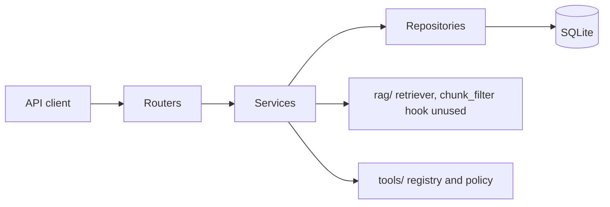
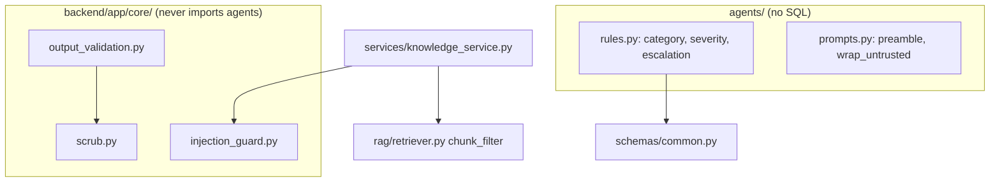

# Phase 7: system design evolution

> **Status of this phase:** implemented and checked locally. All four tasks (P7-1 to P7-4) are done. In a run made for this document (2026-11-27) the whole suite passed (1072 tests) and `ruff check .` reported no problems. Nothing is deployed, and the work is not committed.
>
> **Not built in Phase 7:** no language model, no agent, no graph, no approval service, no judge-model groundedness, no red-team dataset (D6), no `prohibited` tier (D2). The guards are not yet called on the live request path except one retrieval filter.
>
> **Related documents:** [codebase explanation](./01_CODEBASE_EXPLAINED.md), [infrastructure evolution](./03_INFRA_EVOLUTION.md), the local-only `04_INTERVIEW_QNA.md`, and [Phase 6 design evolution](../Phase06/02_DESIGN_EVOLUTION.md).
>
> **Mermaid.** Diagrams were checked for structure only, not rendered.

---

## A. Phase overview

| Item | Content |
|---|---|
| Objective | Make policy and safety deterministic before any specialist calls a model. |
| Initial state | Phase 6: tools behind a registry, mocks, read-only MCP. No rule decided what a ticket is, no text was screened, no reply was validated. |
| Requirements addressed | F3 (severity rules), F10 (escalation table), N4 (injection), N5 (output validation), N7 (scrub); `CLAUDE.md` sections 7.2 and 9; ADR-0003. |
| Major additions | `agents/` package (`agents/rules.py`, `agents/prompts.py`), three modules in `backend/app/core/`, one retrieval wiring. |
| Final capability | Tested decisions for all 13 demo tickets, an attack detector, a delimiter that cannot be escaped, a reply gate with a revise-once policy, and a secret scrubber. |

## B. Initial architecture

Limitations: nothing decides policy cases; the retriever's `chunk_filter` hook was never given a filter; no `agents/` package existed.

## C. Intermediate architectural evolution

### C1. P7-1: escalation and severity rules

- **Original design.** No rules.
- **Motivation.** Policy cases must never depend on model probability (ADR-0003).
- **Introduced.** `agents/__init__.py` and `agents/rules.py`. `rule_category` scores weighted keyword patterns per category; ties go to the first listed (security, billing first). `ESCALATION_RULES` holds six rules in priority order, each with a team: Security team, Data protection team, Privacy team, Billing disputes team, Legal team, Enterprise support team (enterprise plan only). `rule_severity` returns `max(rule floor, model severity)`.
- **Effect on existing components.** None. It imports only the shared enums in `backend/app/schemas/common.py`.
- **Trade-off.** Lexical rules miss paraphrases and can over-match (for example a word like "erase" in an unrelated sentence). `CD-1013` is categorised `security` by its attack phrases but is not escalated by rule; its protection is containment plus high risk later.
- **Verified.** `tests/unit/test_rules.py` (28 tests); a break that let rules lower severity went red.

### C2. P7-2: injection guard, wrapper and retrieval wiring

- **Original design.** Ticket text and retrieved chunks would reach prompts unmarked.
- **Introduced.** `backend/app/core/injection_guard.py` (six attack families), `agents/prompts.py` (`SECURITY_PREAMBLE`, `wrap_untrusted`, with tag escaping), and `CHUNK_FILTER` in `backend/app/services/knowledge_service.py` passed to the retriever.
- **Boundary.** `core` does not import `agents` or `rag`: the filter takes any object with a `.text`. `rag` does not import `app`: the hook was already injected.
- **Trade-off.** Detection is pattern based; a false positive silently drops a chunk, which is why a test checks that none of the 15 real articles is flagged.
- **Verified.** `tests/unit/test_injection.py` (22 tests); a break that kept every chunk went red.

### C3. P7-4: secret scrub (built before P7-3)

- **Motivation.** Memory notes must never hold secrets (N7), and output validation needs the same patterns, so the scrub came first.
- **Introduced.** `backend/app/core/scrub.py`: ordered `SECRET_PATTERNS`, Luhn-checked card detection, `scrub` and `find_secrets`.
- **Trade-off.** A pattern list is only as wide as its patterns; a replaced value is lost, which is intended.
- **Verified.** `tests/unit/test_scrub.py` (24 tests); removing the Luhn check turned the "13 digits that are not a card" test red.

### C4. P7-3: customer output validation

- **Introduced.** `backend/app/core/output_validation.py`: internal URL patterns (localhost, loopback, private ranges, `*.internal`, `*.local`, `kb://`), secret check through `find_secrets`, other-customer terms from the context, claim-level groundedness, `GROUNDEDNESS_THRESHOLD = 0.8`, and `next_step` (send, revise once, escalate; hard failures never revise).
- **Trade-off.** Overlap scoring is crude; a judge model is a recommendation, not built.
- **Verified.** `tests/unit/test_output_validation.py` (24 tests); disabling the groundedness check turned three tests red.

## D. Final architecture

Security boundary: untrusted text (tickets, chunks) is screened and delimited; replies are gated; secrets are removable. Callers for the graph are planned for Phases 9 and 10.

## E. End-to-end execution and data flow

The only live path today is search: `knowledge_service.search` builds the retriever with `CHUNK_FILTER`, which drops flagged chunks on both the vector and the keyword ranking before fusion. All other flows are test-driven; the designed flow is in [the codebase document, section E](./01_CODEBASE_EXPLAINED.md).

## F. Architectural decisions and trade-offs

| Decision | Alternatives | Reason | Cost |
|---|---|---|---|
| Rules decide policy | Prompt the model | Testable, auditable (ADR-0003) | Lexical misses |
| Severity is a monotone max | Let the model overrule | Safety bias | A rule can over-escalate |
| Guard is an injected hook | Retriever imports the guard | Keeps `rag` ticket-free | Wiring in a service |
| Overlap groundedness | Judge model | Offline, free | Crude |
| Leaks escalate, no revise | Revise everything | A leak is not worth a retry | More human work |
| Scrub before validation | Duplicate patterns | One pattern table | Task order differs from TASKS.md |

## G. Architectural improvements

Before: an unfiltered retriever and no policy. After: a screened retriever, a rule table, a reply gate and a scrubber, each unit-tested with a deliberate break.

## H. Limitations and future evolution

- Paraphrased, encoded or non-English attacks and obfuscated secrets are not caught.
- `CD-1001` relies on the model and incident check for its outage handling; the rule table needs explicit outage words.
- The guards have no caller on the live path except retrieval; the graph (planned, Phase 10) must call them.
- Recommendations, not built: a judge model for groundedness, a red-team set and the harder bar (D6), the `prohibited` tier (D2).

## I. Phase completion summary

- **Introduced:** `agents/__init__.py`, `agents/rules.py`, `agents/prompts.py`, `backend/app/core/injection_guard.py`, `backend/app/core/output_validation.py`, `backend/app/core/scrub.py`; one change in `backend/app/services/knowledge_service.py`.
- **Verified outcomes (2026-11-27):** 1072 tests passed (98 new), `ruff check .` and `ruff format --check .` clean.
- **Outstanding:** live callers (Phases 8, 9, 10), real model behaviour, red-team data.
- **Carried forward:** the rule table and severity floor (Phase 9 supervisor and escalation agents), the guard and wrapper (every prompt), the reply gate and `next_step` (Phases 10 and 11), `scrub` (Phase 8 memory).
