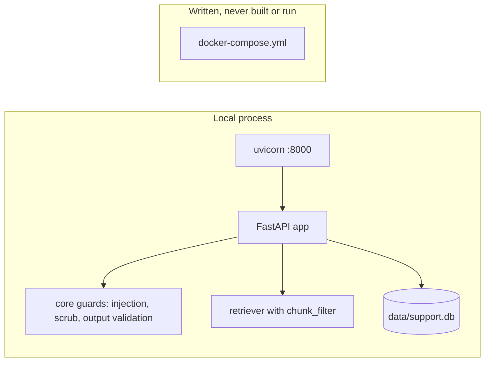

# Phase 7: infrastructure design evolution

> **Status of this phase:** implemented and checked locally. **Phase 7 adds no infrastructure.** No container, port, service, volume, environment variable, route, migration or dependency was added. This document says so and records what the phase relies on. Nothing in it was run in a container; no Docker image was built for this phase.
>
> **Related documents:** [codebase explanation](./01_CODEBASE_EXPLAINED.md), [design evolution](./02_DESIGN_EVOLUTION.md), the local-only `04_INTERVIEW_QNA.md`, and [Phase 6 infrastructure evolution](../Phase06/03_INFRA_EVOLUTION.md).

---

## A. Infrastructure overview

The new code is plain Python modules imported inside the existing backend process. `agents/rules.py` and `agents/prompts.py` sit in a new top-level `agents/` package; the guards sit in `backend/app/core/`.

## B. Initial infrastructure design

Inherited from Phase 6: a local `uvicorn` process serving the API on port 8000, SQLite in `data/support.db`, fakeredis and an in-memory vector store; `docker-compose.yml` and the Dockerfiles exist but were never built or run.

## C. Infrastructure evolution

No changes. One thing to note for later: `backend/Dockerfile` copies `backend/` and `rag/` and `integrations/` (Phase 6) but **not** `agents/`. Nothing in the running backend imports `agents/` yet, so the image is not wrong today. The phase that first imports `agents/` from the backend (planned, Phase 9 or 10) must add the copy and the matching `tests/deployment/test_dockerfiles.py` check. This was a known follow-up when this phase was written. It was done afterwards, in the Phase 8 container fix: the Dockerfile now copies `agents/` and `memory/`, and `tests/deployment/test_dockerfiles.py` checks it.

## D. Docker and container explanation

Unchanged. The backend container runs as a non-root user with a health check on `/health/live`. Not run for this phase.

## E. Docker networking

Unchanged: frontend to backend to redis and qdrant over the compose network. The new guards make no network calls.

## F. Component wiring and routing

No new route. The one wiring change is internal: `backend/app/services/knowledge_service.py` passes `CHUNK_FILTER` to `HybridRetriever`, so `POST /api/v1/knowledge/search` (Phase 5) now drops injected chunks. The Redis retrieval cache stores filtered results, so an entry cached before this change could hold an unfiltered result for up to 300 seconds; no migration of the cache is done.

## G. Lifecycle commands

Unchanged: `make setup`, `make backend`, `make test`, `make lint`. For this phase: `uv run python -m pytest -q` and `uv run python -m ruff check .`. `make` itself was not run for this document.

## H. Environment variables and secrets

None added; `.env.example` (removed 2026-11-27) is unchanged. The thresholds (`GROUNDEDNESS_THRESHOLD`, 0.8) are constants in `backend/app/core/output_validation.py`; `CLAUDE.md` section 10.2 lists a setting of that name as a later addition and it is not read from the environment today. The scrubber exists so secrets are kept out of memory notes and replies; it does not manage secrets.

## I. Persistent storage and data management

No table, column or migration. Nothing the guards do is stored.

## J. Health checks, startup order and resilience

Unchanged. The guards are synchronous pure functions with no I/O, so they add no startup dependency and cannot time out. A regular-expression worst case on a very long text is not measured.

## K. Observability and troubleshooting

No logging or events yet: a flagged chunk is dropped silently. Planned (Phase 10): record guard flags in `workflow_events`. To troubleshoot a missing search result today, call `scan_for_injection` on the chunk text.

## L. Final infrastructure architecture

## M. Infrastructure verification

| Check | Status |
|---|---|
| Guards import and run offline | Verified by 1072 passing tests on 2026-11-27 |
| Search drops a poisoned chunk | Verified by test against an in-memory retriever |
| Image contains `agents/` | **Not applicable yet, not built** |
| Containers, Postgres, real Redis, cloud | **Not verified, not changed** |
