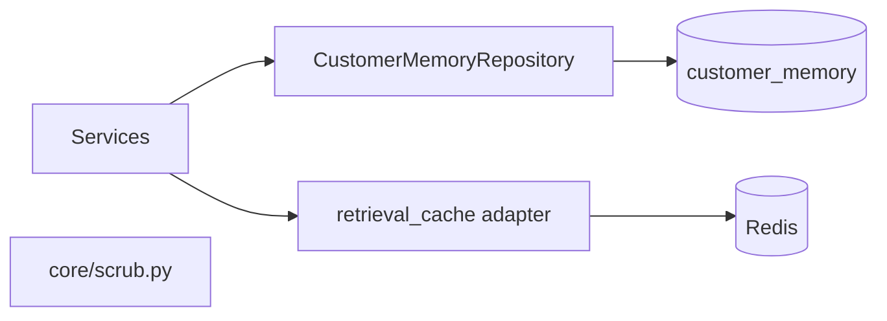
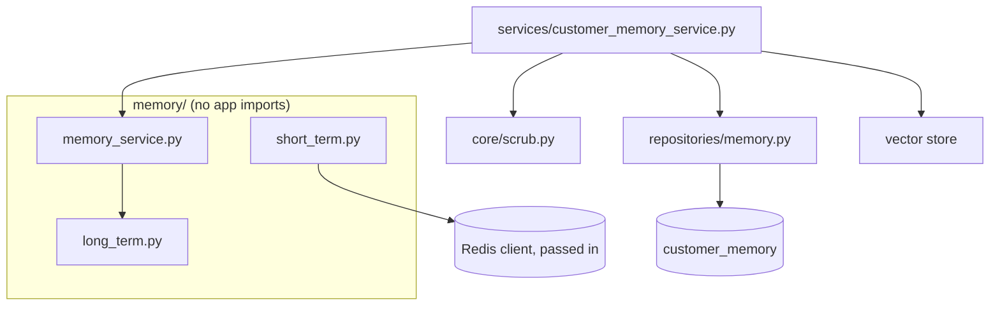

# Phase 8: system design evolution

> **Status of this phase:** implemented and checked locally. All three tasks (P8-1 to P8-3) are done. In a run made for this document (2026-11-27) the whole suite passed (1103 tests) and `ruff check .` reported no problems. Nothing is deployed, and the work is not committed.
>
> **Not built in Phase 8:** no graph node that calls memory, no API route (including erasure), no memory vectors written by the app, no memory summarisation, no per-note expiry, no PII scrub beyond secrets.
>
> **Related documents:** [codebase explanation](./01_CODEBASE_EXPLAINED.md), [infrastructure evolution](./03_INFRA_EVOLUTION.md), the local-only `04_INTERVIEW_QNA.md`, and [Phase 7 design evolution](../Phase07/02_DESIGN_EVOLUTION.md).
>
> **Mermaid.** Diagrams were checked for structure only, not rendered.

---

## A. Phase overview

| Item | Content |
|---|---|
| Objective | A safe memory the workflow can recall from and write to. |
| Initial state | Phase 7: a `customer_memory` table and repository (Phase 2), the scrub (P7-4), a Redis client (P3-3), a retrieval cache adapter (Phase 6). No rule governed what is written. |
| Requirements addressed | F4 (notes in customer context), F11 (memory update), N7 (no secrets); `CLAUDE.md` section 7.5; upstream FR-27 (erasure). |
| Major additions | `memory/` package with three modules, one adapter in `backend/app/services/`, one repository method, a container fix. |
| Final capability | Tested recall, record, de-duplication, confidence floor, scrub, and erasure of rows and vectors. |

## B. Initial architecture

Limitations: nothing enforced a floor, a dedup rule, a cap or erasure; the scrub had no caller.

## C. Intermediate architectural evolution

### C1. P8-1: short-term Redis facade

- **Original design.** Redis was used for the rate limit and the retrieval cache only.
- **Motivation.** The architecture names conversation and workflow state as short-term memory with a 24-hour life.
- **Introduced.** `memory/short_term.py`: `ShortTermMemory` (conversation as a Redis list, state as JSON, TTL refreshed on write), `RetrievalCache`, `cache_key`.
- **Boundary.** The client is an argument; `memory/` imports nothing from the app.
- **Trade-off.** The retriever's cache key is defined in `rag/retriever.py` and repeated here; a test asserts they match. The app still caches through `backend/app/services/retrieval_cache.py`.
- **Verified.** `tests/unit/test_short_term.py` (8 tests); a break that changed the TTL went red.

### C2. P8-2: long-term customer memory

- **Introduced.** `memory/long_term.py` (`LongTermMemory`) over a `MemoryRepository` protocol, and `ids_for_customer` in `backend/app/repositories/memory.py`.
- **Policy.** Types preference, past_issue, troubleshooting, note; keep at confidence 0.7 or more; skip exact duplicates; recall at most 10, newest first; erase vectors first, then rows.
- **Boundary.** The tenant filter stays in the repository (`tests/unit/repositories/test_repositories_layering.py` still passes); `memory/` never names a tenant. The vector store arrives through the retriever's re-exports so `memory/` names no concrete store (a test in `tests/rag/test_vector_store.py` enforces this).
- **Trade-off.** Erasure is two steps, not one transaction across Postgres and a vector store; vectors go first so a retry is safe.
- **Verified.** `tests/unit/test_long_term.py` (11 tests); breaks that lowered the floor and removed the vector delete went red.

### C3. P8-3: memory service and adapter

- **Introduced.** `memory/memory_service.py` (`MemoryService`) and `backend/app/services/customer_memory_service.py` (`build_memory_service`, `erase_customer_memory`).
- **Behaviour.** Five candidate notes per resolution; each passes the injected scrub; a note holding the raw ticket body is dropped; deterministic text makes a repeat call a no-op.
- **Trade-off.** Scrub is injected, so correctness depends on the adapter passing it. Only the adapter builds the service in app code.
- **Verified.** `tests/unit/test_memory_service.py` (8 tests); breaks that removed the scrub and made the resolution text unique went red.

## D. Final architecture

Callers on the live path: none yet. The graph nodes are planned (Phase 10).

## E. End-to-end execution and data flow

Designed: recall at customer context, record at memory update, erasure on request. Today only tests drive it; the sequence is in [the codebase document, section E](./01_CODEBASE_EXPLAINED.md).

## F. Architectural decisions and trade-offs

| Decision | Alternatives | Reason | Cost |
|---|---|---|---|
| `memory/` takes ports as arguments | Import the app | Keeps layers clean and tests offline | An adapter file |
| Inject the scrub | Copy the patterns | One pattern table | A forgotten argument is a leak |
| Deterministic note text | Free-form notes | Idempotent record | Limited wording |
| Rows only from the app | Embed every note | Keeps customer notes out of knowledge search | No semantic recall of notes |
| Vectors deleted before rows | Rows first | A retry stays safe | Vectors briefly outlive nothing |
| Facts below 0.7 discarded | Store with a flag | Never remember a guess | Lost weak signals |

## G. Architectural improvements

Before: a table and a scrub with no rules between them. After: one write path with a floor, scrub, dedup, cap and erasure, each unit-tested with a deliberate break.

## H. Limitations and future evolution

- No caller on the live path; Phase 10 must add the nodes (planned).
- No route to request erasure, and erasure is not audited.
- Redis tested only with fakeredis; real Redis TTL behaviour is the same by design but not run for memory.
- Exact-duplicate matching misses near-duplicates.
- Recommendations, not built: summarising old notes, a reviewed "resolution card" loop (FR-29), embedding notes into a separate collection.

## I. Phase completion summary

- **Introduced:** `memory/__init__.py`, `memory/short_term.py`, `memory/long_term.py`, `memory/memory_service.py`, `backend/app/services/customer_memory_service.py`; one method in `backend/app/repositories/memory.py`; `backend/Dockerfile` and `docker-compose.yml` changes.
- **Verified outcomes (2026-11-27):** 1103 tests passed (31 new or extended), `ruff check .` clean.
- **Outstanding:** live callers, real Redis for memory, an erasure route.
- **Carried forward:** `recall_customer` (Phase 9 customer context, Phase 10 node), `record_resolution` (Phase 10 memory-update node), `erase_customer_memory` (a later privacy route).
