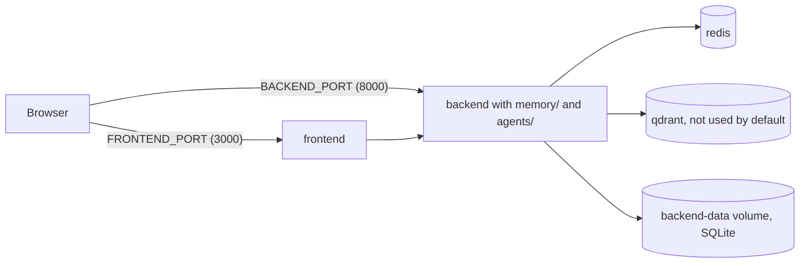

# Phase 8: infrastructure design evolution

> **Status of this phase:** implemented and checked locally. Phase 8 adds no service, volume, route, migration, dependency or environment variable. It does carry a small **container fix** (the Dockerfile copy lines and configurable host ports), and on 2026-11-27 the stack was brought up in Docker for the first time. Both are described below with what was and was not run.
>
> **Related documents:** [codebase explanation](./01_CODEBASE_EXPLAINED.md), [design evolution](./02_DESIGN_EVOLUTION.md), the local-only `04_INTERVIEW_QNA.md`, and [Phase 7 infrastructure evolution](../Phase07/03_INFRA_EVOLUTION.md).

---

## A. Infrastructure overview

The memory code is plain Python in a new top-level `memory/` package imported inside the backend process. Short-term memory uses the same Redis client as the rate limiter; long-term memory uses the existing `customer_memory` table.

## B. Initial infrastructure design

Inherited: `docker-compose.yml` with `frontend`, `backend`, `redis` and `qdrant`, host ports fixed at 3000 and 8000; `backend/Dockerfile` copying `backend/`, `rag/` and `integrations/`. Phase 7 recorded that `agents/` was not copied and that the phase which imports it must add the line.

## C. Infrastructure evolution

1. **`backend/Dockerfile`** now copies `agents/` and `memory/` beside `rag/` and `integrations/`. `agents/` exists since Phase 7 and `memory/` since this phase; the new adapter `backend/app/services/customer_memory_service.py` imports `memory/`, so the image would have failed at import time without the copy. `tests/deployment/test_dockerfiles.py` gained a check that both COPY lines exist and the folders exist.
2. **`docker-compose.yml`** host ports are now `${BACKEND_PORT:-8000}:8000` and `${FRONTEND_PORT:-3000}:3000`. The frontend build argument `NEXT_PUBLIC_API_URL` follows the backend port and `CORS_ORIGINS` follows the frontend port. Reason: on the first bring-up, host port 8000 was already taken by another project. `tests/deployment/test_compose.py` was updated to the new strings and checks that the two variables are not in `.env.example` (removed, then re-created 2026-11-27 as a placeholders-only template).

## D. Docker and container explanation

Unchanged apart from the copied folders. The backend image still runs as a non-root user with a health check on `/health/live`. The image built on 2026-11-27 was built **before** these COPY lines were added; it has not been rebuilt with them.

## E. Docker networking

Container-to-container traffic is unchanged: `frontend` to `backend` to `redis` and `qdrant` by service name inside the compose network. Only the host side of the two published ports can now change. Because the browser (not the container) calls the API, `NEXT_PUBLIC_API_URL` must use the published host port; it is inlined at build time, so the frontend image must be rebuilt after changing `BACKEND_PORT`.

## F. Component wiring and routing

No new route. Memory is not reachable over HTTP. `docker compose config` with `BACKEND_PORT=18000 FRONTEND_PORT=13000` showed the published ports, the API URL and the CORS origin following the variables.

## G. Lifecycle commands

```bash
docker compose config -q
BACKEND_PORT=18000 FRONTEND_PORT=13000 docker compose up --build
```

`docker compose config -q` passed after the change. The second command with the new variables was **not** run; the first bring-up used an override file with port 18000.

## H. Environment variables and secrets

None added to `Settings` or `.env.example` (removed, then re-created 2026-11-27 as a placeholders-only template). `BACKEND_PORT` and `FRONTEND_PORT` are compose-only variables read by Docker Compose, documented in a comment in `docker-compose.yml` and in `README.md` section 5.5. `tests/unit/test_env_example.py` stays green because the code does not read them. No secret is involved.

## I. Persistent storage and data management

No table, column or migration. Short-term keys live in Redis with a TTL (`conv:{ticket_id}`, `wf:{ticket_id}`, 24 hours; cache keys 300 seconds). Compose runs Redis with append-only persistence in the `redis-data` volume, so keys survive a container restart until their TTL passes. Long-term notes live in `customer_memory` (SQLite in `backend-data` under compose). Erasure deletes rows and vectors; Redis keys for a customer's tickets are not deleted by erasure and expire by TTL.

## J. Health checks, startup order and resilience

Unchanged. Observed on 2026-11-27: backend, frontend, redis and qdrant healthy, and `/health/ready` ready with real Redis. Memory adds no startup dependency; if Redis were down, short-term calls would raise and the caller must decide (no retry is built).

## K. Observability and troubleshooting

No events or logs from memory yet. To see a short-term entry, read `conv:<ticket id>` or `wf:<ticket id>` with `redis-cli` inside the redis container (not run). To see notes, query `customer_memory` for a customer.

## L. Final infrastructure architecture



## M. Infrastructure verification

| Check | Status |
|---|---|
| Stack built and brought up in Docker, 2026-11-27 | Backend, frontend, redis, qdrant healthy; `/health/ready` ready with real Redis; demo login, 13 tickets, an MFA knowledge search and frontend `/dashboard` returned 200; ran on port 18000 through an override because 8000 was busy |
| `docker compose config -q` after the port change | Passed |
| Image rebuilt with the `agents/` and `memory/` COPY lines | **Not run** |
| Compose with `BACKEND_PORT` and `FRONTEND_PORT` set, brought up | **Not run** |
| Dockerfile and compose static checks | 38 tests in `tests/deployment` passed |
| Browser view, Postgres, real Qdrant use, memory against real Redis, cloud | **Not verified** |
