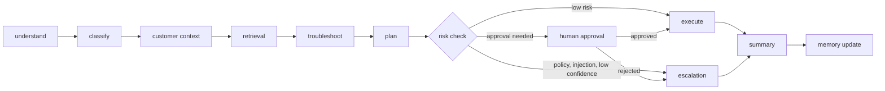

# Phase 10: system design evolution

> **Status:** complete and validated locally. P10-1 to P10-7 are done. Nothing is deployed.

## A. Overview

Phase 10 turns six standalone agents into a resumable workflow with a trace.

## B. Initial architecture

Specialist agents callable only from tests. No state model, no graph, no events, no run route.

## C. Evolution by task

- **P10-1 state:** `agents/state.py` with reducers so parallel contributions never overwrite one another.
- **P10-2 to P10-4 nodes:** supervisor, investigation and decision nodes, each wrapped by the tracer in `agents/nodes/common.py`.
- **P10-5 graph:** `agents/graph.py` with routing, the 12-step budget and the failure path.
- **P10-6 tracer:** `backend/app/core/observability.py` writes `workflow_events`.
- **P10-7 API:** run, workflow, events and agents routes.

## D. Final architecture

## E. Data flow

The route creates a `workflow_runs` row and returns 202. A background task streams the graph, saving state and events after every node. The UI polls the workflow route every two seconds.

## F. Decisions and trade-offs

In-process execution (ADR 0007) over a queue; a partial-dictionary node contract; a rule-first router so policy never depends on a model's confidence.

## G. Improvements made during the phase

An injected ticket (CD-1013) originally auto-resolved; the risk check now escalates on an injection flag. A node stored raw action dicts and produced a 500; actions are now schema-valid. A completed run no longer overwrites a resolved ticket's status.

## H. Limitations

No worker process, so a restart loses a run in flight. Only the 12-step and 0.6-confidence budgets exist; the cycle and question budgets are not built. Concurrent runs of the same ticket are blocked by status only.

## I. Completion summary

Seven tasks done; 1320 backend tests pass offline; the graph ran end to end in Docker on the real model.
