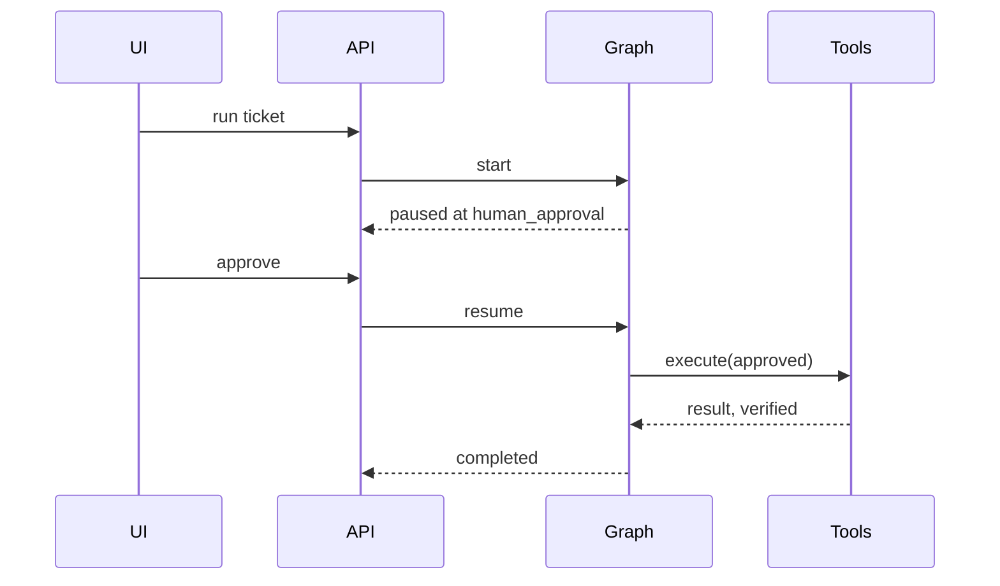

# Phase 11: system design evolution

> **Status:** complete and validated locally except FR-24 (approval timeout), which is not built. P11-1 to P11-6 are done.

## A. Overview

Phase 11 adds the human gate and the safe exit to the workflow of Phase 10.

## B. Initial architecture

A graph that could pause but had no approval record, no decision route and no escalation table writes.

## C. Evolution by task

- **P11-1 approval request:** the pause creates `approval_requests` and moves the ticket to `waiting_on_approval`.
- **P11-2 decision routes:** approve and reject resume the same run.
- **P11-3 execution:** the approved action runs through the registry with idempotency and read-back verification.
- **P11-4 rejection:** a rejected action escalates.
- **P11-5 demo:** `make demo` runs the refund path in a terminal.
- **P11-6 escalations:** `escalations` rows and the escalation list.

## D. Final architecture

## E. Data flow

`approval_requests` holds the action, risk and decision. `resolution_actions` holds the idempotency key and result. `escalations` holds team, reason and priority.

## F. Decisions and trade-offs

Policy by rules (architecture decision record (ADR) 0003); in-process tools (ADR 0004). Rejection escalates, trading a quieter queue for no silently dropped customer.

## G. Improvements during the phase

The ticket status was overwritten to in progress after a resolved run; fixed. The escalation specialist gained `decide`, `record` and `run` so the node stays thin.

## H. Limitations

No approval timeout; an undecided approval waits forever. No `prohibited` tier. No notification to the approver.

## I. Completion summary

Six tasks done; every consequential action is approval-gated and idempotent in the offline tests.
