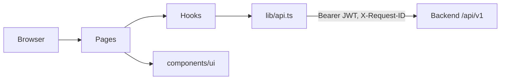

# Phase 12: system design evolution

> **Status:** complete and validated locally. P12-1 to P12-4 are done.

## A. Overview

Phase 12 puts a console in front of the API.

## B. Initial architecture

P12-1 delivered the app shell, a UI kit and placeholder pages for eight routes, `/login` and `/api/health`.

## C. Evolution by task

- **P12-2 typed API client:** `frontend/lib/api.ts` and `frontend/lib/types.ts`.
- **P12-3 login and role-aware layout:** `frontend/lib/auth.tsx`, `frontend/app/login/page.tsx` and `frontend/components/layout/AppShell.tsx`.
- **P12-4 list pages:** dashboard, tickets, customers, knowledge, escalations, approvals, agents, audit and settings.

## D. Final architecture

## E. Data flow

Pages call hooks; hooks call the client; the client attaches the token and maps errors. Polling (`usePolling`) refreshes live data.

## F. Decisions and trade-offs

Own UI kit over a library (fewer dependencies, more code to maintain). Token in `localStorage` (simple, exposed to script injection; a cookie flow is a later hardening).

## G. Improvements

A Home link and a scroll-to-top button; model cost shown in USD and INR together; refund amounts shown in INR.

## H. Limitations

Inbox filters are in the API but the filter bar is minimal. There is no analytics page, no memory-erasure control and no tools or policy pages (PRD items listed in CLAUDE.md section 20).

## I. Completion summary

Four tasks done; the console signs in, lists data for every route and enforces roles in the UI.

---

## Console cleanup, 2026-11-27

The Audit page no longer wraps timestamps, shows a short request id and a method badge, and the Agents page uses the same headline cards as the dashboard. Model cost reads "Cost unavailable" until a verified price is configured and is described as separate from refund amounts (`frontend/lib/format.ts`, `describeCost`).
