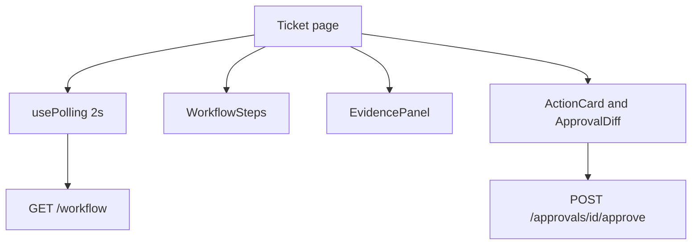

# Phase 13: system design evolution

> **Status:** complete and validated locally. P13-1 to P13-4 are done.

## A. Overview

Phase 13 gives the workflow a face.

## B. Initial architecture

A placeholder ticket page with no data.

## C. Evolution by task

- **P13-1 layout:** the three-column ticket screen and the customer page.
- **P13-2 workflow steps and polling:** `frontend/components/tickets/WorkflowSteps.tsx` and `usePolling`.
- **P13-3 actions:** approve, reject, reply, request information and escalate through `frontend/lib/api.ts`.
- **P13-4 unit tests:** `frontend/__tests__/WorkflowSteps.test.tsx`, `api.test.ts`, `auth_format.test.ts`.

## D. Final architecture

## E. Data flow

The saved `WorkflowState` is the single source; components derive everything from it.

## F. Decisions and trade-offs

Polling over server-sent events. Role-based disabling over hiding.

## G. Improvements

Refund amounts shown in INR; an approval diff shows what changes before a person approves.

## H. Limitations

No live streaming of node output; no side-by-side diff of an edited reply; no browser test for reject and escalate.

## I. Completion summary

Four tasks done; a real run was started, observed and completed in a visible browser.

---

## QA remediation, 2026-11-27: ticket screen refinement

- **Run button.** After "Run", the page keeps polling until the new run appears and ends (`expectedRun` in `frontend/app/(dashboard)/tickets/[id]/page.tsx`), so a stale finished state no longer stops polling and leaves the button enabled. The button reads "Workflow running…" while disabled.
- **Workflow panel.** Status and progress stay at the top; approval, escalation, evidence, diagnosis, actions, summary and a collapsed timeline follow as sections. The panel no longer scrolls on its own.
- **Diagnosis.** `frontend/lib/diagnosis.ts` removes repeated steps and `frontend/components/tickets/DiagnosisPanel.tsx` shows Diagnosis, numbered Recommended actions and a separate warning-styled Safety restrictions block. Display only: no backend decision changed.
- **Evidence.** `frontend/components/tickets/EvidencePanel.tsx` shows the strong or partial label, the real score, a short excerpt, the full passage behind an expand control, and a plain "No sufficiently relevant evidence" state.
- **Reply box and customer panel.** The reply box grows with its text up to a maximum. The customer panel adds only fields the data holds: customer since, region and id.
- **Verification.** Lint, type-check, build and 44 unit tests pass; the headed browser suite (7 tests) passed against the Docker stack.
