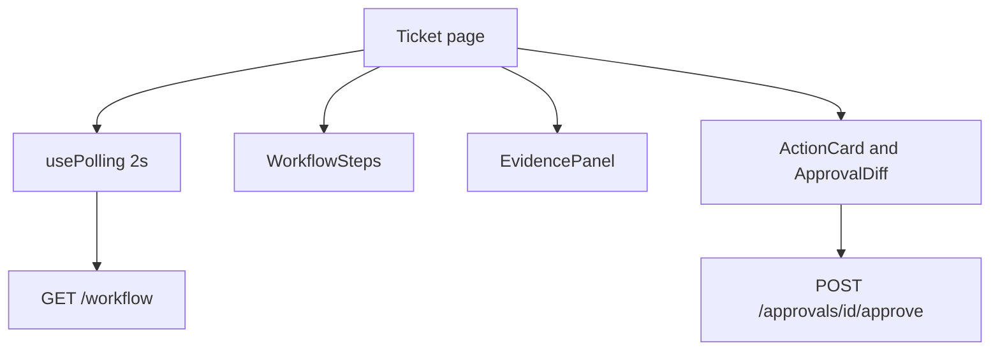

# Phase 13: system design evolution

> **Status:** complete and validated locally. P13-1 to P13-4 are done.

## A. Overview

Phase 13 gives the workflow a face.

## B. Initial architecture

A placeholder ticket page with no data.

## C. Evolution by task

- **P13-1 layout:** the three-column ticket screen and the customer page.
- **P13-2 workflow steps and polling:** `frontend/components/tickets/WorkflowSteps.tsx` and `usePolling`.
- **P13-3 actions:** approve, reject, reply, request information and escalate through `frontend/lib/api.ts`.
- **P13-4 unit tests:** `frontend/__tests__/WorkflowSteps.test.tsx`, `api.test.ts`, `auth_format.test.ts`.

## D. Final architecture

## E. Data flow

The saved `WorkflowState` is the single source; components derive everything from it.

## F. Decisions and trade-offs

Polling over server-sent events. Role-based disabling over hiding.

## G. Improvements

Refund amounts shown in INR; an approval diff shows what changes before a person approves.

## H. Limitations

No live streaming of node output; no side-by-side diff of an edited reply; no browser test for reject and escalate.

## I. Completion summary

Four tasks done; a real run was started, observed and completed in a visible browser.
