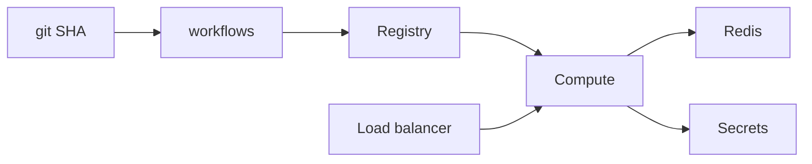

# Phase 14: infrastructure design evolution

> **Status:** Docker and Compose were run locally; the Terraform roots were validated but never planned or applied; no workflow has run on GitHub.

## A. Overview

The delivery layer: containers, Compose, Terraform for AWS, Azure and GCP, deploy scripts and workflows.

## B. Initial design

Dockerfiles and Compose first (P14-2, P14-3), pulled forward at the owner's request.

## C. Evolution

1. 2026-11-27: the stack was built and brought up in Docker with real Redis.
2. Terraform roots were added under `deployment/` and validated with `make terraform-validate`.
3. Deploy scripts, five workflows and a smoke test were added.

## D. Docker and containers

Backend multi-stage `python:3.12-slim`; frontend `node:22-alpine` standalone. Both run as a non-root user with a HEALTHCHECK.

## E. Networking

Locally: browser to frontend :3000, browser to backend on `BACKEND_PORT` (18000 here). In the cloud scaffolds: AWS has a VPC, two subnets and a load balancer on 443; Azure uses the Container Apps environment as ingress; GCP uses Cloud Run.

## F. Wiring

`frontend` depends on `backend`, which depends on `redis` and `qdrant`, each with `service_healthy`.

## G. Lifecycle commands

`docker compose config -q`, `BACKEND_PORT=18000 docker compose up --build -d`, `make terraform-validate`, `BASE_URL=http://localhost:18000 make smoke`, `deployment/scripts/deploy.sh <cloud> <env>`.

## H. Environment variables and secrets

Secrets (`llm_api_key`, `jwt_secret`) are sensitive Terraform variables with empty defaults, supplied by `TF_VAR_*`. The var-files hold non-secret sizing only.

## I. Persistent storage

Named volumes `backend-data`, `redis-data`, `qdrant-storage` locally. In the scaffolds: ElastiCache, Azure Cache for Redis and Memorystore for Redis; the application database is not provisioned (the scaffolds assume an external Postgres or Supabase).

## J. Health checks and resilience

Container health checks; the ALB health check hits `/api/health`; the compose startup order uses `service_healthy`.

## K. Observability

CloudWatch log group, Log Analytics workspace and Cloud Logging bucket are declared; none is connected to a real account.

## L. Final architecture

## M. Verification

Run: Compose bring-up, smoke test, `terraform validate` x3, static delivery tests. Not run: `terraform plan`, `apply`, `checkov`, Trivy, any real cloud, Postgres, real Qdrant use.

---

## Real services in Docker, 2026-11-27

At the owner's request ("all should run in docker locally, no fakes") the Compose stack now has five services: `postgres` (`postgres:16-alpine`, volume `postgres-data`, `pg_isready` health check), `qdrant`, `redis`, `backend` and `frontend`. The backend uses `postgresql+asyncpg` (added with `uv add asyncpg`), `VECTOR_STORE=qdrant` (the collection is filled at startup when empty) and the Euron embeddings chosen in `.env`. The offline test suite still uses SQLite, the in-memory store and the fake provider, because tests must run with no network.

Verified on this stack: the app created its 17 tables and seeded the demo data on Postgres; the refund workflow paused for approval; a viewer got 403, a duplicate approve 409 and a reject after approve 409; exactly one refund executed; a full restart kept every row. `database/schema.sql`, `database/rls_policies.sql` and the migration applied cleanly to a fresh Postgres 16, and a non-superuser role was isolated correctly by the policies (cross-tenant read, update, delete and insert all blocked).

Not true yet: row-level security is not enforced at runtime. The API does not set `app.tenant_id` per transaction, and enabling the policies today would stop the application's own queries, so the repository filter remains the real boundary.

`.env.example` is a placeholders-only template and `.env` holds your real values; `tests/unit/test_env_settings.py` keeps both, `CLAUDE.md` section 10.1 and `Settings` in step.
